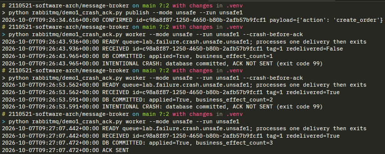
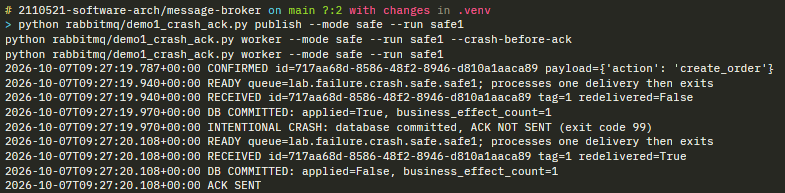
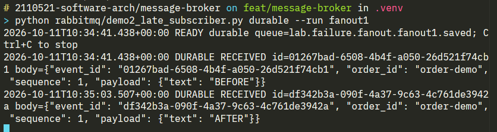
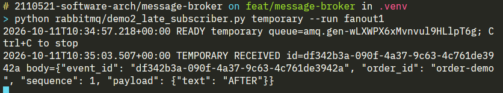
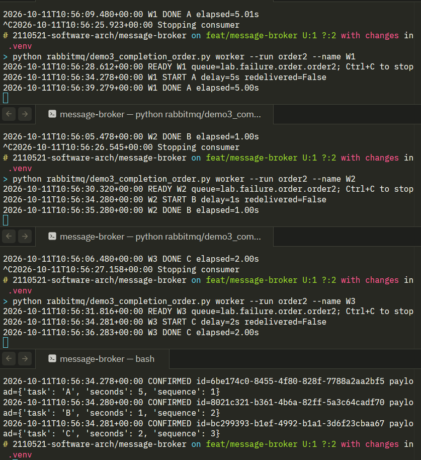
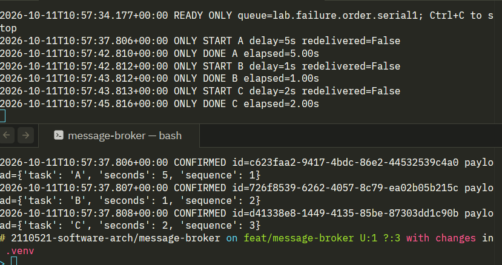
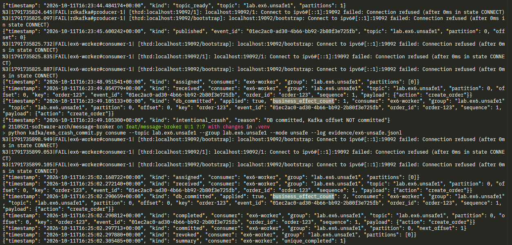
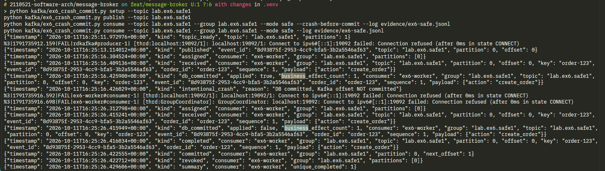

# Message Queue Lab — Submission

## Exercise 1 — RabbitMQ: Crash Before ACK

- [ ] Terminal output from the **unsafe** mode — both the crash run and the restart, showing `applied` and `business_effect_count` 



- [ ] Terminal output from the **safe** mode — both the crash run and the restart, showing `applied` and `business_effect_count` 



- [ ] Written explanation (3–5 sentences): Why does the unsafe mode produce a duplicate? How does the safe mode prevent it, and what role does the single transaction play?

RabbitMQ will try to send the message to consumer until it receives at least 1 ACK. The consumer in this context polls for 1 message from message queue, process and send ACK back. In unsafe mode, the consumer doesn't check whether the table has the requested row or not and always do INSERT. When the unsafe consumer doesn't send ACK back to broker, the broker will repeatedly try to send message, which cause consumer to perform duplicated effects. In safe mode, the consumer checks whether the table has the requested before execution. Therefore, even if the consumer fails to send ACK and receives duplicated request, there is no duplicated effect. 

## Exercise 2 — RabbitMQ: Late Subscribers

- [ ] Terminal output from the **durable** consumer showing both `BEFORE` and `AFTER` received



- [ ] Terminal output from the **temporary** consumer showing `AFTER` received and `BEFORE` missing



- [ ] Written explanation (3–5 sentences): Why did the temporary queue miss `BEFORE`? What would need to change for it to receive `BEFORE`?

The durable queue didn't miss `BEFORE` because it is bounded to the broker before `BEFORE` was even published when `setup` is run. So, after the broker routes message to durable queue, the durable queue stores the message until durable queue's consumer wakes up and consume `BEFORE`. The temporary queue missed `BEFORE` because it is bounded to broker after `BEFORE` was published, so the consumer of temporary queue only receives `AFTER`. To make temporary queue receives `BEFORE`, we need to bound the queue with broker before message is published.

## Exercise 3 — RabbitMQ: Delivery vs. Completion Order

- [ ] Terminal output from the **3-worker** run showing completion order



- [ ] Terminal output from the **1-worker** run showing completion order



- [ ] Written explanation (3–5 sentences): Why do the two runs produce different completion orders? When would you choose one worker over three?

3-worker run has completion order of B -> C -> A which is different to message order because tasks are spread out and processed concurrenry. 1-worker run has completion order of A -> B -> C which is the same to message order because task are sent to 1 worker and done in sequential manner. We might choose 1-worker in case that the system must respect in-order processing. 

---

## Exercise 4 — Kafka: Consumer Groups and Partitions

- [ ] Evidence logs (or terminal screenshots) showing partition assignment for group sizes **2, 4, and 5**

**Group of 2**

Publisher
```json
{"timestamp": "2026-10-11T15:12:18.863871+00:00", "kind": "published", "event_id": "43498796-409f-4574-b5f2-dc0b531abc49", "topic": "lab.ex4.two1", "partition": 3, "offset": 0}
{"timestamp": "2026-10-11T15:12:18.864037+00:00", "kind": "published", "event_id": "7a37bbec-11a9-4f54-9250-12a99f4e3e75", "topic": "lab.ex4.two1", "partition": 3, "offset": 1}
{"timestamp": "2026-10-11T15:12:18.864146+00:00", "kind": "published", "event_id": "5ce185c6-073e-4cf5-8267-98ee50c016cd", "topic": "lab.ex4.two1", "partition": 3, "offset": 2}
{"timestamp": "2026-10-11T15:12:18.864231+00:00", "kind": "published", "event_id": "b8fbac61-b440-4a5a-8bd8-f92719ecf700", "topic": "lab.ex4.two1", "partition": 3, "offset": 3}
{"timestamp": "2026-10-11T15:12:18.864306+00:00", "kind": "published", "event_id": "cd74db69-3ee6-4788-85a9-4bf7d02b0921", "topic": "lab.ex4.two1", "partition": 3, "offset": 4}
{"timestamp": "2026-10-11T15:12:18.864396+00:00", "kind": "published", "event_id": "8a294563-1fc2-4cc2-b278-ab1256b82835", "topic": "lab.ex4.two1", "partition": 3, "offset": 5}
{"timestamp": "2026-10-11T15:12:18.864485+00:00", "kind": "published", "event_id": "3e9489d0-81fe-4e04-85b2-4e2dea7ec670", "topic": "lab.ex4.two1", "partition": 3, "offset": 6}
{"timestamp": "2026-10-11T15:12:18.864559+00:00", "kind": "published", "event_id": "805a7b15-8faa-406d-85e1-da2c1ae430f8", "topic": "lab.ex4.two1", "partition": 3, "offset": 7}
{"timestamp": "2026-10-11T15:12:18.864633+00:00", "kind": "published", "event_id": "83e6cb73-1664-40fc-8f63-88d79f1adef0", "topic": "lab.ex4.two1", "partition": 3, "offset": 8}
{"timestamp": "2026-10-11T15:12:18.864701+00:00", "kind": "published", "event_id": "23c005c9-ac4f-4173-ac7c-2416e1c39b12", "topic": "lab.ex4.two1", "partition": 3, "offset": 9}
{"timestamp": "2026-10-11T15:12:18.865712+00:00", "kind": "published", "event_id": "a4ccec2b-9d54-4ff3-abc9-0ede4cccc5c5", "topic": "lab.ex4.two1", "partition": 0, "offset": 0}
{"timestamp": "2026-10-11T15:12:18.865930+00:00", "kind": "published", "event_id": "4541e3e4-1637-4294-9117-6f424c41c6ac", "topic": "lab.ex4.two1", "partition": 0, "offset": 1}
{"timestamp": "2026-10-11T15:12:18.866040+00:00", "kind": "published", "event_id": "027c3037-0946-4bcc-845e-4cbee46b48e5", "topic": "lab.ex4.two1", "partition": 0, "offset": 2}
{"timestamp": "2026-10-11T15:12:18.866123+00:00", "kind": "published", "event_id": "8f62f8db-6040-4e33-9725-6d2cae8dcf6a", "topic": "lab.ex4.two1", "partition": 0, "offset": 3}
{"timestamp": "2026-10-11T15:12:18.866197+00:00", "kind": "published", "event_id": "4238cbf1-d532-484e-8150-1a6e6c7fd019", "topic": "lab.ex4.two1", "partition": 0, "offset": 4}
{"timestamp": "2026-10-11T15:12:18.866267+00:00", "kind": "published", "event_id": "c2590858-c544-4c6b-ad35-6635792903f5", "topic": "lab.ex4.two1", "partition": 0, "offset": 5}
{"timestamp": "2026-10-11T15:12:18.866363+00:00", "kind": "published", "event_id": "4ae34f86-cc1a-47d5-aaa4-0f89f86a2c6a", "topic": "lab.ex4.two1", "partition": 0, "offset": 6}
{"timestamp": "2026-10-11T15:12:18.866437+00:00", "kind": "published", "event_id": "48dd5490-8a88-4264-8da9-75723c59d647", "topic": "lab.ex4.two1", "partition": 0, "offset": 7}
{"timestamp": "2026-10-11T15:12:18.866531+00:00", "kind": "published", "event_id": "105732e5-fb27-4091-b92f-4bb700627332", "topic": "lab.ex4.two1", "partition": 0, "offset": 8}
{"timestamp": "2026-10-11T15:12:18.866613+00:00", "kind": "published", "event_id": "3f98f174-4132-489e-a3e0-132b1635c3d7", "topic": "lab.ex4.two1", "partition": 0, "offset": 9}
{"timestamp": "2026-10-11T15:12:18.867291+00:00", "kind": "published", "event_id": "013f434d-a723-448c-b0e2-ce871bbadc08", "topic": "lab.ex4.two1", "partition": 1, "offset": 0}
{"timestamp": "2026-10-11T15:12:18.867448+00:00", "kind": "published", "event_id": "8a1f6870-3665-44b3-a460-1bcb2d60cc6c", "topic": "lab.ex4.two1", "partition": 1, "offset": 1}
{"timestamp": "2026-10-11T15:12:18.867542+00:00", "kind": "published", "event_id": "40669fac-c08a-4600-a971-29c14338caf5", "topic": "lab.ex4.two1", "partition": 1, "offset": 2}
{"timestamp": "2026-10-11T15:12:18.867603+00:00", "kind": "published", "event_id": "385fcc5f-51c3-4ce3-bd61-c8355b72291c", "topic": "lab.ex4.two1", "partition": 1, "offset": 3}
{"timestamp": "2026-10-11T15:12:18.867689+00:00", "kind": "published", "event_id": "1110400d-5d5d-43be-9c09-1b8bf2212002", "topic": "lab.ex4.two1", "partition": 1, "offset": 4}
{"timestamp": "2026-10-11T15:12:18.867763+00:00", "kind": "published", "event_id": "ee03b4e5-3713-48dc-808b-ea4321e4f76d", "topic": "lab.ex4.two1", "partition": 1, "offset": 5}
{"timestamp": "2026-10-11T15:12:18.867834+00:00", "kind": "published", "event_id": "1c156fd5-42e2-458f-b3b4-8898f4bdd209", "topic": "lab.ex4.two1", "partition": 1, "offset": 6}
{"timestamp": "2026-10-11T15:12:18.867907+00:00", "kind": "published", "event_id": "b5e6c50e-dad3-4069-9d71-a5920dfec3a0", "topic": "lab.ex4.two1", "partition": 1, "offset": 7}
{"timestamp": "2026-10-11T15:12:18.867969+00:00", "kind": "published", "event_id": "9fc82a44-c710-46e8-96f0-c615e7c7e914", "topic": "lab.ex4.two1", "partition": 1, "offset": 8}
{"timestamp": "2026-10-11T15:12:18.868030+00:00", "kind": "published", "event_id": "3cc18bb9-ebe5-4684-9673-34af43c93f8c", "topic": "lab.ex4.two1", "partition": 1, "offset": 9}
{"timestamp": "2026-10-11T15:12:18.869082+00:00", "kind": "published", "event_id": "1b211b47-d9b0-4c3d-ad86-4b72368840b4", "topic": "lab.ex4.two1", "partition": 2, "offset": 0}
{"timestamp": "2026-10-11T15:12:18.869348+00:00", "kind": "published", "event_id": "c6220455-da67-4800-9c90-9b49b6459638", "topic": "lab.ex4.two1", "partition": 2, "offset": 1}
{"timestamp": "2026-10-11T15:12:18.869465+00:00", "kind": "published", "event_id": "267ef060-4675-4a2f-b158-ecf2b8186eb8", "topic": "lab.ex4.two1", "partition": 2, "offset": 2}
{"timestamp": "2026-10-11T15:12:18.869537+00:00", "kind": "published", "event_id": "b7ff8fac-1650-4f69-aedf-4e172ed6df67", "topic": "lab.ex4.two1", "partition": 2, "offset": 3}
{"timestamp": "2026-10-11T15:12:18.869629+00:00", "kind": "published", "event_id": "e17cd8e8-5ca7-4452-84f9-4a704a6d11c4", "topic": "lab.ex4.two1", "partition": 2, "offset": 4}
{"timestamp": "2026-10-11T15:12:18.869717+00:00", "kind": "published", "event_id": "3b71b045-e07e-4cab-9791-588f2fc871e7", "topic": "lab.ex4.two1", "partition": 2, "offset": 5}
{"timestamp": "2026-10-11T15:12:18.869803+00:00", "kind": "published", "event_id": "0ebc51da-581c-4e8a-b14c-147b73890834", "topic": "lab.ex4.two1", "partition": 2, "offset": 6}
{"timestamp": "2026-10-11T15:12:18.869897+00:00", "kind": "published", "event_id": "f33a665c-8e63-4d79-bca1-19b560654c51", "topic": "lab.ex4.two1", "partition": 2, "offset": 7}
{"timestamp": "2026-10-11T15:12:18.869984+00:00", "kind": "published", "event_id": "2edebb22-9dc5-4744-9f1d-1d8b317e9ba3", "topic": "lab.ex4.two1", "partition": 2, "offset": 8}
{"timestamp": "2026-10-11T15:12:18.870066+00:00", "kind": "published", "event_id": "391621d8-dadc-469e-933a-4cf00abb24f0", "topic": "lab.ex4.two1", "partition": 2, "offset": 9}
```

Consumer 1
```json
{"timestamp": "2026-10-11T15:11:34.971931+00:00", "kind": "assigned", "consumer": "C1", "group": "lab.ex4.two1", "partitions": [0, 1, 2, 3]}
{"timestamp": "2026-10-11T15:11:43.978544+00:00", "kind": "revoked", "consumer": "C1", "group": "lab.ex4.two1", "partitions": [0, 1, 2, 3]}
{"timestamp": "2026-10-11T15:11:43.989796+00:00", "kind": "assigned", "consumer": "C1", "group": "lab.ex4.two1", "partitions": [0, 1]}
{"timestamp": "2026-10-11T15:12:18.869256+00:00", "kind": "received", "consumer": "C1", "group": "lab.ex4.two1", "topic": "lab.ex4.two1", "partition": 0, "offset": 0, "key": "order-0", "event_id": "a4ccec2b-9d54-4ff3-abc9-0ede4cccc5c5", "order_id": "order-0", "sequence": 1, "payload": {"text": "group experiment"}}
{"timestamp": "2026-10-11T15:12:18.869372+00:00", "kind": "completed", "consumer": "C1", "group": "lab.ex4.two1", "topic": "lab.ex4.two1", "partition": 0, "offset": 0, "key": "order-0", "event_id": "a4ccec2b-9d54-4ff3-abc9-0ede4cccc5c5", "order_id": "order-0", "sequence": 1, "payload": {"text": "group experiment"}}
{"timestamp": "2026-10-11T15:12:18.892790+00:00", "kind": "committed", "consumer": "C1", "group": "lab.ex4.two1", "partition": 0, "next_offset": 1}
{"timestamp": "2026-10-11T15:12:18.892933+00:00", "kind": "received", "consumer": "C1", "group": "lab.ex4.two1", "topic": "lab.ex4.two1", "partition": 0, "offset": 1, "key": "order-4", "event_id": "4541e3e4-1637-4294-9117-6f424c41c6ac", "order_id": "order-4", "sequence": 1, "payload": {"text": "group experiment"}}
{"timestamp": "2026-10-11T15:12:18.893001+00:00", "kind": "completed", "consumer": "C1", "group": "lab.ex4.two1", "topic": "lab.ex4.two1", "partition": 0, "offset": 1, "key": "order-4", "event_id": "4541e3e4-1637-4294-9117-6f424c41c6ac", "order_id": "order-4", "sequence": 1, "payload": {"text": "group experiment"}}
{"timestamp": "2026-10-11T15:12:18.900843+00:00", "kind": "committed", "consumer": "C1", "group": "lab.ex4.two1", "partition": 0, "next_offset": 2}
{"timestamp": "2026-10-11T15:12:18.901079+00:00", "kind": "received", "consumer": "C1", "group": "lab.ex4.two1", "topic": "lab.ex4.two1", "partition": 0, "offset": 2, "key": "order-8", "event_id": "027c3037-0946-4bcc-845e-4cbee46b48e5", "order_id": "order-8", "sequence": 1, "payload": {"text": "group experiment"}}
{"timestamp": "2026-10-11T15:12:18.901281+00:00", "kind": "completed", "consumer": "C1", "group": "lab.ex4.two1", "topic": "lab.ex4.two1", "partition": 0, "offset": 2, "key": "order-8", "event_id": "027c3037-0946-4bcc-845e-4cbee46b48e5", "order_id": "order-8", "sequence": 1, "payload": {"text": "group experiment"}}
{"timestamp": "2026-10-11T15:12:18.908443+00:00", "kind": "committed", "consumer": "C1", "group": "lab.ex4.two1", "partition": 0, "next_offset": 3}
{"timestamp": "2026-10-11T15:12:18.908628+00:00", "kind": "received", "consumer": "C1", "group": "lab.ex4.two1", "topic": "lab.ex4.two1", "partition": 0, "offset": 3, "key": "order-12", "event_id": "8f62f8db-6040-4e33-9725-6d2cae8dcf6a", "order_id": "order-12", "sequence": 1, "payload": {"text": "group experiment"}}
{"timestamp": "2026-10-11T15:12:18.908690+00:00", "kind": "completed", "consumer": "C1", "group": "lab.ex4.two1", "topic": "lab.ex4.two1", "partition": 0, "offset": 3, "key": "order-12", "event_id": "8f62f8db-6040-4e33-9725-6d2cae8dcf6a", "order_id": "order-12", "sequence": 1, "payload": {"text": "group experiment"}}
{"timestamp": "2026-10-11T15:12:18.915702+00:00", "kind": "committed", "consumer": "C1", "group": "lab.ex4.two1", "partition": 0, "next_offset": 4}
{"timestamp": "2026-10-11T15:12:18.915883+00:00", "kind": "received", "consumer": "C1", "group": "lab.ex4.two1", "topic": "lab.ex4.two1", "partition": 0, "offset": 4, "key": "order-16", "event_id": "4238cbf1-d532-484e-8150-1a6e6c7fd019", "order_id": "order-16", "sequence": 1, "payload": {"text": "group experiment"}}
{"timestamp": "2026-10-11T15:12:18.915966+00:00", "kind": "completed", "consumer": "C1", "group": "lab.ex4.two1", "topic": "lab.ex4.two1", "partition": 0, "offset": 4, "key": "order-16", "event_id": "4238cbf1-d532-484e-8150-1a6e6c7fd019", "order_id": "order-16", "sequence": 1, "payload": {"text": "group experiment"}}
{"timestamp": "2026-10-11T15:12:18.923182+00:00", "kind": "committed", "consumer": "C1", "group": "lab.ex4.two1", "partition": 0, "next_offset": 5}
{"timestamp": "2026-10-11T15:12:18.923368+00:00", "kind": "received", "consumer": "C1", "group": "lab.ex4.two1", "topic": "lab.ex4.two1", "partition": 0, "offset": 5, "key": "order-20", "event_id": "c2590858-c544-4c6b-ad35-6635792903f5", "order_id": "order-20", "sequence": 1, "payload": {"text": "group experiment"}}
{"timestamp": "2026-10-11T15:12:18.923433+00:00", "kind": "completed", "consumer": "C1", "group": "lab.ex4.two1", "topic": "lab.ex4.two1", "partition": 0, "offset": 5, "key": "order-20", "event_id": "c2590858-c544-4c6b-ad35-6635792903f5", "order_id": "order-20", "sequence": 1, "payload": {"text": "group experiment"}}
{"timestamp": "2026-10-11T15:12:18.930516+00:00", "kind": "committed", "consumer": "C1", "group": "lab.ex4.two1", "partition": 0, "next_offset": 6}
{"timestamp": "2026-10-11T15:12:18.930770+00:00", "kind": "received", "consumer": "C1", "group": "lab.ex4.two1", "topic": "lab.ex4.two1", "partition": 0, "offset": 6, "key": "order-24", "event_id": "4ae34f86-cc1a-47d5-aaa4-0f89f86a2c6a", "order_id": "order-24", "sequence": 1, "payload": {"text": "group experiment"}}
{"timestamp": "2026-10-11T15:12:18.930852+00:00", "kind": "completed", "consumer": "C1", "group": "lab.ex4.two1", "topic": "lab.ex4.two1", "partition": 0, "offset": 6, "key": "order-24", "event_id": "4ae34f86-cc1a-47d5-aaa4-0f89f86a2c6a", "order_id": "order-24", "sequence": 1, "payload": {"text": "group experiment"}}
{"timestamp": "2026-10-11T15:12:18.938287+00:00", "kind": "committed", "consumer": "C1", "group": "lab.ex4.two1", "partition": 0, "next_offset": 7}
{"timestamp": "2026-10-11T15:12:18.938435+00:00", "kind": "received", "consumer": "C1", "group": "lab.ex4.two1", "topic": "lab.ex4.two1", "partition": 0, "offset": 7, "key": "order-28", "event_id": "48dd5490-8a88-4264-8da9-75723c59d647", "order_id": "order-28", "sequence": 1, "payload": {"text": "group experiment"}}
{"timestamp": "2026-10-11T15:12:18.938507+00:00", "kind": "completed", "consumer": "C1", "group": "lab.ex4.two1", "topic": "lab.ex4.two1", "partition": 0, "offset": 7, "key": "order-28", "event_id": "48dd5490-8a88-4264-8da9-75723c59d647", "order_id": "order-28", "sequence": 1, "payload": {"text": "group experiment"}}
{"timestamp": "2026-10-11T15:12:18.945624+00:00", "kind": "committed", "consumer": "C1", "group": "lab.ex4.two1", "partition": 0, "next_offset": 8}
{"timestamp": "2026-10-11T15:12:18.945827+00:00", "kind": "received", "consumer": "C1", "group": "lab.ex4.two1", "topic": "lab.ex4.two1", "partition": 0, "offset": 8, "key": "order-32", "event_id": "105732e5-fb27-4091-b92f-4bb700627332", "order_id": "order-32", "sequence": 1, "payload": {"text": "group experiment"}}
{"timestamp": "2026-10-11T15:12:18.945893+00:00", "kind": "completed", "consumer": "C1", "group": "lab.ex4.two1", "topic": "lab.ex4.two1", "partition": 0, "offset": 8, "key": "order-32", "event_id": "105732e5-fb27-4091-b92f-4bb700627332", "order_id": "order-32", "sequence": 1, "payload": {"text": "group experiment"}}
{"timestamp": "2026-10-11T15:12:18.953107+00:00", "kind": "committed", "consumer": "C1", "group": "lab.ex4.two1", "partition": 0, "next_offset": 9}
{"timestamp": "2026-10-11T15:12:18.953265+00:00", "kind": "received", "consumer": "C1", "group": "lab.ex4.two1", "topic": "lab.ex4.two1", "partition": 0, "offset": 9, "key": "order-36", "event_id": "3f98f174-4132-489e-a3e0-132b1635c3d7", "order_id": "order-36", "sequence": 1, "payload": {"text": "group experiment"}}
{"timestamp": "2026-10-11T15:12:18.953330+00:00", "kind": "completed", "consumer": "C1", "group": "lab.ex4.two1", "topic": "lab.ex4.two1", "partition": 0, "offset": 9, "key": "order-36", "event_id": "3f98f174-4132-489e-a3e0-132b1635c3d7", "order_id": "order-36", "sequence": 1, "payload": {"text": "group experiment"}}
{"timestamp": "2026-10-11T15:12:18.960454+00:00", "kind": "committed", "consumer": "C1", "group": "lab.ex4.two1", "partition": 0, "next_offset": 10}
{"timestamp": "2026-10-11T15:12:18.960634+00:00", "kind": "received", "consumer": "C1", "group": "lab.ex4.two1", "topic": "lab.ex4.two1", "partition": 1, "offset": 0, "key": "order-1", "event_id": "013f434d-a723-448c-b0e2-ce871bbadc08", "order_id": "order-1", "sequence": 1, "payload": {"text": "group experiment"}}
{"timestamp": "2026-10-11T15:12:18.960733+00:00", "kind": "completed", "consumer": "C1", "group": "lab.ex4.two1", "topic": "lab.ex4.two1", "partition": 1, "offset": 0, "key": "order-1", "event_id": "013f434d-a723-448c-b0e2-ce871bbadc08", "order_id": "order-1", "sequence": 1, "payload": {"text": "group experiment"}}
{"timestamp": "2026-10-11T15:12:18.967870+00:00", "kind": "committed", "consumer": "C1", "group": "lab.ex4.two1", "partition": 1, "next_offset": 1}
{"timestamp": "2026-10-11T15:12:18.968035+00:00", "kind": "received", "consumer": "C1", "group": "lab.ex4.two1", "topic": "lab.ex4.two1", "partition": 1, "offset": 1, "key": "order-5", "event_id": "8a1f6870-3665-44b3-a460-1bcb2d60cc6c", "order_id": "order-5", "sequence": 1, "payload": {"text": "group experiment"}}
{"timestamp": "2026-10-11T15:12:18.968092+00:00", "kind": "completed", "consumer": "C1", "group": "lab.ex4.two1", "topic": "lab.ex4.two1", "partition": 1, "offset": 1, "key": "order-5", "event_id": "8a1f6870-3665-44b3-a460-1bcb2d60cc6c", "order_id": "order-5", "sequence": 1, "payload": {"text": "group experiment"}}
{"timestamp": "2026-10-11T15:12:18.977939+00:00", "kind": "committed", "consumer": "C1", "group": "lab.ex4.two1", "partition": 1, "next_offset": 2}
{"timestamp": "2026-10-11T15:12:18.978230+00:00", "kind": "received", "consumer": "C1", "group": "lab.ex4.two1", "topic": "lab.ex4.two1", "partition": 1, "offset": 2, "key": "order-9", "event_id": "40669fac-c08a-4600-a971-29c14338caf5", "order_id": "order-9", "sequence": 1, "payload": {"text": "group experiment"}}
{"timestamp": "2026-10-11T15:12:18.978574+00:00", "kind": "completed", "consumer": "C1", "group": "lab.ex4.two1", "topic": "lab.ex4.two1", "partition": 1, "offset": 2, "key": "order-9", "event_id": "40669fac-c08a-4600-a971-29c14338caf5", "order_id": "order-9", "sequence": 1, "payload": {"text": "group experiment"}}
{"timestamp": "2026-10-11T15:12:18.985838+00:00", "kind": "committed", "consumer": "C1", "group": "lab.ex4.two1", "partition": 1, "next_offset": 3}
{"timestamp": "2026-10-11T15:12:18.986013+00:00", "kind": "received", "consumer": "C1", "group": "lab.ex4.two1", "topic": "lab.ex4.two1", "partition": 1, "offset": 3, "key": "order-13", "event_id": "385fcc5f-51c3-4ce3-bd61-c8355b72291c", "order_id": "order-13", "sequence": 1, "payload": {"text": "group experiment"}}
{"timestamp": "2026-10-11T15:12:18.986123+00:00", "kind": "completed", "consumer": "C1", "group": "lab.ex4.two1", "topic": "lab.ex4.two1", "partition": 1, "offset": 3, "key": "order-13", "event_id": "385fcc5f-51c3-4ce3-bd61-c8355b72291c", "order_id": "order-13", "sequence": 1, "payload": {"text": "group experiment"}}
{"timestamp": "2026-10-11T15:12:18.993405+00:00", "kind": "committed", "consumer": "C1", "group": "lab.ex4.two1", "partition": 1, "next_offset": 4}
{"timestamp": "2026-10-11T15:12:18.993558+00:00", "kind": "received", "consumer": "C1", "group": "lab.ex4.two1", "topic": "lab.ex4.two1", "partition": 1, "offset": 4, "key": "order-17", "event_id": "1110400d-5d5d-43be-9c09-1b8bf2212002", "order_id": "order-17", "sequence": 1, "payload": {"text": "group experiment"}}
{"timestamp": "2026-10-11T15:12:18.993627+00:00", "kind": "completed", "consumer": "C1", "group": "lab.ex4.two1", "topic": "lab.ex4.two1", "partition": 1, "offset": 4, "key": "order-17", "event_id": "1110400d-5d5d-43be-9c09-1b8bf2212002", "order_id": "order-17", "sequence": 1, "payload": {"text": "group experiment"}}
{"timestamp": "2026-10-11T15:12:19.000285+00:00", "kind": "committed", "consumer": "C1", "group": "lab.ex4.two1", "partition": 1, "next_offset": 5}
{"timestamp": "2026-10-11T15:12:19.000470+00:00", "kind": "received", "consumer": "C1", "group": "lab.ex4.two1", "topic": "lab.ex4.two1", "partition": 1, "offset": 5, "key": "order-21", "event_id": "ee03b4e5-3713-48dc-808b-ea4321e4f76d", "order_id": "order-21", "sequence": 1, "payload": {"text": "group experiment"}}
{"timestamp": "2026-10-11T15:12:19.000540+00:00", "kind": "completed", "consumer": "C1", "group": "lab.ex4.two1", "topic": "lab.ex4.two1", "partition": 1, "offset": 5, "key": "order-21", "event_id": "ee03b4e5-3713-48dc-808b-ea4321e4f76d", "order_id": "order-21", "sequence": 1, "payload": {"text": "group experiment"}}
{"timestamp": "2026-10-11T15:12:19.007540+00:00", "kind": "committed", "consumer": "C1", "group": "lab.ex4.two1", "partition": 1, "next_offset": 6}
{"timestamp": "2026-10-11T15:12:19.007724+00:00", "kind": "received", "consumer": "C1", "group": "lab.ex4.two1", "topic": "lab.ex4.two1", "partition": 1, "offset": 6, "key": "order-25", "event_id": "1c156fd5-42e2-458f-b3b4-8898f4bdd209", "order_id": "order-25", "sequence": 1, "payload": {"text": "group experiment"}}
{"timestamp": "2026-10-11T15:12:19.007788+00:00", "kind": "completed", "consumer": "C1", "group": "lab.ex4.two1", "topic": "lab.ex4.two1", "partition": 1, "offset": 6, "key": "order-25", "event_id": "1c156fd5-42e2-458f-b3b4-8898f4bdd209", "order_id": "order-25", "sequence": 1, "payload": {"text": "group experiment"}}
{"timestamp": "2026-10-11T15:12:19.014983+00:00", "kind": "committed", "consumer": "C1", "group": "lab.ex4.two1", "partition": 1, "next_offset": 7}
{"timestamp": "2026-10-11T15:12:19.015169+00:00", "kind": "received", "consumer": "C1", "group": "lab.ex4.two1", "topic": "lab.ex4.two1", "partition": 1, "offset": 7, "key": "order-29", "event_id": "b5e6c50e-dad3-4069-9d71-a5920dfec3a0", "order_id": "order-29", "sequence": 1, "payload": {"text": "group experiment"}}
{"timestamp": "2026-10-11T15:12:19.015240+00:00", "kind": "completed", "consumer": "C1", "group": "lab.ex4.two1", "topic": "lab.ex4.two1", "partition": 1, "offset": 7, "key": "order-29", "event_id": "b5e6c50e-dad3-4069-9d71-a5920dfec3a0", "order_id": "order-29", "sequence": 1, "payload": {"text": "group experiment"}}
{"timestamp": "2026-10-11T15:12:19.027773+00:00", "kind": "committed", "consumer": "C1", "group": "lab.ex4.two1", "partition": 1, "next_offset": 8}
{"timestamp": "2026-10-11T15:12:19.027938+00:00", "kind": "received", "consumer": "C1", "group": "lab.ex4.two1", "topic": "lab.ex4.two1", "partition": 1, "offset": 8, "key": "order-33", "event_id": "9fc82a44-c710-46e8-96f0-c615e7c7e914", "order_id": "order-33", "sequence": 1, "payload": {"text": "group experiment"}}
{"timestamp": "2026-10-11T15:12:19.028004+00:00", "kind": "completed", "consumer": "C1", "group": "lab.ex4.two1", "topic": "lab.ex4.two1", "partition": 1, "offset": 8, "key": "order-33", "event_id": "9fc82a44-c710-46e8-96f0-c615e7c7e914", "order_id": "order-33", "sequence": 1, "payload": {"text": "group experiment"}}
{"timestamp": "2026-10-11T15:12:19.035257+00:00", "kind": "committed", "consumer": "C1", "group": "lab.ex4.two1", "partition": 1, "next_offset": 9}
{"timestamp": "2026-10-11T15:12:19.035483+00:00", "kind": "received", "consumer": "C1", "group": "lab.ex4.two1", "topic": "lab.ex4.two1", "partition": 1, "offset": 9, "key": "order-37", "event_id": "3cc18bb9-ebe5-4684-9673-34af43c93f8c", "order_id": "order-37", "sequence": 1, "payload": {"text": "group experiment"}}
{"timestamp": "2026-10-11T15:12:19.035556+00:00", "kind": "completed", "consumer": "C1", "group": "lab.ex4.two1", "topic": "lab.ex4.two1", "partition": 1, "offset": 9, "key": "order-37", "event_id": "3cc18bb9-ebe5-4684-9673-34af43c93f8c", "order_id": "order-37", "sequence": 1, "payload": {"text": "group experiment"}}
{"timestamp": "2026-10-11T15:12:19.042702+00:00", "kind": "committed", "consumer": "C1", "group": "lab.ex4.two1", "partition": 1, "next_offset": 10}
```

Consumer 2
```json
{"timestamp": "2026-10-11T15:11:43.989811+00:00", "kind": "assigned", "consumer": "C2", "group": "lab.ex4.two1", "partitions": [2, 3]}
{"timestamp": "2026-10-11T15:12:18.869235+00:00", "kind": "received", "consumer": "C2", "group": "lab.ex4.two1", "topic": "lab.ex4.two1", "partition": 3, "offset": 0, "key": "order-3", "event_id": "43498796-409f-4574-b5f2-dc0b531abc49", "order_id": "order-3", "sequence": 1, "payload": {"text": "group experiment"}}
{"timestamp": "2026-10-11T15:12:18.869371+00:00", "kind": "completed", "consumer": "C2", "group": "lab.ex4.two1", "topic": "lab.ex4.two1", "partition": 3, "offset": 0, "key": "order-3", "event_id": "43498796-409f-4574-b5f2-dc0b531abc49", "order_id": "order-3", "sequence": 1, "payload": {"text": "group experiment"}}
{"timestamp": "2026-10-11T15:12:18.892695+00:00", "kind": "committed", "consumer": "C2", "group": "lab.ex4.two1", "partition": 3, "next_offset": 1}
{"timestamp": "2026-10-11T15:12:18.892925+00:00", "kind": "received", "consumer": "C2", "group": "lab.ex4.two1", "topic": "lab.ex4.two1", "partition": 3, "offset": 1, "key": "order-7", "event_id": "7a37bbec-11a9-4f54-9250-12a99f4e3e75", "order_id": "order-7", "sequence": 1, "payload": {"text": "group experiment"}}
{"timestamp": "2026-10-11T15:12:18.893013+00:00", "kind": "completed", "consumer": "C2", "group": "lab.ex4.two1", "topic": "lab.ex4.two1", "partition": 3, "offset": 1, "key": "order-7", "event_id": "7a37bbec-11a9-4f54-9250-12a99f4e3e75", "order_id": "order-7", "sequence": 1, "payload": {"text": "group experiment"}}
{"timestamp": "2026-10-11T15:12:18.900843+00:00", "kind": "committed", "consumer": "C2", "group": "lab.ex4.two1", "partition": 3, "next_offset": 2}
{"timestamp": "2026-10-11T15:12:18.901032+00:00", "kind": "received", "consumer": "C2", "group": "lab.ex4.two1", "topic": "lab.ex4.two1", "partition": 3, "offset": 2, "key": "order-11", "event_id": "5ce185c6-073e-4cf5-8267-98ee50c016cd", "order_id": "order-11", "sequence": 1, "payload": {"text": "group experiment"}}
{"timestamp": "2026-10-11T15:12:18.901096+00:00", "kind": "completed", "consumer": "C2", "group": "lab.ex4.two1", "topic": "lab.ex4.two1", "partition": 3, "offset": 2, "key": "order-11", "event_id": "5ce185c6-073e-4cf5-8267-98ee50c016cd", "order_id": "order-11", "sequence": 1, "payload": {"text": "group experiment"}}
{"timestamp": "2026-10-11T15:12:18.908442+00:00", "kind": "committed", "consumer": "C2", "group": "lab.ex4.two1", "partition": 3, "next_offset": 3}
{"timestamp": "2026-10-11T15:12:18.908648+00:00", "kind": "received", "consumer": "C2", "group": "lab.ex4.two1", "topic": "lab.ex4.two1", "partition": 3, "offset": 3, "key": "order-15", "event_id": "b8fbac61-b440-4a5a-8bd8-f92719ecf700", "order_id": "order-15", "sequence": 1, "payload": {"text": "group experiment"}}
{"timestamp": "2026-10-11T15:12:18.908699+00:00", "kind": "completed", "consumer": "C2", "group": "lab.ex4.two1", "topic": "lab.ex4.two1", "partition": 3, "offset": 3, "key": "order-15", "event_id": "b8fbac61-b440-4a5a-8bd8-f92719ecf700", "order_id": "order-15", "sequence": 1, "payload": {"text": "group experiment"}}
{"timestamp": "2026-10-11T15:12:18.915702+00:00", "kind": "committed", "consumer": "C2", "group": "lab.ex4.two1", "partition": 3, "next_offset": 4}
{"timestamp": "2026-10-11T15:12:18.915884+00:00", "kind": "received", "consumer": "C2", "group": "lab.ex4.two1", "topic": "lab.ex4.two1", "partition": 3, "offset": 4, "key": "order-19", "event_id": "cd74db69-3ee6-4788-85a9-4bf7d02b0921", "order_id": "order-19", "sequence": 1, "payload": {"text": "group experiment"}}
{"timestamp": "2026-10-11T15:12:18.915967+00:00", "kind": "completed", "consumer": "C2", "group": "lab.ex4.two1", "topic": "lab.ex4.two1", "partition": 3, "offset": 4, "key": "order-19", "event_id": "cd74db69-3ee6-4788-85a9-4bf7d02b0921", "order_id": "order-19", "sequence": 1, "payload": {"text": "group experiment"}}
{"timestamp": "2026-10-11T15:12:18.923203+00:00", "kind": "committed", "consumer": "C2", "group": "lab.ex4.two1", "partition": 3, "next_offset": 5}
{"timestamp": "2026-10-11T15:12:18.923367+00:00", "kind": "received", "consumer": "C2", "group": "lab.ex4.two1", "topic": "lab.ex4.two1", "partition": 3, "offset": 5, "key": "order-23", "event_id": "8a294563-1fc2-4cc2-b278-ab1256b82835", "order_id": "order-23", "sequence": 1, "payload": {"text": "group experiment"}}
{"timestamp": "2026-10-11T15:12:18.923443+00:00", "kind": "completed", "consumer": "C2", "group": "lab.ex4.two1", "topic": "lab.ex4.two1", "partition": 3, "offset": 5, "key": "order-23", "event_id": "8a294563-1fc2-4cc2-b278-ab1256b82835", "order_id": "order-23", "sequence": 1, "payload": {"text": "group experiment"}}
{"timestamp": "2026-10-11T15:12:18.930516+00:00", "kind": "committed", "consumer": "C2", "group": "lab.ex4.two1", "partition": 3, "next_offset": 6}
{"timestamp": "2026-10-11T15:12:18.931007+00:00", "kind": "received", "consumer": "C2", "group": "lab.ex4.two1", "topic": "lab.ex4.two1", "partition": 3, "offset": 6, "key": "order-27", "event_id": "3e9489d0-81fe-4e04-85b2-4e2dea7ec670", "order_id": "order-27", "sequence": 1, "payload": {"text": "group experiment"}}
{"timestamp": "2026-10-11T15:12:18.931106+00:00", "kind": "completed", "consumer": "C2", "group": "lab.ex4.two1", "topic": "lab.ex4.two1", "partition": 3, "offset": 6, "key": "order-27", "event_id": "3e9489d0-81fe-4e04-85b2-4e2dea7ec670", "order_id": "order-27", "sequence": 1, "payload": {"text": "group experiment"}}
{"timestamp": "2026-10-11T15:12:18.938267+00:00", "kind": "committed", "consumer": "C2", "group": "lab.ex4.two1", "partition": 3, "next_offset": 7}
{"timestamp": "2026-10-11T15:12:18.938435+00:00", "kind": "received", "consumer": "C2", "group": "lab.ex4.two1", "topic": "lab.ex4.two1", "partition": 3, "offset": 7, "key": "order-31", "event_id": "805a7b15-8faa-406d-85e1-da2c1ae430f8", "order_id": "order-31", "sequence": 1, "payload": {"text": "group experiment"}}
{"timestamp": "2026-10-11T15:12:18.938506+00:00", "kind": "completed", "consumer": "C2", "group": "lab.ex4.two1", "topic": "lab.ex4.two1", "partition": 3, "offset": 7, "key": "order-31", "event_id": "805a7b15-8faa-406d-85e1-da2c1ae430f8", "order_id": "order-31", "sequence": 1, "payload": {"text": "group experiment"}}
{"timestamp": "2026-10-11T15:12:18.945632+00:00", "kind": "committed", "consumer": "C2", "group": "lab.ex4.two1", "partition": 3, "next_offset": 8}
{"timestamp": "2026-10-11T15:12:18.945825+00:00", "kind": "received", "consumer": "C2", "group": "lab.ex4.two1", "topic": "lab.ex4.two1", "partition": 3, "offset": 8, "key": "order-35", "event_id": "83e6cb73-1664-40fc-8f63-88d79f1adef0", "order_id": "order-35", "sequence": 1, "payload": {"text": "group experiment"}}
{"timestamp": "2026-10-11T15:12:18.945876+00:00", "kind": "completed", "consumer": "C2", "group": "lab.ex4.two1", "topic": "lab.ex4.two1", "partition": 3, "offset": 8, "key": "order-35", "event_id": "83e6cb73-1664-40fc-8f63-88d79f1adef0", "order_id": "order-35", "sequence": 1, "payload": {"text": "group experiment"}}
{"timestamp": "2026-10-11T15:12:18.953119+00:00", "kind": "committed", "consumer": "C2", "group": "lab.ex4.two1", "partition": 3, "next_offset": 9}
{"timestamp": "2026-10-11T15:12:18.953265+00:00", "kind": "received", "consumer": "C2", "group": "lab.ex4.two1", "topic": "lab.ex4.two1", "partition": 3, "offset": 9, "key": "order-39", "event_id": "23c005c9-ac4f-4173-ac7c-2416e1c39b12", "order_id": "order-39", "sequence": 1, "payload": {"text": "group experiment"}}
{"timestamp": "2026-10-11T15:12:18.953319+00:00", "kind": "completed", "consumer": "C2", "group": "lab.ex4.two1", "topic": "lab.ex4.two1", "partition": 3, "offset": 9, "key": "order-39", "event_id": "23c005c9-ac4f-4173-ac7c-2416e1c39b12", "order_id": "order-39", "sequence": 1, "payload": {"text": "group experiment"}}
{"timestamp": "2026-10-11T15:12:18.960454+00:00", "kind": "committed", "consumer": "C2", "group": "lab.ex4.two1", "partition": 3, "next_offset": 10}
{"timestamp": "2026-10-11T15:12:18.960628+00:00", "kind": "received", "consumer": "C2", "group": "lab.ex4.two1", "topic": "lab.ex4.two1", "partition": 2, "offset": 0, "key": "order-2", "event_id": "1b211b47-d9b0-4c3d-ad86-4b72368840b4", "order_id": "order-2", "sequence": 1, "payload": {"text": "group experiment"}}
{"timestamp": "2026-10-11T15:12:18.960733+00:00", "kind": "completed", "consumer": "C2", "group": "lab.ex4.two1", "topic": "lab.ex4.two1", "partition": 2, "offset": 0, "key": "order-2", "event_id": "1b211b47-d9b0-4c3d-ad86-4b72368840b4", "order_id": "order-2", "sequence": 1, "payload": {"text": "group experiment"}}
{"timestamp": "2026-10-11T15:12:18.967870+00:00", "kind": "committed", "consumer": "C2", "group": "lab.ex4.two1", "partition": 2, "next_offset": 1}
{"timestamp": "2026-10-11T15:12:18.968034+00:00", "kind": "received", "consumer": "C2", "group": "lab.ex4.two1", "topic": "lab.ex4.two1", "partition": 2, "offset": 1, "key": "order-6", "event_id": "c6220455-da67-4800-9c90-9b49b6459638", "order_id": "order-6", "sequence": 1, "payload": {"text": "group experiment"}}
{"timestamp": "2026-10-11T15:12:18.968090+00:00", "kind": "completed", "consumer": "C2", "group": "lab.ex4.two1", "topic": "lab.ex4.two1", "partition": 2, "offset": 1, "key": "order-6", "event_id": "c6220455-da67-4800-9c90-9b49b6459638", "order_id": "order-6", "sequence": 1, "payload": {"text": "group experiment"}}
{"timestamp": "2026-10-11T15:12:18.978425+00:00", "kind": "committed", "consumer": "C2", "group": "lab.ex4.two1", "partition": 2, "next_offset": 2}
{"timestamp": "2026-10-11T15:12:18.978733+00:00", "kind": "received", "consumer": "C2", "group": "lab.ex4.two1", "topic": "lab.ex4.two1", "partition": 2, "offset": 2, "key": "order-10", "event_id": "267ef060-4675-4a2f-b158-ecf2b8186eb8", "order_id": "order-10", "sequence": 1, "payload": {"text": "group experiment"}}
{"timestamp": "2026-10-11T15:12:18.978794+00:00", "kind": "completed", "consumer": "C2", "group": "lab.ex4.two1", "topic": "lab.ex4.two1", "partition": 2, "offset": 2, "key": "order-10", "event_id": "267ef060-4675-4a2f-b158-ecf2b8186eb8", "order_id": "order-10", "sequence": 1, "payload": {"text": "group experiment"}}
{"timestamp": "2026-10-11T15:12:18.985858+00:00", "kind": "committed", "consumer": "C2", "group": "lab.ex4.two1", "partition": 2, "next_offset": 3}
{"timestamp": "2026-10-11T15:12:18.986016+00:00", "kind": "received", "consumer": "C2", "group": "lab.ex4.two1", "topic": "lab.ex4.two1", "partition": 2, "offset": 3, "key": "order-14", "event_id": "b7ff8fac-1650-4f69-aedf-4e172ed6df67", "order_id": "order-14", "sequence": 1, "payload": {"text": "group experiment"}}
{"timestamp": "2026-10-11T15:12:18.986097+00:00", "kind": "completed", "consumer": "C2", "group": "lab.ex4.two1", "topic": "lab.ex4.two1", "partition": 2, "offset": 3, "key": "order-14", "event_id": "b7ff8fac-1650-4f69-aedf-4e172ed6df67", "order_id": "order-14", "sequence": 1, "payload": {"text": "group experiment"}}
{"timestamp": "2026-10-11T15:12:18.993063+00:00", "kind": "committed", "consumer": "C2", "group": "lab.ex4.two1", "partition": 2, "next_offset": 4}
{"timestamp": "2026-10-11T15:12:18.993238+00:00", "kind": "received", "consumer": "C2", "group": "lab.ex4.two1", "topic": "lab.ex4.two1", "partition": 2, "offset": 4, "key": "order-18", "event_id": "e17cd8e8-5ca7-4452-84f9-4a704a6d11c4", "order_id": "order-18", "sequence": 1, "payload": {"text": "group experiment"}}
{"timestamp": "2026-10-11T15:12:18.993304+00:00", "kind": "completed", "consumer": "C2", "group": "lab.ex4.two1", "topic": "lab.ex4.two1", "partition": 2, "offset": 4, "key": "order-18", "event_id": "e17cd8e8-5ca7-4452-84f9-4a704a6d11c4", "order_id": "order-18", "sequence": 1, "payload": {"text": "group experiment"}}
{"timestamp": "2026-10-11T15:12:19.000285+00:00", "kind": "committed", "consumer": "C2", "group": "lab.ex4.two1", "partition": 2, "next_offset": 5}
{"timestamp": "2026-10-11T15:12:19.000469+00:00", "kind": "received", "consumer": "C2", "group": "lab.ex4.two1", "topic": "lab.ex4.two1", "partition": 2, "offset": 5, "key": "order-22", "event_id": "3b71b045-e07e-4cab-9791-588f2fc871e7", "order_id": "order-22", "sequence": 1, "payload": {"text": "group experiment"}}
{"timestamp": "2026-10-11T15:12:19.000535+00:00", "kind": "completed", "consumer": "C2", "group": "lab.ex4.two1", "topic": "lab.ex4.two1", "partition": 2, "offset": 5, "key": "order-22", "event_id": "3b71b045-e07e-4cab-9791-588f2fc871e7", "order_id": "order-22", "sequence": 1, "payload": {"text": "group experiment"}}
{"timestamp": "2026-10-11T15:12:19.007540+00:00", "kind": "committed", "consumer": "C2", "group": "lab.ex4.two1", "partition": 2, "next_offset": 6}
{"timestamp": "2026-10-11T15:12:19.007723+00:00", "kind": "received", "consumer": "C2", "group": "lab.ex4.two1", "topic": "lab.ex4.two1", "partition": 2, "offset": 6, "key": "order-26", "event_id": "0ebc51da-581c-4e8a-b14c-147b73890834", "order_id": "order-26", "sequence": 1, "payload": {"text": "group experiment"}}
{"timestamp": "2026-10-11T15:12:19.007787+00:00", "kind": "completed", "consumer": "C2", "group": "lab.ex4.two1", "topic": "lab.ex4.two1", "partition": 2, "offset": 6, "key": "order-26", "event_id": "0ebc51da-581c-4e8a-b14c-147b73890834", "order_id": "order-26", "sequence": 1, "payload": {"text": "group experiment"}}
{"timestamp": "2026-10-11T15:12:19.014983+00:00", "kind": "committed", "consumer": "C2", "group": "lab.ex4.two1", "partition": 2, "next_offset": 7}
{"timestamp": "2026-10-11T15:12:19.015169+00:00", "kind": "received", "consumer": "C2", "group": "lab.ex4.two1", "topic": "lab.ex4.two1", "partition": 2, "offset": 7, "key": "order-30", "event_id": "f33a665c-8e63-4d79-bca1-19b560654c51", "order_id": "order-30", "sequence": 1, "payload": {"text": "group experiment"}}
{"timestamp": "2026-10-11T15:12:19.015240+00:00", "kind": "completed", "consumer": "C2", "group": "lab.ex4.two1", "topic": "lab.ex4.two1", "partition": 2, "offset": 7, "key": "order-30", "event_id": "f33a665c-8e63-4d79-bca1-19b560654c51", "order_id": "order-30", "sequence": 1, "payload": {"text": "group experiment"}}
{"timestamp": "2026-10-11T15:12:19.027773+00:00", "kind": "committed", "consumer": "C2", "group": "lab.ex4.two1", "partition": 2, "next_offset": 8}
{"timestamp": "2026-10-11T15:12:19.027937+00:00", "kind": "received", "consumer": "C2", "group": "lab.ex4.two1", "topic": "lab.ex4.two1", "partition": 2, "offset": 8, "key": "order-34", "event_id": "2edebb22-9dc5-4744-9f1d-1d8b317e9ba3", "order_id": "order-34", "sequence": 1, "payload": {"text": "group experiment"}}
{"timestamp": "2026-10-11T15:12:19.027995+00:00", "kind": "completed", "consumer": "C2", "group": "lab.ex4.two1", "topic": "lab.ex4.two1", "partition": 2, "offset": 8, "key": "order-34", "event_id": "2edebb22-9dc5-4744-9f1d-1d8b317e9ba3", "order_id": "order-34", "sequence": 1, "payload": {"text": "group experiment"}}
{"timestamp": "2026-10-11T15:12:19.035256+00:00", "kind": "committed", "consumer": "C2", "group": "lab.ex4.two1", "partition": 2, "next_offset": 9}
{"timestamp": "2026-10-11T15:12:19.035499+00:00", "kind": "received", "consumer": "C2", "group": "lab.ex4.two1", "topic": "lab.ex4.two1", "partition": 2, "offset": 9, "key": "order-38", "event_id": "391621d8-dadc-469e-933a-4cf00abb24f0", "order_id": "order-38", "sequence": 1, "payload": {"text": "group experiment"}}
{"timestamp": "2026-10-11T15:12:19.035558+00:00", "kind": "completed", "consumer": "C2", "group": "lab.ex4.two1", "topic": "lab.ex4.two1", "partition": 2, "offset": 9, "key": "order-38", "event_id": "391621d8-dadc-469e-933a-4cf00abb24f0", "order_id": "order-38", "sequence": 1, "payload": {"text": "group experiment"}}
{"timestamp": "2026-10-11T15:12:19.042702+00:00", "kind": "committed", "consumer": "C2", "group": "lab.ex4.two1", "partition": 2, "next_offset": 10}
{"timestamp": "2026-10-11T15:16:32.153059+00:00", "kind": "revoked", "consumer": "C2", "group": "lab.ex4.two1", "partitions": [2, 3]}
{"timestamp": "2026-10-11T15:16:32.162308+00:00", "kind": "assigned", "consumer": "C2", "group": "lab.ex4.two1", "partitions": [0, 1, 2, 3]}
{"timestamp": "2026-10-11T15:16:42.214659+00:00", "kind": "revoked", "consumer": "C2", "group": "lab.ex4.two1", "partitions": [0, 1, 2, 3]}
{"timestamp": "2026-10-11T15:16:42.222503+00:00", "kind": "summary", "consumer": "C2", "unique_completed": 20}
```

**Group of 4**

Publisher
```json
{"timestamp": "2026-10-11T15:23:42.931614+00:00", "kind": "published", "event_id": "cdec3552-7b07-43f4-b9b2-ef2bd2ab8d0d", "topic": "lab.ex4.four1", "partition": 3, "offset": 0}
{"timestamp": "2026-10-11T15:23:42.931791+00:00", "kind": "published", "event_id": "ec6a3716-59a7-4bbb-bbaa-abb16dfec626", "topic": "lab.ex4.four1", "partition": 3, "offset": 1}
{"timestamp": "2026-10-11T15:23:42.931895+00:00", "kind": "published", "event_id": "3fafe216-3d1b-474b-960f-bec90f5ebeb5", "topic": "lab.ex4.four1", "partition": 3, "offset": 2}
{"timestamp": "2026-10-11T15:23:42.931961+00:00", "kind": "published", "event_id": "144a086e-df2a-4343-b44a-6c67215de1e8", "topic": "lab.ex4.four1", "partition": 3, "offset": 3}
{"timestamp": "2026-10-11T15:23:42.932025+00:00", "kind": "published", "event_id": "4daf3e06-ba87-4ca2-8e8d-6badc325e1b7", "topic": "lab.ex4.four1", "partition": 3, "offset": 4}
{"timestamp": "2026-10-11T15:23:42.932092+00:00", "kind": "published", "event_id": "bf6f80c2-b6b0-461f-80a7-daecce6d0302", "topic": "lab.ex4.four1", "partition": 3, "offset": 5}
{"timestamp": "2026-10-11T15:23:42.932151+00:00", "kind": "published", "event_id": "8bceb200-0aff-4e14-b4ed-2b8c7364faa9", "topic": "lab.ex4.four1", "partition": 3, "offset": 6}
{"timestamp": "2026-10-11T15:23:42.932211+00:00", "kind": "published", "event_id": "e30d7774-d1dd-41c5-a066-917c6d41415a", "topic": "lab.ex4.four1", "partition": 3, "offset": 7}
{"timestamp": "2026-10-11T15:23:42.932265+00:00", "kind": "published", "event_id": "501bbd30-4e32-4f10-ad91-95b3179de9a4", "topic": "lab.ex4.four1", "partition": 3, "offset": 8}
{"timestamp": "2026-10-11T15:23:42.932330+00:00", "kind": "published", "event_id": "d00eb1a1-6583-4631-9d09-5893d0ab3057", "topic": "lab.ex4.four1", "partition": 3, "offset": 9}
{"timestamp": "2026-10-11T15:23:42.933278+00:00", "kind": "published", "event_id": "efc496e4-3408-42fb-a047-e212fb8bb00b", "topic": "lab.ex4.four1", "partition": 0, "offset": 0}
{"timestamp": "2026-10-11T15:23:42.933472+00:00", "kind": "published", "event_id": "a0a7046c-70fa-43c9-9da3-12b66e443e5f", "topic": "lab.ex4.four1", "partition": 0, "offset": 1}
{"timestamp": "2026-10-11T15:23:42.933616+00:00", "kind": "published", "event_id": "621ebc34-1991-4e24-bc72-2545c7284f4f", "topic": "lab.ex4.four1", "partition": 0, "offset": 2}
{"timestamp": "2026-10-11T15:23:42.933727+00:00", "kind": "published", "event_id": "c4cb6850-a20a-4afa-a6fc-9391927c7919", "topic": "lab.ex4.four1", "partition": 0, "offset": 3}
{"timestamp": "2026-10-11T15:23:42.933838+00:00", "kind": "published", "event_id": "14c95e38-6958-41bd-882d-35c4602246fd", "topic": "lab.ex4.four1", "partition": 0, "offset": 4}
{"timestamp": "2026-10-11T15:23:42.933907+00:00", "kind": "published", "event_id": "60f9b051-4d55-4454-8250-eee6af267425", "topic": "lab.ex4.four1", "partition": 0, "offset": 5}
{"timestamp": "2026-10-11T15:23:42.933970+00:00", "kind": "published", "event_id": "5eb5b27f-3a86-44bc-bbd4-003fc2c3d07d", "topic": "lab.ex4.four1", "partition": 0, "offset": 6}
{"timestamp": "2026-10-11T15:23:42.934032+00:00", "kind": "published", "event_id": "6f23c119-d4d5-4d73-bb19-f178898b5892", "topic": "lab.ex4.four1", "partition": 0, "offset": 7}
{"timestamp": "2026-10-11T15:23:42.934098+00:00", "kind": "published", "event_id": "5c59ffbc-5364-4de9-aa9d-b65a1e76d490", "topic": "lab.ex4.four1", "partition": 0, "offset": 8}
{"timestamp": "2026-10-11T15:23:42.934162+00:00", "kind": "published", "event_id": "7b0ad969-80c8-49ae-90d6-6d6b5bed5f94", "topic": "lab.ex4.four1", "partition": 0, "offset": 9}
{"timestamp": "2026-10-11T15:23:42.935158+00:00", "kind": "published", "event_id": "77d6bdd8-7209-46bf-8b4f-601397b73901", "topic": "lab.ex4.four1", "partition": 1, "offset": 0}
{"timestamp": "2026-10-11T15:23:42.935441+00:00", "kind": "published", "event_id": "14ee3e59-eaef-4e49-b1be-560d716f0f65", "topic": "lab.ex4.four1", "partition": 1, "offset": 1}
{"timestamp": "2026-10-11T15:23:42.935577+00:00", "kind": "published", "event_id": "51db0151-48dc-45f3-af22-8f430f6507ec", "topic": "lab.ex4.four1", "partition": 1, "offset": 2}
{"timestamp": "2026-10-11T15:23:42.936008+00:00", "kind": "published", "event_id": "e663fc1f-6b66-425c-9910-ffdd3479cdee", "topic": "lab.ex4.four1", "partition": 1, "offset": 3}
{"timestamp": "2026-10-11T15:23:42.936241+00:00", "kind": "published", "event_id": "334bbfd3-5a30-49ea-8c57-bb8ea95de9e9", "topic": "lab.ex4.four1", "partition": 1, "offset": 4}
{"timestamp": "2026-10-11T15:23:42.936380+00:00", "kind": "published", "event_id": "4202b16d-3700-4907-8434-1ff8c259033c", "topic": "lab.ex4.four1", "partition": 1, "offset": 5}
{"timestamp": "2026-10-11T15:23:42.936581+00:00", "kind": "published", "event_id": "8f82e642-ec71-4395-a8c1-e7ee42398b75", "topic": "lab.ex4.four1", "partition": 1, "offset": 6}
{"timestamp": "2026-10-11T15:23:42.936670+00:00", "kind": "published", "event_id": "1a522d58-2b81-4b4a-b14b-fab8a8eab9c7", "topic": "lab.ex4.four1", "partition": 1, "offset": 7}
{"timestamp": "2026-10-11T15:23:42.936727+00:00", "kind": "published", "event_id": "7f8437a2-af63-4109-be7c-6ecacc9d2bcd", "topic": "lab.ex4.four1", "partition": 1, "offset": 8}
{"timestamp": "2026-10-11T15:23:42.936779+00:00", "kind": "published", "event_id": "427cc281-f059-4df2-a2e8-0e587218112b", "topic": "lab.ex4.four1", "partition": 1, "offset": 9}
{"timestamp": "2026-10-11T15:23:42.936951+00:00", "kind": "published", "event_id": "91e730c7-5d86-47f0-8699-5cb6fef62613", "topic": "lab.ex4.four1", "partition": 2, "offset": 0}
{"timestamp": "2026-10-11T15:23:42.937018+00:00", "kind": "published", "event_id": "3eb0f20d-2ccf-43bb-a180-27353d3442ea", "topic": "lab.ex4.four1", "partition": 2, "offset": 1}
{"timestamp": "2026-10-11T15:23:42.937061+00:00", "kind": "published", "event_id": "787544e5-4ee8-4b43-aee7-3fa9af81eaa9", "topic": "lab.ex4.four1", "partition": 2, "offset": 2}
{"timestamp": "2026-10-11T15:23:42.937107+00:00", "kind": "published", "event_id": "fa64fcf9-692d-4559-9df8-67700e172d29", "topic": "lab.ex4.four1", "partition": 2, "offset": 3}
{"timestamp": "2026-10-11T15:23:42.937152+00:00", "kind": "published", "event_id": "93a55c60-e7ba-49f1-9c06-ed9eecc8f069", "topic": "lab.ex4.four1", "partition": 2, "offset": 4}
{"timestamp": "2026-10-11T15:23:42.937197+00:00", "kind": "published", "event_id": "aea52016-cd5e-421b-9bd3-b56e9a7b25d3", "topic": "lab.ex4.four1", "partition": 2, "offset": 5}
{"timestamp": "2026-10-11T15:23:42.937241+00:00", "kind": "published", "event_id": "cb88c5a5-1644-48ba-b424-3e88b4e851eb", "topic": "lab.ex4.four1", "partition": 2, "offset": 6}
{"timestamp": "2026-10-11T15:23:42.937287+00:00", "kind": "published", "event_id": "be346814-2100-400d-9245-5b6a1c88b76d", "topic": "lab.ex4.four1", "partition": 2, "offset": 7}
{"timestamp": "2026-10-11T15:23:42.937343+00:00", "kind": "published", "event_id": "afc96e93-288e-4527-9d83-80e8e03f47dc", "topic": "lab.ex4.four1", "partition": 2, "offset": 8}
{"timestamp": "2026-10-11T15:23:42.937390+00:00", "kind": "published", "event_id": "f482c19a-2cd6-4f60-ba81-418d5432840c", "topic": "lab.ex4.four1", "partition": 2, "offset": 9}
```

Consumer 1
```json
{"timestamp": "2026-10-11T15:21:59.546221+00:00", "kind": "assigned", "consumer": "C1", "group": "lab.ex4.four1", "partitions": [0, 1, 2, 3]}
{"timestamp": "2026-10-11T15:22:14.556422+00:00", "kind": "revoked", "consumer": "C1", "group": "lab.ex4.four1", "partitions": [0, 1, 2, 3]}
{"timestamp": "2026-10-11T15:22:14.564973+00:00", "kind": "assigned", "consumer": "C1", "group": "lab.ex4.four1", "partitions": [0, 1]}
{"timestamp": "2026-10-11T15:22:20.569538+00:00", "kind": "revoked", "consumer": "C1", "group": "lab.ex4.four1", "partitions": [0, 1]}
{"timestamp": "2026-10-11T15:22:20.578480+00:00", "kind": "assigned", "consumer": "C1", "group": "lab.ex4.four1", "partitions": [0, 1]}
{"timestamp": "2026-10-11T15:22:32.586057+00:00", "kind": "revoked", "consumer": "C1", "group": "lab.ex4.four1", "partitions": [0, 1]}
{"timestamp": "2026-10-11T15:22:32.595101+00:00", "kind": "assigned", "consumer": "C1", "group": "lab.ex4.four1", "partitions": [0]}
{"timestamp": "2026-10-11T15:23:42.933579+00:00", "kind": "received", "consumer": "C1", "group": "lab.ex4.four1", "topic": "lab.ex4.four1", "partition": 0, "offset": 0, "key": "order-0", "event_id": "efc496e4-3408-42fb-a047-e212fb8bb00b", "order_id": "order-0", "sequence": 1, "payload": {"text": "group experiment"}}
{"timestamp": "2026-10-11T15:23:42.933683+00:00", "kind": "completed", "consumer": "C1", "group": "lab.ex4.four1", "topic": "lab.ex4.four1", "partition": 0, "offset": 0, "key": "order-0", "event_id": "efc496e4-3408-42fb-a047-e212fb8bb00b", "order_id": "order-0", "sequence": 1, "payload": {"text": "group experiment"}}
{"timestamp": "2026-10-11T15:23:42.940850+00:00", "kind": "committed", "consumer": "C1", "group": "lab.ex4.four1", "partition": 0, "next_offset": 1}
{"timestamp": "2026-10-11T15:23:42.941036+00:00", "kind": "received", "consumer": "C1", "group": "lab.ex4.four1", "topic": "lab.ex4.four1", "partition": 0, "offset": 1, "key": "order-4", "event_id": "a0a7046c-70fa-43c9-9da3-12b66e443e5f", "order_id": "order-4", "sequence": 1, "payload": {"text": "group experiment"}}
{"timestamp": "2026-10-11T15:23:42.941102+00:00", "kind": "completed", "consumer": "C1", "group": "lab.ex4.four1", "topic": "lab.ex4.four1", "partition": 0, "offset": 1, "key": "order-4", "event_id": "a0a7046c-70fa-43c9-9da3-12b66e443e5f", "order_id": "order-4", "sequence": 1, "payload": {"text": "group experiment"}}
{"timestamp": "2026-10-11T15:23:42.948301+00:00", "kind": "committed", "consumer": "C1", "group": "lab.ex4.four1", "partition": 0, "next_offset": 2}
{"timestamp": "2026-10-11T15:23:42.948488+00:00", "kind": "received", "consumer": "C1", "group": "lab.ex4.four1", "topic": "lab.ex4.four1", "partition": 0, "offset": 2, "key": "order-8", "event_id": "621ebc34-1991-4e24-bc72-2545c7284f4f", "order_id": "order-8", "sequence": 1, "payload": {"text": "group experiment"}}
{"timestamp": "2026-10-11T15:23:42.948654+00:00", "kind": "completed", "consumer": "C1", "group": "lab.ex4.four1", "topic": "lab.ex4.four1", "partition": 0, "offset": 2, "key": "order-8", "event_id": "621ebc34-1991-4e24-bc72-2545c7284f4f", "order_id": "order-8", "sequence": 1, "payload": {"text": "group experiment"}}
{"timestamp": "2026-10-11T15:23:42.956524+00:00", "kind": "committed", "consumer": "C1", "group": "lab.ex4.four1", "partition": 0, "next_offset": 3}
{"timestamp": "2026-10-11T15:23:42.956710+00:00", "kind": "received", "consumer": "C1", "group": "lab.ex4.four1", "topic": "lab.ex4.four1", "partition": 0, "offset": 3, "key": "order-12", "event_id": "c4cb6850-a20a-4afa-a6fc-9391927c7919", "order_id": "order-12", "sequence": 1, "payload": {"text": "group experiment"}}
{"timestamp": "2026-10-11T15:23:42.956771+00:00", "kind": "completed", "consumer": "C1", "group": "lab.ex4.four1", "topic": "lab.ex4.four1", "partition": 0, "offset": 3, "key": "order-12", "event_id": "c4cb6850-a20a-4afa-a6fc-9391927c7919", "order_id": "order-12", "sequence": 1, "payload": {"text": "group experiment"}}
{"timestamp": "2026-10-11T15:23:42.963913+00:00", "kind": "committed", "consumer": "C1", "group": "lab.ex4.four1", "partition": 0, "next_offset": 4}
{"timestamp": "2026-10-11T15:23:42.964109+00:00", "kind": "received", "consumer": "C1", "group": "lab.ex4.four1", "topic": "lab.ex4.four1", "partition": 0, "offset": 4, "key": "order-16", "event_id": "14c95e38-6958-41bd-882d-35c4602246fd", "order_id": "order-16", "sequence": 1, "payload": {"text": "group experiment"}}
{"timestamp": "2026-10-11T15:23:42.964178+00:00", "kind": "completed", "consumer": "C1", "group": "lab.ex4.four1", "topic": "lab.ex4.four1", "partition": 0, "offset": 4, "key": "order-16", "event_id": "14c95e38-6958-41bd-882d-35c4602246fd", "order_id": "order-16", "sequence": 1, "payload": {"text": "group experiment"}}
{"timestamp": "2026-10-11T15:23:42.971622+00:00", "kind": "committed", "consumer": "C1", "group": "lab.ex4.four1", "partition": 0, "next_offset": 5}
{"timestamp": "2026-10-11T15:23:42.972238+00:00", "kind": "received", "consumer": "C1", "group": "lab.ex4.four1", "topic": "lab.ex4.four1", "partition": 0, "offset": 5, "key": "order-20", "event_id": "60f9b051-4d55-4454-8250-eee6af267425", "order_id": "order-20", "sequence": 1, "payload": {"text": "group experiment"}}
{"timestamp": "2026-10-11T15:23:42.972334+00:00", "kind": "completed", "consumer": "C1", "group": "lab.ex4.four1", "topic": "lab.ex4.four1", "partition": 0, "offset": 5, "key": "order-20", "event_id": "60f9b051-4d55-4454-8250-eee6af267425", "order_id": "order-20", "sequence": 1, "payload": {"text": "group experiment"}}
{"timestamp": "2026-10-11T15:23:42.979072+00:00", "kind": "committed", "consumer": "C1", "group": "lab.ex4.four1", "partition": 0, "next_offset": 6}
{"timestamp": "2026-10-11T15:23:42.979265+00:00", "kind": "received", "consumer": "C1", "group": "lab.ex4.four1", "topic": "lab.ex4.four1", "partition": 0, "offset": 6, "key": "order-24", "event_id": "5eb5b27f-3a86-44bc-bbd4-003fc2c3d07d", "order_id": "order-24", "sequence": 1, "payload": {"text": "group experiment"}}
{"timestamp": "2026-10-11T15:23:42.979349+00:00", "kind": "completed", "consumer": "C1", "group": "lab.ex4.four1", "topic": "lab.ex4.four1", "partition": 0, "offset": 6, "key": "order-24", "event_id": "5eb5b27f-3a86-44bc-bbd4-003fc2c3d07d", "order_id": "order-24", "sequence": 1, "payload": {"text": "group experiment"}}
{"timestamp": "2026-10-11T15:23:42.993638+00:00", "kind": "committed", "consumer": "C1", "group": "lab.ex4.four1", "partition": 0, "next_offset": 7}
{"timestamp": "2026-10-11T15:23:42.993780+00:00", "kind": "received", "consumer": "C1", "group": "lab.ex4.four1", "topic": "lab.ex4.four1", "partition": 0, "offset": 7, "key": "order-28", "event_id": "6f23c119-d4d5-4d73-bb19-f178898b5892", "order_id": "order-28", "sequence": 1, "payload": {"text": "group experiment"}}
{"timestamp": "2026-10-11T15:23:42.993845+00:00", "kind": "completed", "consumer": "C1", "group": "lab.ex4.four1", "topic": "lab.ex4.four1", "partition": 0, "offset": 7, "key": "order-28", "event_id": "6f23c119-d4d5-4d73-bb19-f178898b5892", "order_id": "order-28", "sequence": 1, "payload": {"text": "group experiment"}}
{"timestamp": "2026-10-11T15:23:43.001443+00:00", "kind": "committed", "consumer": "C1", "group": "lab.ex4.four1", "partition": 0, "next_offset": 8}
{"timestamp": "2026-10-11T15:23:43.001688+00:00", "kind": "received", "consumer": "C1", "group": "lab.ex4.four1", "topic": "lab.ex4.four1", "partition": 0, "offset": 8, "key": "order-32", "event_id": "5c59ffbc-5364-4de9-aa9d-b65a1e76d490", "order_id": "order-32", "sequence": 1, "payload": {"text": "group experiment"}}
{"timestamp": "2026-10-11T15:23:43.002024+00:00", "kind": "completed", "consumer": "C1", "group": "lab.ex4.four1", "topic": "lab.ex4.four1", "partition": 0, "offset": 8, "key": "order-32", "event_id": "5c59ffbc-5364-4de9-aa9d-b65a1e76d490", "order_id": "order-32", "sequence": 1, "payload": {"text": "group experiment"}}
{"timestamp": "2026-10-11T15:23:43.008837+00:00", "kind": "committed", "consumer": "C1", "group": "lab.ex4.four1", "partition": 0, "next_offset": 9}
{"timestamp": "2026-10-11T15:23:43.009011+00:00", "kind": "received", "consumer": "C1", "group": "lab.ex4.four1", "topic": "lab.ex4.four1", "partition": 0, "offset": 9, "key": "order-36", "event_id": "7b0ad969-80c8-49ae-90d6-6d6b5bed5f94", "order_id": "order-36", "sequence": 1, "payload": {"text": "group experiment"}}
{"timestamp": "2026-10-11T15:23:43.009095+00:00", "kind": "completed", "consumer": "C1", "group": "lab.ex4.four1", "topic": "lab.ex4.four1", "partition": 0, "offset": 9, "key": "order-36", "event_id": "7b0ad969-80c8-49ae-90d6-6d6b5bed5f94", "order_id": "order-36", "sequence": 1, "payload": {"text": "group experiment"}}
{"timestamp": "2026-10-11T15:23:43.016467+00:00", "kind": "committed", "consumer": "C1", "group": "lab.ex4.four1", "partition": 0, "next_offset": 10}
{"timestamp": "2026-10-11T15:26:57.111975+00:00", "kind": "revoked", "consumer": "C1", "group": "lab.ex4.four1", "partitions": [0]}
{"timestamp": "2026-10-11T15:26:57.115229+00:00", "kind": "summary", "consumer": "C1", "unique_completed": 10}
```

Consumer 2
```json
{"timestamp": "2026-10-11T15:22:14.564962+00:00", "kind": "assigned", "consumer": "C2", "group": "lab.ex4.four1", "partitions": [2, 3]}
{"timestamp": "2026-10-11T15:22:20.569593+00:00", "kind": "revoked", "consumer": "C2", "group": "lab.ex4.four1", "partitions": [2, 3]}
{"timestamp": "2026-10-11T15:22:20.578472+00:00", "kind": "assigned", "consumer": "C2", "group": "lab.ex4.four1", "partitions": [2]}
{"timestamp": "2026-10-11T15:22:32.586056+00:00", "kind": "revoked", "consumer": "C2", "group": "lab.ex4.four1", "partitions": [2]}
{"timestamp": "2026-10-11T15:22:32.595516+00:00", "kind": "assigned", "consumer": "C2", "group": "lab.ex4.four1", "partitions": [1]}
{"timestamp": "2026-10-11T15:23:42.935629+00:00", "kind": "received", "consumer": "C2", "group": "lab.ex4.four1", "topic": "lab.ex4.four1", "partition": 1, "offset": 0, "key": "order-1", "event_id": "77d6bdd8-7209-46bf-8b4f-601397b73901", "order_id": "order-1", "sequence": 1, "payload": {"text": "group experiment"}}
{"timestamp": "2026-10-11T15:23:42.935742+00:00", "kind": "completed", "consumer": "C2", "group": "lab.ex4.four1", "topic": "lab.ex4.four1", "partition": 1, "offset": 0, "key": "order-1", "event_id": "77d6bdd8-7209-46bf-8b4f-601397b73901", "order_id": "order-1", "sequence": 1, "payload": {"text": "group experiment"}}
{"timestamp": "2026-10-11T15:23:42.940835+00:00", "kind": "committed", "consumer": "C2", "group": "lab.ex4.four1", "partition": 1, "next_offset": 1}
{"timestamp": "2026-10-11T15:23:42.941037+00:00", "kind": "received", "consumer": "C2", "group": "lab.ex4.four1", "topic": "lab.ex4.four1", "partition": 1, "offset": 1, "key": "order-5", "event_id": "14ee3e59-eaef-4e49-b1be-560d716f0f65", "order_id": "order-5", "sequence": 1, "payload": {"text": "group experiment"}}
{"timestamp": "2026-10-11T15:23:42.941103+00:00", "kind": "completed", "consumer": "C2", "group": "lab.ex4.four1", "topic": "lab.ex4.four1", "partition": 1, "offset": 1, "key": "order-5", "event_id": "14ee3e59-eaef-4e49-b1be-560d716f0f65", "order_id": "order-5", "sequence": 1, "payload": {"text": "group experiment"}}
{"timestamp": "2026-10-11T15:23:42.948293+00:00", "kind": "committed", "consumer": "C2", "group": "lab.ex4.four1", "partition": 1, "next_offset": 2}
{"timestamp": "2026-10-11T15:23:42.948597+00:00", "kind": "received", "consumer": "C2", "group": "lab.ex4.four1", "topic": "lab.ex4.four1", "partition": 1, "offset": 2, "key": "order-9", "event_id": "51db0151-48dc-45f3-af22-8f430f6507ec", "order_id": "order-9", "sequence": 1, "payload": {"text": "group experiment"}}
{"timestamp": "2026-10-11T15:23:42.948685+00:00", "kind": "completed", "consumer": "C2", "group": "lab.ex4.four1", "topic": "lab.ex4.four1", "partition": 1, "offset": 2, "key": "order-9", "event_id": "51db0151-48dc-45f3-af22-8f430f6507ec", "order_id": "order-9", "sequence": 1, "payload": {"text": "group experiment"}}
{"timestamp": "2026-10-11T15:23:42.956540+00:00", "kind": "committed", "consumer": "C2", "group": "lab.ex4.four1", "partition": 1, "next_offset": 3}
{"timestamp": "2026-10-11T15:23:42.956941+00:00", "kind": "received", "consumer": "C2", "group": "lab.ex4.four1", "topic": "lab.ex4.four1", "partition": 1, "offset": 3, "key": "order-13", "event_id": "e663fc1f-6b66-425c-9910-ffdd3479cdee", "order_id": "order-13", "sequence": 1, "payload": {"text": "group experiment"}}
{"timestamp": "2026-10-11T15:23:42.957140+00:00", "kind": "completed", "consumer": "C2", "group": "lab.ex4.four1", "topic": "lab.ex4.four1", "partition": 1, "offset": 3, "key": "order-13", "event_id": "e663fc1f-6b66-425c-9910-ffdd3479cdee", "order_id": "order-13", "sequence": 1, "payload": {"text": "group experiment"}}
{"timestamp": "2026-10-11T15:23:42.963941+00:00", "kind": "committed", "consumer": "C2", "group": "lab.ex4.four1", "partition": 1, "next_offset": 4}
{"timestamp": "2026-10-11T15:23:42.964109+00:00", "kind": "received", "consumer": "C2", "group": "lab.ex4.four1", "topic": "lab.ex4.four1", "partition": 1, "offset": 4, "key": "order-17", "event_id": "334bbfd3-5a30-49ea-8c57-bb8ea95de9e9", "order_id": "order-17", "sequence": 1, "payload": {"text": "group experiment"}}
{"timestamp": "2026-10-11T15:23:42.964179+00:00", "kind": "completed", "consumer": "C2", "group": "lab.ex4.four1", "topic": "lab.ex4.four1", "partition": 1, "offset": 4, "key": "order-17", "event_id": "334bbfd3-5a30-49ea-8c57-bb8ea95de9e9", "order_id": "order-17", "sequence": 1, "payload": {"text": "group experiment"}}
{"timestamp": "2026-10-11T15:23:42.971615+00:00", "kind": "committed", "consumer": "C2", "group": "lab.ex4.four1", "partition": 1, "next_offset": 5}
{"timestamp": "2026-10-11T15:23:42.971836+00:00", "kind": "received", "consumer": "C2", "group": "lab.ex4.four1", "topic": "lab.ex4.four1", "partition": 1, "offset": 5, "key": "order-21", "event_id": "4202b16d-3700-4907-8434-1ff8c259033c", "order_id": "order-21", "sequence": 1, "payload": {"text": "group experiment"}}
{"timestamp": "2026-10-11T15:23:42.971904+00:00", "kind": "completed", "consumer": "C2", "group": "lab.ex4.four1", "topic": "lab.ex4.four1", "partition": 1, "offset": 5, "key": "order-21", "event_id": "4202b16d-3700-4907-8434-1ff8c259033c", "order_id": "order-21", "sequence": 1, "payload": {"text": "group experiment"}}
{"timestamp": "2026-10-11T15:23:42.979055+00:00", "kind": "committed", "consumer": "C2", "group": "lab.ex4.four1", "partition": 1, "next_offset": 6}
{"timestamp": "2026-10-11T15:23:42.979342+00:00", "kind": "received", "consumer": "C2", "group": "lab.ex4.four1", "topic": "lab.ex4.four1", "partition": 1, "offset": 6, "key": "order-25", "event_id": "8f82e642-ec71-4395-a8c1-e7ee42398b75", "order_id": "order-25", "sequence": 1, "payload": {"text": "group experiment"}}
{"timestamp": "2026-10-11T15:23:42.979675+00:00", "kind": "completed", "consumer": "C2", "group": "lab.ex4.four1", "topic": "lab.ex4.four1", "partition": 1, "offset": 6, "key": "order-25", "event_id": "8f82e642-ec71-4395-a8c1-e7ee42398b75", "order_id": "order-25", "sequence": 1, "payload": {"text": "group experiment"}}
{"timestamp": "2026-10-11T15:23:42.993644+00:00", "kind": "committed", "consumer": "C2", "group": "lab.ex4.four1", "partition": 1, "next_offset": 7}
{"timestamp": "2026-10-11T15:23:42.993781+00:00", "kind": "received", "consumer": "C2", "group": "lab.ex4.four1", "topic": "lab.ex4.four1", "partition": 1, "offset": 7, "key": "order-29", "event_id": "1a522d58-2b81-4b4a-b14b-fab8a8eab9c7", "order_id": "order-29", "sequence": 1, "payload": {"text": "group experiment"}}
{"timestamp": "2026-10-11T15:23:42.993845+00:00", "kind": "completed", "consumer": "C2", "group": "lab.ex4.four1", "topic": "lab.ex4.four1", "partition": 1, "offset": 7, "key": "order-29", "event_id": "1a522d58-2b81-4b4a-b14b-fab8a8eab9c7", "order_id": "order-29", "sequence": 1, "payload": {"text": "group experiment"}}
{"timestamp": "2026-10-11T15:23:43.001408+00:00", "kind": "committed", "consumer": "C2", "group": "lab.ex4.four1", "partition": 1, "next_offset": 8}
{"timestamp": "2026-10-11T15:23:43.001630+00:00", "kind": "received", "consumer": "C2", "group": "lab.ex4.four1", "topic": "lab.ex4.four1", "partition": 1, "offset": 8, "key": "order-33", "event_id": "7f8437a2-af63-4109-be7c-6ecacc9d2bcd", "order_id": "order-33", "sequence": 1, "payload": {"text": "group experiment"}}
{"timestamp": "2026-10-11T15:23:43.001703+00:00", "kind": "completed", "consumer": "C2", "group": "lab.ex4.four1", "topic": "lab.ex4.four1", "partition": 1, "offset": 8, "key": "order-33", "event_id": "7f8437a2-af63-4109-be7c-6ecacc9d2bcd", "order_id": "order-33", "sequence": 1, "payload": {"text": "group experiment"}}
{"timestamp": "2026-10-11T15:23:43.008836+00:00", "kind": "committed", "consumer": "C2", "group": "lab.ex4.four1", "partition": 1, "next_offset": 9}
{"timestamp": "2026-10-11T15:23:43.009009+00:00", "kind": "received", "consumer": "C2", "group": "lab.ex4.four1", "topic": "lab.ex4.four1", "partition": 1, "offset": 9, "key": "order-37", "event_id": "427cc281-f059-4df2-a2e8-0e587218112b", "order_id": "order-37", "sequence": 1, "payload": {"text": "group experiment"}}
{"timestamp": "2026-10-11T15:23:43.009064+00:00", "kind": "completed", "consumer": "C2", "group": "lab.ex4.four1", "topic": "lab.ex4.four1", "partition": 1, "offset": 9, "key": "order-37", "event_id": "427cc281-f059-4df2-a2e8-0e587218112b", "order_id": "order-37", "sequence": 1, "payload": {"text": "group experiment"}}
{"timestamp": "2026-10-11T15:23:43.016412+00:00", "kind": "committed", "consumer": "C2", "group": "lab.ex4.four1", "partition": 1, "next_offset": 10}
{"timestamp": "2026-10-11T15:26:59.723566+00:00", "kind": "revoked", "consumer": "C2", "group": "lab.ex4.four1", "partitions": [1]}
{"timestamp": "2026-10-11T15:26:59.736367+00:00", "kind": "assigned", "consumer": "C2", "group": "lab.ex4.four1", "partitions": [0, 1]}
{"timestamp": "2026-10-11T15:27:13.121577+00:00", "kind": "revoked", "consumer": "C2", "group": "lab.ex4.four1", "partitions": [0, 1]}
{"timestamp": "2026-10-11T15:27:13.124180+00:00", "kind": "summary", "consumer": "C2", "unique_completed": 10}
```

Consumer 3
```json
{"timestamp": "2026-10-11T15:22:20.578514+00:00", "kind": "assigned", "consumer": "C3", "group": "lab.ex4.four1", "partitions": [3]}
{"timestamp": "2026-10-11T15:22:32.585113+00:00", "kind": "revoked", "consumer": "C3", "group": "lab.ex4.four1", "partitions": [3]}
{"timestamp": "2026-10-11T15:22:32.595101+00:00", "kind": "assigned", "consumer": "C3", "group": "lab.ex4.four1", "partitions": [2]}
{"timestamp": "2026-10-11T15:23:42.937689+00:00", "kind": "received", "consumer": "C3", "group": "lab.ex4.four1", "topic": "lab.ex4.four1", "partition": 2, "offset": 0, "key": "order-2", "event_id": "91e730c7-5d86-47f0-8699-5cb6fef62613", "order_id": "order-2", "sequence": 1, "payload": {"text": "group experiment"}}
{"timestamp": "2026-10-11T15:23:42.937837+00:00", "kind": "completed", "consumer": "C3", "group": "lab.ex4.four1", "topic": "lab.ex4.four1", "partition": 2, "offset": 0, "key": "order-2", "event_id": "91e730c7-5d86-47f0-8699-5cb6fef62613", "order_id": "order-2", "sequence": 1, "payload": {"text": "group experiment"}}
{"timestamp": "2026-10-11T15:23:42.940835+00:00", "kind": "committed", "consumer": "C3", "group": "lab.ex4.four1", "partition": 2, "next_offset": 1}
{"timestamp": "2026-10-11T15:23:42.941036+00:00", "kind": "received", "consumer": "C3", "group": "lab.ex4.four1", "topic": "lab.ex4.four1", "partition": 2, "offset": 1, "key": "order-6", "event_id": "3eb0f20d-2ccf-43bb-a180-27353d3442ea", "order_id": "order-6", "sequence": 1, "payload": {"text": "group experiment"}}
{"timestamp": "2026-10-11T15:23:42.941104+00:00", "kind": "completed", "consumer": "C3", "group": "lab.ex4.four1", "topic": "lab.ex4.four1", "partition": 2, "offset": 1, "key": "order-6", "event_id": "3eb0f20d-2ccf-43bb-a180-27353d3442ea", "order_id": "order-6", "sequence": 1, "payload": {"text": "group experiment"}}
{"timestamp": "2026-10-11T15:23:42.948266+00:00", "kind": "committed", "consumer": "C3", "group": "lab.ex4.four1", "partition": 2, "next_offset": 2}
{"timestamp": "2026-10-11T15:23:42.948493+00:00", "kind": "received", "consumer": "C3", "group": "lab.ex4.four1", "topic": "lab.ex4.four1", "partition": 2, "offset": 2, "key": "order-10", "event_id": "787544e5-4ee8-4b43-aee7-3fa9af81eaa9", "order_id": "order-10", "sequence": 1, "payload": {"text": "group experiment"}}
{"timestamp": "2026-10-11T15:23:42.948816+00:00", "kind": "completed", "consumer": "C3", "group": "lab.ex4.four1", "topic": "lab.ex4.four1", "partition": 2, "offset": 2, "key": "order-10", "event_id": "787544e5-4ee8-4b43-aee7-3fa9af81eaa9", "order_id": "order-10", "sequence": 1, "payload": {"text": "group experiment"}}
{"timestamp": "2026-10-11T15:23:42.956544+00:00", "kind": "committed", "consumer": "C3", "group": "lab.ex4.four1", "partition": 2, "next_offset": 3}
{"timestamp": "2026-10-11T15:23:42.956710+00:00", "kind": "received", "consumer": "C3", "group": "lab.ex4.four1", "topic": "lab.ex4.four1", "partition": 2, "offset": 3, "key": "order-14", "event_id": "fa64fcf9-692d-4559-9df8-67700e172d29", "order_id": "order-14", "sequence": 1, "payload": {"text": "group experiment"}}
{"timestamp": "2026-10-11T15:23:42.956777+00:00", "kind": "completed", "consumer": "C3", "group": "lab.ex4.four1", "topic": "lab.ex4.four1", "partition": 2, "offset": 3, "key": "order-14", "event_id": "fa64fcf9-692d-4559-9df8-67700e172d29", "order_id": "order-14", "sequence": 1, "payload": {"text": "group experiment"}}
{"timestamp": "2026-10-11T15:23:42.963921+00:00", "kind": "committed", "consumer": "C3", "group": "lab.ex4.four1", "partition": 2, "next_offset": 4}
{"timestamp": "2026-10-11T15:23:42.964109+00:00", "kind": "received", "consumer": "C3", "group": "lab.ex4.four1", "topic": "lab.ex4.four1", "partition": 2, "offset": 4, "key": "order-18", "event_id": "93a55c60-e7ba-49f1-9c06-ed9eecc8f069", "order_id": "order-18", "sequence": 1, "payload": {"text": "group experiment"}}
{"timestamp": "2026-10-11T15:23:42.964176+00:00", "kind": "completed", "consumer": "C3", "group": "lab.ex4.four1", "topic": "lab.ex4.four1", "partition": 2, "offset": 4, "key": "order-18", "event_id": "93a55c60-e7ba-49f1-9c06-ed9eecc8f069", "order_id": "order-18", "sequence": 1, "payload": {"text": "group experiment"}}
{"timestamp": "2026-10-11T15:23:42.971973+00:00", "kind": "committed", "consumer": "C3", "group": "lab.ex4.four1", "partition": 2, "next_offset": 5}
{"timestamp": "2026-10-11T15:23:42.973042+00:00", "kind": "received", "consumer": "C3", "group": "lab.ex4.four1", "topic": "lab.ex4.four1", "partition": 2, "offset": 5, "key": "order-22", "event_id": "aea52016-cd5e-421b-9bd3-b56e9a7b25d3", "order_id": "order-22", "sequence": 1, "payload": {"text": "group experiment"}}
{"timestamp": "2026-10-11T15:23:42.973691+00:00", "kind": "completed", "consumer": "C3", "group": "lab.ex4.four1", "topic": "lab.ex4.four1", "partition": 2, "offset": 5, "key": "order-22", "event_id": "aea52016-cd5e-421b-9bd3-b56e9a7b25d3", "order_id": "order-22", "sequence": 1, "payload": {"text": "group experiment"}}
{"timestamp": "2026-10-11T15:23:42.979507+00:00", "kind": "committed", "consumer": "C3", "group": "lab.ex4.four1", "partition": 2, "next_offset": 6}
{"timestamp": "2026-10-11T15:23:42.979663+00:00", "kind": "received", "consumer": "C3", "group": "lab.ex4.four1", "topic": "lab.ex4.four1", "partition": 2, "offset": 6, "key": "order-26", "event_id": "cb88c5a5-1644-48ba-b424-3e88b4e851eb", "order_id": "order-26", "sequence": 1, "payload": {"text": "group experiment"}}
{"timestamp": "2026-10-11T15:23:42.979734+00:00", "kind": "completed", "consumer": "C3", "group": "lab.ex4.four1", "topic": "lab.ex4.four1", "partition": 2, "offset": 6, "key": "order-26", "event_id": "cb88c5a5-1644-48ba-b424-3e88b4e851eb", "order_id": "order-26", "sequence": 1, "payload": {"text": "group experiment"}}
{"timestamp": "2026-10-11T15:23:42.993649+00:00", "kind": "committed", "consumer": "C3", "group": "lab.ex4.four1", "partition": 2, "next_offset": 7}
{"timestamp": "2026-10-11T15:23:42.993790+00:00", "kind": "received", "consumer": "C3", "group": "lab.ex4.four1", "topic": "lab.ex4.four1", "partition": 2, "offset": 7, "key": "order-30", "event_id": "be346814-2100-400d-9245-5b6a1c88b76d", "order_id": "order-30", "sequence": 1, "payload": {"text": "group experiment"}}
{"timestamp": "2026-10-11T15:23:42.993869+00:00", "kind": "completed", "consumer": "C3", "group": "lab.ex4.four1", "topic": "lab.ex4.four1", "partition": 2, "offset": 7, "key": "order-30", "event_id": "be346814-2100-400d-9245-5b6a1c88b76d", "order_id": "order-30", "sequence": 1, "payload": {"text": "group experiment"}}
{"timestamp": "2026-10-11T15:23:43.001469+00:00", "kind": "committed", "consumer": "C3", "group": "lab.ex4.four1", "partition": 2, "next_offset": 8}
{"timestamp": "2026-10-11T15:23:43.001629+00:00", "kind": "received", "consumer": "C3", "group": "lab.ex4.four1", "topic": "lab.ex4.four1", "partition": 2, "offset": 8, "key": "order-34", "event_id": "afc96e93-288e-4527-9d83-80e8e03f47dc", "order_id": "order-34", "sequence": 1, "payload": {"text": "group experiment"}}
{"timestamp": "2026-10-11T15:23:43.001705+00:00", "kind": "completed", "consumer": "C3", "group": "lab.ex4.four1", "topic": "lab.ex4.four1", "partition": 2, "offset": 8, "key": "order-34", "event_id": "afc96e93-288e-4527-9d83-80e8e03f47dc", "order_id": "order-34", "sequence": 1, "payload": {"text": "group experiment"}}
{"timestamp": "2026-10-11T15:23:43.008837+00:00", "kind": "committed", "consumer": "C3", "group": "lab.ex4.four1", "partition": 2, "next_offset": 9}
{"timestamp": "2026-10-11T15:23:43.009011+00:00", "kind": "received", "consumer": "C3", "group": "lab.ex4.four1", "topic": "lab.ex4.four1", "partition": 2, "offset": 9, "key": "order-38", "event_id": "f482c19a-2cd6-4f60-ba81-418d5432840c", "order_id": "order-38", "sequence": 1, "payload": {"text": "group experiment"}}
{"timestamp": "2026-10-11T15:23:43.009080+00:00", "kind": "completed", "consumer": "C3", "group": "lab.ex4.four1", "topic": "lab.ex4.four1", "partition": 2, "offset": 9, "key": "order-38", "event_id": "f482c19a-2cd6-4f60-ba81-418d5432840c", "order_id": "order-38", "sequence": 1, "payload": {"text": "group experiment"}}
{"timestamp": "2026-10-11T15:23:43.016434+00:00", "kind": "committed", "consumer": "C3", "group": "lab.ex4.four1", "partition": 2, "next_offset": 10}
{"timestamp": "2026-10-11T15:26:59.723575+00:00", "kind": "revoked", "consumer": "C3", "group": "lab.ex4.four1", "partitions": [2]}
{"timestamp": "2026-10-11T15:26:59.736339+00:00", "kind": "assigned", "consumer": "C3", "group": "lab.ex4.four1", "partitions": [2]}
{"timestamp": "2026-10-11T15:27:14.744345+00:00", "kind": "revoked", "consumer": "C3", "group": "lab.ex4.four1", "partitions": [2]}
{"timestamp": "2026-10-11T15:27:14.752780+00:00", "kind": "assigned", "consumer": "C3", "group": "lab.ex4.four1", "partitions": [0, 1]}
{"timestamp": "2026-10-11T15:27:20.124017+00:00", "kind": "revoked", "consumer": "C3", "group": "lab.ex4.four1", "partitions": [0, 1]}
{"timestamp": "2026-10-11T15:27:20.125756+00:00", "kind": "summary", "consumer": "C3", "unique_completed": 10}
```

Consumer 4
```json
{"timestamp": "2026-10-11T15:22:32.595123+00:00", "kind": "assigned", "consumer": "C4", "group": "lab.ex4.four1", "partitions": [3]}
{"timestamp": "2026-10-11T15:23:42.932434+00:00", "kind": "received", "consumer": "C4", "group": "lab.ex4.four1", "topic": "lab.ex4.four1", "partition": 3, "offset": 0, "key": "order-3", "event_id": "cdec3552-7b07-43f4-b9b2-ef2bd2ab8d0d", "order_id": "order-3", "sequence": 1, "payload": {"text": "group experiment"}}
{"timestamp": "2026-10-11T15:23:42.932592+00:00", "kind": "completed", "consumer": "C4", "group": "lab.ex4.four1", "topic": "lab.ex4.four1", "partition": 3, "offset": 0, "key": "order-3", "event_id": "cdec3552-7b07-43f4-b9b2-ef2bd2ab8d0d", "order_id": "order-3", "sequence": 1, "payload": {"text": "group experiment"}}
{"timestamp": "2026-10-11T15:23:42.941563+00:00", "kind": "committed", "consumer": "C4", "group": "lab.ex4.four1", "partition": 3, "next_offset": 1}
{"timestamp": "2026-10-11T15:23:42.941789+00:00", "kind": "received", "consumer": "C4", "group": "lab.ex4.four1", "topic": "lab.ex4.four1", "partition": 3, "offset": 1, "key": "order-7", "event_id": "ec6a3716-59a7-4bbb-bbaa-abb16dfec626", "order_id": "order-7", "sequence": 1, "payload": {"text": "group experiment"}}
{"timestamp": "2026-10-11T15:23:42.941859+00:00", "kind": "completed", "consumer": "C4", "group": "lab.ex4.four1", "topic": "lab.ex4.four1", "partition": 3, "offset": 1, "key": "order-7", "event_id": "ec6a3716-59a7-4bbb-bbaa-abb16dfec626", "order_id": "order-7", "sequence": 1, "payload": {"text": "group experiment"}}
{"timestamp": "2026-10-11T15:23:42.948304+00:00", "kind": "committed", "consumer": "C4", "group": "lab.ex4.four1", "partition": 3, "next_offset": 2}
{"timestamp": "2026-10-11T15:23:42.948557+00:00", "kind": "received", "consumer": "C4", "group": "lab.ex4.four1", "topic": "lab.ex4.four1", "partition": 3, "offset": 2, "key": "order-11", "event_id": "3fafe216-3d1b-474b-960f-bec90f5ebeb5", "order_id": "order-11", "sequence": 1, "payload": {"text": "group experiment"}}
{"timestamp": "2026-10-11T15:23:42.948707+00:00", "kind": "completed", "consumer": "C4", "group": "lab.ex4.four1", "topic": "lab.ex4.four1", "partition": 3, "offset": 2, "key": "order-11", "event_id": "3fafe216-3d1b-474b-960f-bec90f5ebeb5", "order_id": "order-11", "sequence": 1, "payload": {"text": "group experiment"}}
{"timestamp": "2026-10-11T15:23:42.956523+00:00", "kind": "committed", "consumer": "C4", "group": "lab.ex4.four1", "partition": 3, "next_offset": 3}
{"timestamp": "2026-10-11T15:23:42.956716+00:00", "kind": "received", "consumer": "C4", "group": "lab.ex4.four1", "topic": "lab.ex4.four1", "partition": 3, "offset": 3, "key": "order-15", "event_id": "144a086e-df2a-4343-b44a-6c67215de1e8", "order_id": "order-15", "sequence": 1, "payload": {"text": "group experiment"}}
{"timestamp": "2026-10-11T15:23:42.956778+00:00", "kind": "completed", "consumer": "C4", "group": "lab.ex4.four1", "topic": "lab.ex4.four1", "partition": 3, "offset": 3, "key": "order-15", "event_id": "144a086e-df2a-4343-b44a-6c67215de1e8", "order_id": "order-15", "sequence": 1, "payload": {"text": "group experiment"}}
{"timestamp": "2026-10-11T15:23:42.963934+00:00", "kind": "committed", "consumer": "C4", "group": "lab.ex4.four1", "partition": 3, "next_offset": 4}
{"timestamp": "2026-10-11T15:23:42.964226+00:00", "kind": "received", "consumer": "C4", "group": "lab.ex4.four1", "topic": "lab.ex4.four1", "partition": 3, "offset": 4, "key": "order-19", "event_id": "4daf3e06-ba87-4ca2-8e8d-6badc325e1b7", "order_id": "order-19", "sequence": 1, "payload": {"text": "group experiment"}}
{"timestamp": "2026-10-11T15:23:42.964334+00:00", "kind": "completed", "consumer": "C4", "group": "lab.ex4.four1", "topic": "lab.ex4.four1", "partition": 3, "offset": 4, "key": "order-19", "event_id": "4daf3e06-ba87-4ca2-8e8d-6badc325e1b7", "order_id": "order-19", "sequence": 1, "payload": {"text": "group experiment"}}
{"timestamp": "2026-10-11T15:23:42.972105+00:00", "kind": "committed", "consumer": "C4", "group": "lab.ex4.four1", "partition": 3, "next_offset": 5}
{"timestamp": "2026-10-11T15:23:42.972632+00:00", "kind": "received", "consumer": "C4", "group": "lab.ex4.four1", "topic": "lab.ex4.four1", "partition": 3, "offset": 5, "key": "order-23", "event_id": "bf6f80c2-b6b0-461f-80a7-daecce6d0302", "order_id": "order-23", "sequence": 1, "payload": {"text": "group experiment"}}
{"timestamp": "2026-10-11T15:23:42.973416+00:00", "kind": "completed", "consumer": "C4", "group": "lab.ex4.four1", "topic": "lab.ex4.four1", "partition": 3, "offset": 5, "key": "order-23", "event_id": "bf6f80c2-b6b0-461f-80a7-daecce6d0302", "order_id": "order-23", "sequence": 1, "payload": {"text": "group experiment"}}
{"timestamp": "2026-10-11T15:23:42.979113+00:00", "kind": "committed", "consumer": "C4", "group": "lab.ex4.four1", "partition": 3, "next_offset": 6}
{"timestamp": "2026-10-11T15:23:42.979264+00:00", "kind": "received", "consumer": "C4", "group": "lab.ex4.four1", "topic": "lab.ex4.four1", "partition": 3, "offset": 6, "key": "order-27", "event_id": "8bceb200-0aff-4e14-b4ed-2b8c7364faa9", "order_id": "order-27", "sequence": 1, "payload": {"text": "group experiment"}}
{"timestamp": "2026-10-11T15:23:42.979349+00:00", "kind": "completed", "consumer": "C4", "group": "lab.ex4.four1", "topic": "lab.ex4.four1", "partition": 3, "offset": 6, "key": "order-27", "event_id": "8bceb200-0aff-4e14-b4ed-2b8c7364faa9", "order_id": "order-27", "sequence": 1, "payload": {"text": "group experiment"}}
{"timestamp": "2026-10-11T15:23:42.993571+00:00", "kind": "committed", "consumer": "C4", "group": "lab.ex4.four1", "partition": 3, "next_offset": 7}
{"timestamp": "2026-10-11T15:23:42.993767+00:00", "kind": "received", "consumer": "C4", "group": "lab.ex4.four1", "topic": "lab.ex4.four1", "partition": 3, "offset": 7, "key": "order-31", "event_id": "e30d7774-d1dd-41c5-a066-917c6d41415a", "order_id": "order-31", "sequence": 1, "payload": {"text": "group experiment"}}
{"timestamp": "2026-10-11T15:23:42.993831+00:00", "kind": "completed", "consumer": "C4", "group": "lab.ex4.four1", "topic": "lab.ex4.four1", "partition": 3, "offset": 7, "key": "order-31", "event_id": "e30d7774-d1dd-41c5-a066-917c6d41415a", "order_id": "order-31", "sequence": 1, "payload": {"text": "group experiment"}}
{"timestamp": "2026-10-11T15:23:43.001432+00:00", "kind": "committed", "consumer": "C4", "group": "lab.ex4.four1", "partition": 3, "next_offset": 8}
{"timestamp": "2026-10-11T15:23:43.001630+00:00", "kind": "received", "consumer": "C4", "group": "lab.ex4.four1", "topic": "lab.ex4.four1", "partition": 3, "offset": 8, "key": "order-35", "event_id": "501bbd30-4e32-4f10-ad91-95b3179de9a4", "order_id": "order-35", "sequence": 1, "payload": {"text": "group experiment"}}
{"timestamp": "2026-10-11T15:23:43.001705+00:00", "kind": "completed", "consumer": "C4", "group": "lab.ex4.four1", "topic": "lab.ex4.four1", "partition": 3, "offset": 8, "key": "order-35", "event_id": "501bbd30-4e32-4f10-ad91-95b3179de9a4", "order_id": "order-35", "sequence": 1, "payload": {"text": "group experiment"}}
{"timestamp": "2026-10-11T15:23:43.008841+00:00", "kind": "committed", "consumer": "C4", "group": "lab.ex4.four1", "partition": 3, "next_offset": 9}
{"timestamp": "2026-10-11T15:23:43.009009+00:00", "kind": "received", "consumer": "C4", "group": "lab.ex4.four1", "topic": "lab.ex4.four1", "partition": 3, "offset": 9, "key": "order-39", "event_id": "d00eb1a1-6583-4631-9d09-5893d0ab3057", "order_id": "order-39", "sequence": 1, "payload": {"text": "group experiment"}}
{"timestamp": "2026-10-11T15:23:43.009065+00:00", "kind": "completed", "consumer": "C4", "group": "lab.ex4.four1", "topic": "lab.ex4.four1", "partition": 3, "offset": 9, "key": "order-39", "event_id": "d00eb1a1-6583-4631-9d09-5893d0ab3057", "order_id": "order-39", "sequence": 1, "payload": {"text": "group experiment"}}
{"timestamp": "2026-10-11T15:23:43.016412+00:00", "kind": "committed", "consumer": "C4", "group": "lab.ex4.four1", "partition": 3, "next_offset": 10}
{"timestamp": "2026-10-11T15:26:59.723640+00:00", "kind": "revoked", "consumer": "C4", "group": "lab.ex4.four1", "partitions": [3]}
{"timestamp": "2026-10-11T15:26:59.736403+00:00", "kind": "assigned", "consumer": "C4", "group": "lab.ex4.four1", "partitions": [3]}
{"timestamp": "2026-10-11T15:27:14.743430+00:00", "kind": "revoked", "consumer": "C4", "group": "lab.ex4.four1", "partitions": [3]}
{"timestamp": "2026-10-11T15:27:14.752791+00:00", "kind": "assigned", "consumer": "C4", "group": "lab.ex4.four1", "partitions": [2, 3]}
{"timestamp": "2026-10-11T15:27:20.756263+00:00", "kind": "revoked", "consumer": "C4", "group": "lab.ex4.four1", "partitions": [2, 3]}
{"timestamp": "2026-10-11T15:27:20.764369+00:00", "kind": "assigned", "consumer": "C4", "group": "lab.ex4.four1", "partitions": [0, 1, 2, 3]}
{"timestamp": "2026-10-11T15:27:30.132089+00:00", "kind": "revoked", "consumer": "C4", "group": "lab.ex4.four1", "partitions": [0, 1, 2, 3]}
{"timestamp": "2026-10-11T15:27:30.139799+00:00", "kind": "summary", "consumer": "C4", "unique_completed": 10}
```

**Group of 5**

Publisher
```json
{"timestamp": "2026-10-11T15:30:58.659713+00:00", "kind": "published", "event_id": "b2baba58-b26d-4819-91f6-7e4c3c80968f", "topic": "lab.ex4.five1", "partition": 0, "offset": 0}
{"timestamp": "2026-10-11T15:30:58.659907+00:00", "kind": "published", "event_id": "96a54206-7f9c-4f90-ac83-e0d37ea74fdc", "topic": "lab.ex4.five1", "partition": 0, "offset": 1}
{"timestamp": "2026-10-11T15:30:58.660090+00:00", "kind": "published", "event_id": "38e636aa-602f-4ff9-9126-7d7dd28e053f", "topic": "lab.ex4.five1", "partition": 0, "offset": 2}
{"timestamp": "2026-10-11T15:30:58.660200+00:00", "kind": "published", "event_id": "215f8092-00e8-4e6b-84f5-8400b96cd414", "topic": "lab.ex4.five1", "partition": 0, "offset": 3}
{"timestamp": "2026-10-11T15:30:58.660273+00:00", "kind": "published", "event_id": "dbeb2131-0dc4-4fbf-8a0d-68b99bd01849", "topic": "lab.ex4.five1", "partition": 0, "offset": 4}
{"timestamp": "2026-10-11T15:30:58.660336+00:00", "kind": "published", "event_id": "2c9d98b0-d1b5-4db5-822a-530c81576e0f", "topic": "lab.ex4.five1", "partition": 0, "offset": 5}
{"timestamp": "2026-10-11T15:30:58.660395+00:00", "kind": "published", "event_id": "cb25ff86-d506-446e-8f55-fff05e6074b8", "topic": "lab.ex4.five1", "partition": 0, "offset": 6}
{"timestamp": "2026-10-11T15:30:58.660493+00:00", "kind": "published", "event_id": "c827a5ad-dead-4e6c-bb30-03952f648905", "topic": "lab.ex4.five1", "partition": 0, "offset": 7}
{"timestamp": "2026-10-11T15:30:58.660679+00:00", "kind": "published", "event_id": "abdc59c1-2bfc-454d-a061-3474e25b50a4", "topic": "lab.ex4.five1", "partition": 0, "offset": 8}
{"timestamp": "2026-10-11T15:30:58.660778+00:00", "kind": "published", "event_id": "a4d942c6-ea98-4b9f-bc0d-43c6c6ea1b0b", "topic": "lab.ex4.five1", "partition": 0, "offset": 9}
{"timestamp": "2026-10-11T15:30:58.661342+00:00", "kind": "published", "event_id": "77fabf82-1bb6-4e67-881b-e4e19351a72c", "topic": "lab.ex4.five1", "partition": 1, "offset": 0}
{"timestamp": "2026-10-11T15:30:58.661499+00:00", "kind": "published", "event_id": "a6161623-085f-485a-91c0-c32bbc4e16ba", "topic": "lab.ex4.five1", "partition": 1, "offset": 1}
{"timestamp": "2026-10-11T15:30:58.661578+00:00", "kind": "published", "event_id": "18e75a3c-f61c-47af-8581-1672479667c8", "topic": "lab.ex4.five1", "partition": 1, "offset": 2}
{"timestamp": "2026-10-11T15:30:58.661682+00:00", "kind": "published", "event_id": "6b08c026-7ddc-44dd-9ca6-edfc7edc9bc3", "topic": "lab.ex4.five1", "partition": 1, "offset": 3}
{"timestamp": "2026-10-11T15:30:58.661777+00:00", "kind": "published", "event_id": "75e0be7b-4012-4aba-adc3-a87242f01997", "topic": "lab.ex4.five1", "partition": 1, "offset": 4}
{"timestamp": "2026-10-11T15:30:58.661875+00:00", "kind": "published", "event_id": "4d2b32c3-87e0-4f8e-a724-17145623610a", "topic": "lab.ex4.five1", "partition": 1, "offset": 5}
{"timestamp": "2026-10-11T15:30:58.661947+00:00", "kind": "published", "event_id": "b3253c85-913c-4f11-b5ab-611267db248c", "topic": "lab.ex4.five1", "partition": 1, "offset": 6}
{"timestamp": "2026-10-11T15:30:58.662046+00:00", "kind": "published", "event_id": "7ebaeba4-0a3a-4f6c-b9bb-9b79a83d2aed", "topic": "lab.ex4.five1", "partition": 1, "offset": 7}
{"timestamp": "2026-10-11T15:30:58.662118+00:00", "kind": "published", "event_id": "0cb4383b-a1ab-47a7-98ab-9538db41fe5e", "topic": "lab.ex4.five1", "partition": 1, "offset": 8}
{"timestamp": "2026-10-11T15:30:58.662178+00:00", "kind": "published", "event_id": "c987d4d3-a5c8-4666-8374-02e802e73f31", "topic": "lab.ex4.five1", "partition": 1, "offset": 9}
{"timestamp": "2026-10-11T15:30:58.663415+00:00", "kind": "published", "event_id": "3099cd5f-329f-401d-ad10-d7a1b0f23a57", "topic": "lab.ex4.five1", "partition": 2, "offset": 0}
{"timestamp": "2026-10-11T15:30:58.663637+00:00", "kind": "published", "event_id": "ac7f468d-4fb3-4022-9edd-422a46cede69", "topic": "lab.ex4.five1", "partition": 2, "offset": 1}
{"timestamp": "2026-10-11T15:30:58.663941+00:00", "kind": "published", "event_id": "eabc7246-b5ac-49d1-bb39-1f4ae0196131", "topic": "lab.ex4.five1", "partition": 2, "offset": 2}
{"timestamp": "2026-10-11T15:30:58.664097+00:00", "kind": "published", "event_id": "81ad666d-b95a-4d52-aea6-e80d656f3c3e", "topic": "lab.ex4.five1", "partition": 2, "offset": 3}
{"timestamp": "2026-10-11T15:30:58.664233+00:00", "kind": "published", "event_id": "3934d782-d066-4d81-ba3f-d033381535b3", "topic": "lab.ex4.five1", "partition": 2, "offset": 4}
{"timestamp": "2026-10-11T15:30:58.664321+00:00", "kind": "published", "event_id": "cbd21044-3d5f-48c9-97d9-d4149b59a923", "topic": "lab.ex4.five1", "partition": 2, "offset": 5}
{"timestamp": "2026-10-11T15:30:58.664391+00:00", "kind": "published", "event_id": "2d4ab17d-4a86-4619-8282-726e56727cdf", "topic": "lab.ex4.five1", "partition": 2, "offset": 6}
{"timestamp": "2026-10-11T15:30:58.664453+00:00", "kind": "published", "event_id": "3f7069f8-9f6a-4d5b-8864-b2615edd8174", "topic": "lab.ex4.five1", "partition": 2, "offset": 7}
{"timestamp": "2026-10-11T15:30:58.664556+00:00", "kind": "published", "event_id": "4a58c559-337f-4f8d-83cd-dd2381dd6696", "topic": "lab.ex4.five1", "partition": 2, "offset": 8}
{"timestamp": "2026-10-11T15:30:58.664690+00:00", "kind": "published", "event_id": "4878c04a-5e68-4a4c-8c19-cf11481eec4b", "topic": "lab.ex4.five1", "partition": 2, "offset": 9}
{"timestamp": "2026-10-11T15:30:58.665159+00:00", "kind": "published", "event_id": "5a78fd68-24d5-49db-8706-1e7bec9affc4", "topic": "lab.ex4.five1", "partition": 3, "offset": 0}
{"timestamp": "2026-10-11T15:30:58.665322+00:00", "kind": "published", "event_id": "33f54b08-4556-4b5f-ab68-ad3944c9447f", "topic": "lab.ex4.five1", "partition": 3, "offset": 1}
{"timestamp": "2026-10-11T15:30:58.665399+00:00", "kind": "published", "event_id": "f666f096-2948-493f-8e85-fa0aef89c73e", "topic": "lab.ex4.five1", "partition": 3, "offset": 2}
{"timestamp": "2026-10-11T15:30:58.665472+00:00", "kind": "published", "event_id": "f31f2d69-a3aa-45f6-8e52-0e83f51bdbdb", "topic": "lab.ex4.five1", "partition": 3, "offset": 3}
{"timestamp": "2026-10-11T15:30:58.665529+00:00", "kind": "published", "event_id": "68853c10-e573-41e1-8d30-15c9244652da", "topic": "lab.ex4.five1", "partition": 3, "offset": 4}
{"timestamp": "2026-10-11T15:30:58.665584+00:00", "kind": "published", "event_id": "67c7f5b9-1170-4d7c-82c6-608566665b10", "topic": "lab.ex4.five1", "partition": 3, "offset": 5}
{"timestamp": "2026-10-11T15:30:58.665642+00:00", "kind": "published", "event_id": "b734b4df-26f1-4a8f-8531-90c949f8fcb9", "topic": "lab.ex4.five1", "partition": 3, "offset": 6}
{"timestamp": "2026-10-11T15:30:58.665706+00:00", "kind": "published", "event_id": "5513b582-3869-4654-9cea-06177357d03f", "topic": "lab.ex4.five1", "partition": 3, "offset": 7}
{"timestamp": "2026-10-11T15:30:58.665761+00:00", "kind": "published", "event_id": "fb0ab67f-3273-4819-9d46-49212916b081", "topic": "lab.ex4.five1", "partition": 3, "offset": 8}
{"timestamp": "2026-10-11T15:30:58.665818+00:00", "kind": "published", "event_id": "9bde1677-9a92-4bdb-a152-51f55d4403be", "topic": "lab.ex4.five1", "partition": 3, "offset": 9}
```

Consumer 1
```json
{"timestamp": "2026-10-11T15:29:53.260492+00:00", "kind": "assigned", "consumer": "C1", "group": "lab.ex4.five1", "partitions": [0, 1, 2, 3]}
{"timestamp": "2026-10-11T15:30:05.269299+00:00", "kind": "revoked", "consumer": "C1", "group": "lab.ex4.five1", "partitions": [0, 1, 2, 3]}
{"timestamp": "2026-10-11T15:30:05.277225+00:00", "kind": "assigned", "consumer": "C1", "group": "lab.ex4.five1", "partitions": [0, 1]}
{"timestamp": "2026-10-11T15:30:14.282883+00:00", "kind": "revoked", "consumer": "C1", "group": "lab.ex4.five1", "partitions": [0, 1]}
{"timestamp": "2026-10-11T15:30:14.291258+00:00", "kind": "assigned", "consumer": "C1", "group": "lab.ex4.five1", "partitions": [0, 1]}
{"timestamp": "2026-10-11T15:30:23.296814+00:00", "kind": "revoked", "consumer": "C1", "group": "lab.ex4.five1", "partitions": [0, 1]}
{"timestamp": "2026-10-11T15:30:23.305234+00:00", "kind": "assigned", "consumer": "C1", "group": "lab.ex4.five1", "partitions": [0]}
{"timestamp": "2026-10-11T15:30:38.313487+00:00", "kind": "revoked", "consumer": "C1", "group": "lab.ex4.five1", "partitions": [0]}
{"timestamp": "2026-10-11T15:30:38.322696+00:00", "kind": "assigned", "consumer": "C1", "group": "lab.ex4.five1", "partitions": [0]}
{"timestamp": "2026-10-11T15:30:58.660837+00:00", "kind": "received", "consumer": "C1", "group": "lab.ex4.five1", "topic": "lab.ex4.five1", "partition": 0, "offset": 0, "key": "order-0", "event_id": "b2baba58-b26d-4819-91f6-7e4c3c80968f", "order_id": "order-0", "sequence": 1, "payload": {"text": "group experiment"}}
{"timestamp": "2026-10-11T15:30:58.661024+00:00", "kind": "completed", "consumer": "C1", "group": "lab.ex4.five1", "topic": "lab.ex4.five1", "partition": 0, "offset": 0, "key": "order-0", "event_id": "b2baba58-b26d-4819-91f6-7e4c3c80968f", "order_id": "order-0", "sequence": 1, "payload": {"text": "group experiment"}}
{"timestamp": "2026-10-11T15:30:58.668847+00:00", "kind": "committed", "consumer": "C1", "group": "lab.ex4.five1", "partition": 0, "next_offset": 1}
{"timestamp": "2026-10-11T15:30:58.669026+00:00", "kind": "received", "consumer": "C1", "group": "lab.ex4.five1", "topic": "lab.ex4.five1", "partition": 0, "offset": 1, "key": "order-4", "event_id": "96a54206-7f9c-4f90-ac83-e0d37ea74fdc", "order_id": "order-4", "sequence": 1, "payload": {"text": "group experiment"}}
{"timestamp": "2026-10-11T15:30:58.669101+00:00", "kind": "completed", "consumer": "C1", "group": "lab.ex4.five1", "topic": "lab.ex4.five1", "partition": 0, "offset": 1, "key": "order-4", "event_id": "96a54206-7f9c-4f90-ac83-e0d37ea74fdc", "order_id": "order-4", "sequence": 1, "payload": {"text": "group experiment"}}
{"timestamp": "2026-10-11T15:30:58.677288+00:00", "kind": "committed", "consumer": "C1", "group": "lab.ex4.five1", "partition": 0, "next_offset": 2}
{"timestamp": "2026-10-11T15:30:58.677429+00:00", "kind": "received", "consumer": "C1", "group": "lab.ex4.five1", "topic": "lab.ex4.five1", "partition": 0, "offset": 2, "key": "order-8", "event_id": "38e636aa-602f-4ff9-9126-7d7dd28e053f", "order_id": "order-8", "sequence": 1, "payload": {"text": "group experiment"}}
{"timestamp": "2026-10-11T15:30:58.677511+00:00", "kind": "completed", "consumer": "C1", "group": "lab.ex4.five1", "topic": "lab.ex4.five1", "partition": 0, "offset": 2, "key": "order-8", "event_id": "38e636aa-602f-4ff9-9126-7d7dd28e053f", "order_id": "order-8", "sequence": 1, "payload": {"text": "group experiment"}}
{"timestamp": "2026-10-11T15:30:58.684397+00:00", "kind": "committed", "consumer": "C1", "group": "lab.ex4.five1", "partition": 0, "next_offset": 3}
{"timestamp": "2026-10-11T15:30:58.684608+00:00", "kind": "received", "consumer": "C1", "group": "lab.ex4.five1", "topic": "lab.ex4.five1", "partition": 0, "offset": 3, "key": "order-12", "event_id": "215f8092-00e8-4e6b-84f5-8400b96cd414", "order_id": "order-12", "sequence": 1, "payload": {"text": "group experiment"}}
{"timestamp": "2026-10-11T15:30:58.684685+00:00", "kind": "completed", "consumer": "C1", "group": "lab.ex4.five1", "topic": "lab.ex4.five1", "partition": 0, "offset": 3, "key": "order-12", "event_id": "215f8092-00e8-4e6b-84f5-8400b96cd414", "order_id": "order-12", "sequence": 1, "payload": {"text": "group experiment"}}
{"timestamp": "2026-10-11T15:30:58.691833+00:00", "kind": "committed", "consumer": "C1", "group": "lab.ex4.five1", "partition": 0, "next_offset": 4}
{"timestamp": "2026-10-11T15:30:58.692088+00:00", "kind": "received", "consumer": "C1", "group": "lab.ex4.five1", "topic": "lab.ex4.five1", "partition": 0, "offset": 4, "key": "order-16", "event_id": "dbeb2131-0dc4-4fbf-8a0d-68b99bd01849", "order_id": "order-16", "sequence": 1, "payload": {"text": "group experiment"}}
{"timestamp": "2026-10-11T15:30:58.692231+00:00", "kind": "completed", "consumer": "C1", "group": "lab.ex4.five1", "topic": "lab.ex4.five1", "partition": 0, "offset": 4, "key": "order-16", "event_id": "dbeb2131-0dc4-4fbf-8a0d-68b99bd01849", "order_id": "order-16", "sequence": 1, "payload": {"text": "group experiment"}}
{"timestamp": "2026-10-11T15:30:58.705743+00:00", "kind": "committed", "consumer": "C1", "group": "lab.ex4.five1", "partition": 0, "next_offset": 5}
{"timestamp": "2026-10-11T15:30:58.706251+00:00", "kind": "received", "consumer": "C1", "group": "lab.ex4.five1", "topic": "lab.ex4.five1", "partition": 0, "offset": 5, "key": "order-20", "event_id": "2c9d98b0-d1b5-4db5-822a-530c81576e0f", "order_id": "order-20", "sequence": 1, "payload": {"text": "group experiment"}}
{"timestamp": "2026-10-11T15:30:58.706807+00:00", "kind": "completed", "consumer": "C1", "group": "lab.ex4.five1", "topic": "lab.ex4.five1", "partition": 0, "offset": 5, "key": "order-20", "event_id": "2c9d98b0-d1b5-4db5-822a-530c81576e0f", "order_id": "order-20", "sequence": 1, "payload": {"text": "group experiment"}}
{"timestamp": "2026-10-11T15:30:58.713151+00:00", "kind": "committed", "consumer": "C1", "group": "lab.ex4.five1", "partition": 0, "next_offset": 6}
{"timestamp": "2026-10-11T15:30:58.713415+00:00", "kind": "received", "consumer": "C1", "group": "lab.ex4.five1", "topic": "lab.ex4.five1", "partition": 0, "offset": 6, "key": "order-24", "event_id": "cb25ff86-d506-446e-8f55-fff05e6074b8", "order_id": "order-24", "sequence": 1, "payload": {"text": "group experiment"}}
{"timestamp": "2026-10-11T15:30:58.713543+00:00", "kind": "completed", "consumer": "C1", "group": "lab.ex4.five1", "topic": "lab.ex4.five1", "partition": 0, "offset": 6, "key": "order-24", "event_id": "cb25ff86-d506-446e-8f55-fff05e6074b8", "order_id": "order-24", "sequence": 1, "payload": {"text": "group experiment"}}
{"timestamp": "2026-10-11T15:30:58.720259+00:00", "kind": "committed", "consumer": "C1", "group": "lab.ex4.five1", "partition": 0, "next_offset": 7}
{"timestamp": "2026-10-11T15:30:58.720444+00:00", "kind": "received", "consumer": "C1", "group": "lab.ex4.five1", "topic": "lab.ex4.five1", "partition": 0, "offset": 7, "key": "order-28", "event_id": "c827a5ad-dead-4e6c-bb30-03952f648905", "order_id": "order-28", "sequence": 1, "payload": {"text": "group experiment"}}
{"timestamp": "2026-10-11T15:30:58.720528+00:00", "kind": "completed", "consumer": "C1", "group": "lab.ex4.five1", "topic": "lab.ex4.five1", "partition": 0, "offset": 7, "key": "order-28", "event_id": "c827a5ad-dead-4e6c-bb30-03952f648905", "order_id": "order-28", "sequence": 1, "payload": {"text": "group experiment"}}
{"timestamp": "2026-10-11T15:30:58.727416+00:00", "kind": "committed", "consumer": "C1", "group": "lab.ex4.five1", "partition": 0, "next_offset": 8}
{"timestamp": "2026-10-11T15:30:58.727652+00:00", "kind": "received", "consumer": "C1", "group": "lab.ex4.five1", "topic": "lab.ex4.five1", "partition": 0, "offset": 8, "key": "order-32", "event_id": "abdc59c1-2bfc-454d-a061-3474e25b50a4", "order_id": "order-32", "sequence": 1, "payload": {"text": "group experiment"}}
{"timestamp": "2026-10-11T15:30:58.727718+00:00", "kind": "completed", "consumer": "C1", "group": "lab.ex4.five1", "topic": "lab.ex4.five1", "partition": 0, "offset": 8, "key": "order-32", "event_id": "abdc59c1-2bfc-454d-a061-3474e25b50a4", "order_id": "order-32", "sequence": 1, "payload": {"text": "group experiment"}}
{"timestamp": "2026-10-11T15:30:58.735615+00:00", "kind": "committed", "consumer": "C1", "group": "lab.ex4.five1", "partition": 0, "next_offset": 9}
{"timestamp": "2026-10-11T15:30:58.735778+00:00", "kind": "received", "consumer": "C1", "group": "lab.ex4.five1", "topic": "lab.ex4.five1", "partition": 0, "offset": 9, "key": "order-36", "event_id": "a4d942c6-ea98-4b9f-bc0d-43c6c6ea1b0b", "order_id": "order-36", "sequence": 1, "payload": {"text": "group experiment"}}
{"timestamp": "2026-10-11T15:30:58.735858+00:00", "kind": "completed", "consumer": "C1", "group": "lab.ex4.five1", "topic": "lab.ex4.five1", "partition": 0, "offset": 9, "key": "order-36", "event_id": "a4d942c6-ea98-4b9f-bc0d-43c6c6ea1b0b", "order_id": "order-36", "sequence": 1, "payload": {"text": "group experiment"}}
{"timestamp": "2026-10-11T15:30:58.743223+00:00", "kind": "committed", "consumer": "C1", "group": "lab.ex4.five1", "partition": 0, "next_offset": 10}
```

Consumer 2
```json
{"timestamp": "2026-10-11T15:30:05.277238+00:00", "kind": "assigned", "consumer": "C2", "group": "lab.ex4.five1", "partitions": [2, 3]}
{"timestamp": "2026-10-11T15:30:14.281896+00:00", "kind": "revoked", "consumer": "C2", "group": "lab.ex4.five1", "partitions": [2, 3]}
{"timestamp": "2026-10-11T15:30:14.291264+00:00", "kind": "assigned", "consumer": "C2", "group": "lab.ex4.five1", "partitions": [2]}
{"timestamp": "2026-10-11T15:30:23.297010+00:00", "kind": "revoked", "consumer": "C2", "group": "lab.ex4.five1", "partitions": [2]}
{"timestamp": "2026-10-11T15:30:23.305291+00:00", "kind": "assigned", "consumer": "C2", "group": "lab.ex4.five1", "partitions": [1]}
{"timestamp": "2026-10-11T15:30:38.313530+00:00", "kind": "revoked", "consumer": "C2", "group": "lab.ex4.five1", "partitions": [1]}
{"timestamp": "2026-10-11T15:30:38.322694+00:00", "kind": "assigned", "consumer": "C2", "group": "lab.ex4.five1", "partitions": [1]}
{"timestamp": "2026-10-11T15:30:58.662123+00:00", "kind": "received", "consumer": "C2", "group": "lab.ex4.five1", "topic": "lab.ex4.five1", "partition": 1, "offset": 0, "key": "order-1", "event_id": "77fabf82-1bb6-4e67-881b-e4e19351a72c", "order_id": "order-1", "sequence": 1, "payload": {"text": "group experiment"}}
{"timestamp": "2026-10-11T15:30:58.662217+00:00", "kind": "completed", "consumer": "C2", "group": "lab.ex4.five1", "topic": "lab.ex4.five1", "partition": 1, "offset": 0, "key": "order-1", "event_id": "77fabf82-1bb6-4e67-881b-e4e19351a72c", "order_id": "order-1", "sequence": 1, "payload": {"text": "group experiment"}}
{"timestamp": "2026-10-11T15:30:58.668374+00:00", "kind": "committed", "consumer": "C2", "group": "lab.ex4.five1", "partition": 1, "next_offset": 1}
{"timestamp": "2026-10-11T15:30:58.668627+00:00", "kind": "received", "consumer": "C2", "group": "lab.ex4.five1", "topic": "lab.ex4.five1", "partition": 1, "offset": 1, "key": "order-5", "event_id": "a6161623-085f-485a-91c0-c32bbc4e16ba", "order_id": "order-5", "sequence": 1, "payload": {"text": "group experiment"}}
{"timestamp": "2026-10-11T15:30:58.668707+00:00", "kind": "completed", "consumer": "C2", "group": "lab.ex4.five1", "topic": "lab.ex4.five1", "partition": 1, "offset": 1, "key": "order-5", "event_id": "a6161623-085f-485a-91c0-c32bbc4e16ba", "order_id": "order-5", "sequence": 1, "payload": {"text": "group experiment"}}
{"timestamp": "2026-10-11T15:30:58.677341+00:00", "kind": "committed", "consumer": "C2", "group": "lab.ex4.five1", "partition": 1, "next_offset": 2}
{"timestamp": "2026-10-11T15:30:58.677511+00:00", "kind": "received", "consumer": "C2", "group": "lab.ex4.five1", "topic": "lab.ex4.five1", "partition": 1, "offset": 2, "key": "order-9", "event_id": "18e75a3c-f61c-47af-8581-1672479667c8", "order_id": "order-9", "sequence": 1, "payload": {"text": "group experiment"}}
{"timestamp": "2026-10-11T15:30:58.677582+00:00", "kind": "completed", "consumer": "C2", "group": "lab.ex4.five1", "topic": "lab.ex4.five1", "partition": 1, "offset": 2, "key": "order-9", "event_id": "18e75a3c-f61c-47af-8581-1672479667c8", "order_id": "order-9", "sequence": 1, "payload": {"text": "group experiment"}}
{"timestamp": "2026-10-11T15:30:58.684394+00:00", "kind": "committed", "consumer": "C2", "group": "lab.ex4.five1", "partition": 1, "next_offset": 3}
{"timestamp": "2026-10-11T15:30:58.684685+00:00", "kind": "received", "consumer": "C2", "group": "lab.ex4.five1", "topic": "lab.ex4.five1", "partition": 1, "offset": 3, "key": "order-13", "event_id": "6b08c026-7ddc-44dd-9ca6-edfc7edc9bc3", "order_id": "order-13", "sequence": 1, "payload": {"text": "group experiment"}}
{"timestamp": "2026-10-11T15:30:58.684786+00:00", "kind": "completed", "consumer": "C2", "group": "lab.ex4.five1", "topic": "lab.ex4.five1", "partition": 1, "offset": 3, "key": "order-13", "event_id": "6b08c026-7ddc-44dd-9ca6-edfc7edc9bc3", "order_id": "order-13", "sequence": 1, "payload": {"text": "group experiment"}}
{"timestamp": "2026-10-11T15:30:58.692416+00:00", "kind": "committed", "consumer": "C2", "group": "lab.ex4.five1", "partition": 1, "next_offset": 4}
{"timestamp": "2026-10-11T15:30:58.692666+00:00", "kind": "received", "consumer": "C2", "group": "lab.ex4.five1", "topic": "lab.ex4.five1", "partition": 1, "offset": 4, "key": "order-17", "event_id": "75e0be7b-4012-4aba-adc3-a87242f01997", "order_id": "order-17", "sequence": 1, "payload": {"text": "group experiment"}}
{"timestamp": "2026-10-11T15:30:58.692777+00:00", "kind": "completed", "consumer": "C2", "group": "lab.ex4.five1", "topic": "lab.ex4.five1", "partition": 1, "offset": 4, "key": "order-17", "event_id": "75e0be7b-4012-4aba-adc3-a87242f01997", "order_id": "order-17", "sequence": 1, "payload": {"text": "group experiment"}}
{"timestamp": "2026-10-11T15:30:58.705804+00:00", "kind": "committed", "consumer": "C2", "group": "lab.ex4.five1", "partition": 1, "next_offset": 5}
{"timestamp": "2026-10-11T15:30:58.705957+00:00", "kind": "received", "consumer": "C2", "group": "lab.ex4.five1", "topic": "lab.ex4.five1", "partition": 1, "offset": 5, "key": "order-21", "event_id": "4d2b32c3-87e0-4f8e-a724-17145623610a", "order_id": "order-21", "sequence": 1, "payload": {"text": "group experiment"}}
{"timestamp": "2026-10-11T15:30:58.706038+00:00", "kind": "completed", "consumer": "C2", "group": "lab.ex4.five1", "topic": "lab.ex4.five1", "partition": 1, "offset": 5, "key": "order-21", "event_id": "4d2b32c3-87e0-4f8e-a724-17145623610a", "order_id": "order-21", "sequence": 1, "payload": {"text": "group experiment"}}
{"timestamp": "2026-10-11T15:30:58.713106+00:00", "kind": "committed", "consumer": "C2", "group": "lab.ex4.five1", "partition": 1, "next_offset": 6}
{"timestamp": "2026-10-11T15:30:58.713315+00:00", "kind": "received", "consumer": "C2", "group": "lab.ex4.five1", "topic": "lab.ex4.five1", "partition": 1, "offset": 6, "key": "order-25", "event_id": "b3253c85-913c-4f11-b5ab-611267db248c", "order_id": "order-25", "sequence": 1, "payload": {"text": "group experiment"}}
{"timestamp": "2026-10-11T15:30:58.713443+00:00", "kind": "completed", "consumer": "C2", "group": "lab.ex4.five1", "topic": "lab.ex4.five1", "partition": 1, "offset": 6, "key": "order-25", "event_id": "b3253c85-913c-4f11-b5ab-611267db248c", "order_id": "order-25", "sequence": 1, "payload": {"text": "group experiment"}}
{"timestamp": "2026-10-11T15:30:58.720272+00:00", "kind": "committed", "consumer": "C2", "group": "lab.ex4.five1", "partition": 1, "next_offset": 7}
{"timestamp": "2026-10-11T15:30:58.720444+00:00", "kind": "received", "consumer": "C2", "group": "lab.ex4.five1", "topic": "lab.ex4.five1", "partition": 1, "offset": 7, "key": "order-29", "event_id": "7ebaeba4-0a3a-4f6c-b9bb-9b79a83d2aed", "order_id": "order-29", "sequence": 1, "payload": {"text": "group experiment"}}
{"timestamp": "2026-10-11T15:30:58.720595+00:00", "kind": "completed", "consumer": "C2", "group": "lab.ex4.five1", "topic": "lab.ex4.five1", "partition": 1, "offset": 7, "key": "order-29", "event_id": "7ebaeba4-0a3a-4f6c-b9bb-9b79a83d2aed", "order_id": "order-29", "sequence": 1, "payload": {"text": "group experiment"}}
{"timestamp": "2026-10-11T15:30:58.728011+00:00", "kind": "committed", "consumer": "C2", "group": "lab.ex4.five1", "partition": 1, "next_offset": 8}
{"timestamp": "2026-10-11T15:30:58.728229+00:00", "kind": "received", "consumer": "C2", "group": "lab.ex4.five1", "topic": "lab.ex4.five1", "partition": 1, "offset": 8, "key": "order-33", "event_id": "0cb4383b-a1ab-47a7-98ab-9538db41fe5e", "order_id": "order-33", "sequence": 1, "payload": {"text": "group experiment"}}
{"timestamp": "2026-10-11T15:30:58.728365+00:00", "kind": "completed", "consumer": "C2", "group": "lab.ex4.five1", "topic": "lab.ex4.five1", "partition": 1, "offset": 8, "key": "order-33", "event_id": "0cb4383b-a1ab-47a7-98ab-9538db41fe5e", "order_id": "order-33", "sequence": 1, "payload": {"text": "group experiment"}}
{"timestamp": "2026-10-11T15:30:58.736604+00:00", "kind": "committed", "consumer": "C2", "group": "lab.ex4.five1", "partition": 1, "next_offset": 9}
{"timestamp": "2026-10-11T15:30:58.736787+00:00", "kind": "received", "consumer": "C2", "group": "lab.ex4.five1", "topic": "lab.ex4.five1", "partition": 1, "offset": 9, "key": "order-37", "event_id": "c987d4d3-a5c8-4666-8374-02e802e73f31", "order_id": "order-37", "sequence": 1, "payload": {"text": "group experiment"}}
{"timestamp": "2026-10-11T15:30:58.736940+00:00", "kind": "completed", "consumer": "C2", "group": "lab.ex4.five1", "topic": "lab.ex4.five1", "partition": 1, "offset": 9, "key": "order-37", "event_id": "c987d4d3-a5c8-4666-8374-02e802e73f31", "order_id": "order-37", "sequence": 1, "payload": {"text": "group experiment"}}
{"timestamp": "2026-10-11T15:30:58.743643+00:00", "kind": "committed", "consumer": "C2", "group": "lab.ex4.five1", "partition": 1, "next_offset": 10}
```

Consumer 3
```json
{"timestamp": "2026-10-11T15:30:14.291270+00:00", "kind": "assigned", "consumer": "C3", "group": "lab.ex4.five1", "partitions": [3]}
{"timestamp": "2026-10-11T15:30:23.296805+00:00", "kind": "revoked", "consumer": "C3", "group": "lab.ex4.five1", "partitions": [3]}
{"timestamp": "2026-10-11T15:30:23.305245+00:00", "kind": "assigned", "consumer": "C3", "group": "lab.ex4.five1", "partitions": [2]}
{"timestamp": "2026-10-11T15:30:38.313419+00:00", "kind": "revoked", "consumer": "C3", "group": "lab.ex4.five1", "partitions": [2]}
{"timestamp": "2026-10-11T15:30:38.322696+00:00", "kind": "assigned", "consumer": "C3", "group": "lab.ex4.five1", "partitions": [2]}
{"timestamp": "2026-10-11T15:30:58.663582+00:00", "kind": "received", "consumer": "C3", "group": "lab.ex4.five1", "topic": "lab.ex4.five1", "partition": 2, "offset": 0, "key": "order-2", "event_id": "3099cd5f-329f-401d-ad10-d7a1b0f23a57", "order_id": "order-2", "sequence": 1, "payload": {"text": "group experiment"}}
{"timestamp": "2026-10-11T15:30:58.663748+00:00", "kind": "completed", "consumer": "C3", "group": "lab.ex4.five1", "topic": "lab.ex4.five1", "partition": 2, "offset": 0, "key": "order-2", "event_id": "3099cd5f-329f-401d-ad10-d7a1b0f23a57", "order_id": "order-2", "sequence": 1, "payload": {"text": "group experiment"}}
{"timestamp": "2026-10-11T15:30:58.668411+00:00", "kind": "committed", "consumer": "C3", "group": "lab.ex4.five1", "partition": 2, "next_offset": 1}
{"timestamp": "2026-10-11T15:30:58.668629+00:00", "kind": "received", "consumer": "C3", "group": "lab.ex4.five1", "topic": "lab.ex4.five1", "partition": 2, "offset": 1, "key": "order-6", "event_id": "ac7f468d-4fb3-4022-9edd-422a46cede69", "order_id": "order-6", "sequence": 1, "payload": {"text": "group experiment"}}
{"timestamp": "2026-10-11T15:30:58.668706+00:00", "kind": "completed", "consumer": "C3", "group": "lab.ex4.five1", "topic": "lab.ex4.five1", "partition": 2, "offset": 1, "key": "order-6", "event_id": "ac7f468d-4fb3-4022-9edd-422a46cede69", "order_id": "order-6", "sequence": 1, "payload": {"text": "group experiment"}}
{"timestamp": "2026-10-11T15:30:58.677198+00:00", "kind": "committed", "consumer": "C3", "group": "lab.ex4.five1", "partition": 2, "next_offset": 2}
{"timestamp": "2026-10-11T15:30:58.677362+00:00", "kind": "received", "consumer": "C3", "group": "lab.ex4.five1", "topic": "lab.ex4.five1", "partition": 2, "offset": 2, "key": "order-10", "event_id": "eabc7246-b5ac-49d1-bb39-1f4ae0196131", "order_id": "order-10", "sequence": 1, "payload": {"text": "group experiment"}}
{"timestamp": "2026-10-11T15:30:58.677434+00:00", "kind": "completed", "consumer": "C3", "group": "lab.ex4.five1", "topic": "lab.ex4.five1", "partition": 2, "offset": 2, "key": "order-10", "event_id": "eabc7246-b5ac-49d1-bb39-1f4ae0196131", "order_id": "order-10", "sequence": 1, "payload": {"text": "group experiment"}}
{"timestamp": "2026-10-11T15:30:58.685155+00:00", "kind": "committed", "consumer": "C3", "group": "lab.ex4.five1", "partition": 2, "next_offset": 3}
{"timestamp": "2026-10-11T15:30:58.685348+00:00", "kind": "received", "consumer": "C3", "group": "lab.ex4.five1", "topic": "lab.ex4.five1", "partition": 2, "offset": 3, "key": "order-14", "event_id": "81ad666d-b95a-4d52-aea6-e80d656f3c3e", "order_id": "order-14", "sequence": 1, "payload": {"text": "group experiment"}}
{"timestamp": "2026-10-11T15:30:58.685428+00:00", "kind": "completed", "consumer": "C3", "group": "lab.ex4.five1", "topic": "lab.ex4.five1", "partition": 2, "offset": 3, "key": "order-14", "event_id": "81ad666d-b95a-4d52-aea6-e80d656f3c3e", "order_id": "order-14", "sequence": 1, "payload": {"text": "group experiment"}}
{"timestamp": "2026-10-11T15:30:58.691821+00:00", "kind": "committed", "consumer": "C3", "group": "lab.ex4.five1", "partition": 2, "next_offset": 4}
{"timestamp": "2026-10-11T15:30:58.691998+00:00", "kind": "received", "consumer": "C3", "group": "lab.ex4.five1", "topic": "lab.ex4.five1", "partition": 2, "offset": 4, "key": "order-18", "event_id": "3934d782-d066-4d81-ba3f-d033381535b3", "order_id": "order-18", "sequence": 1, "payload": {"text": "group experiment"}}
{"timestamp": "2026-10-11T15:30:58.692084+00:00", "kind": "completed", "consumer": "C3", "group": "lab.ex4.five1", "topic": "lab.ex4.five1", "partition": 2, "offset": 4, "key": "order-18", "event_id": "3934d782-d066-4d81-ba3f-d033381535b3", "order_id": "order-18", "sequence": 1, "payload": {"text": "group experiment"}}
{"timestamp": "2026-10-11T15:30:58.705817+00:00", "kind": "committed", "consumer": "C3", "group": "lab.ex4.five1", "partition": 2, "next_offset": 5}
{"timestamp": "2026-10-11T15:30:58.705959+00:00", "kind": "received", "consumer": "C3", "group": "lab.ex4.five1", "topic": "lab.ex4.five1", "partition": 2, "offset": 5, "key": "order-22", "event_id": "cbd21044-3d5f-48c9-97d9-d4149b59a923", "order_id": "order-22", "sequence": 1, "payload": {"text": "group experiment"}}
{"timestamp": "2026-10-11T15:30:58.706020+00:00", "kind": "completed", "consumer": "C3", "group": "lab.ex4.five1", "topic": "lab.ex4.five1", "partition": 2, "offset": 5, "key": "order-22", "event_id": "cbd21044-3d5f-48c9-97d9-d4149b59a923", "order_id": "order-22", "sequence": 1, "payload": {"text": "group experiment"}}
{"timestamp": "2026-10-11T15:30:58.713106+00:00", "kind": "committed", "consumer": "C3", "group": "lab.ex4.five1", "partition": 2, "next_offset": 6}
{"timestamp": "2026-10-11T15:30:58.713311+00:00", "kind": "received", "consumer": "C3", "group": "lab.ex4.five1", "topic": "lab.ex4.five1", "partition": 2, "offset": 6, "key": "order-26", "event_id": "2d4ab17d-4a86-4619-8282-726e56727cdf", "order_id": "order-26", "sequence": 1, "payload": {"text": "group experiment"}}
{"timestamp": "2026-10-11T15:30:58.713369+00:00", "kind": "completed", "consumer": "C3", "group": "lab.ex4.five1", "topic": "lab.ex4.five1", "partition": 2, "offset": 6, "key": "order-26", "event_id": "2d4ab17d-4a86-4619-8282-726e56727cdf", "order_id": "order-26", "sequence": 1, "payload": {"text": "group experiment"}}
{"timestamp": "2026-10-11T15:30:58.720259+00:00", "kind": "committed", "consumer": "C3", "group": "lab.ex4.five1", "partition": 2, "next_offset": 7}
{"timestamp": "2026-10-11T15:30:58.720446+00:00", "kind": "received", "consumer": "C3", "group": "lab.ex4.five1", "topic": "lab.ex4.five1", "partition": 2, "offset": 7, "key": "order-30", "event_id": "3f7069f8-9f6a-4d5b-8864-b2615edd8174", "order_id": "order-30", "sequence": 1, "payload": {"text": "group experiment"}}
{"timestamp": "2026-10-11T15:30:58.720547+00:00", "kind": "completed", "consumer": "C3", "group": "lab.ex4.five1", "topic": "lab.ex4.five1", "partition": 2, "offset": 7, "key": "order-30", "event_id": "3f7069f8-9f6a-4d5b-8864-b2615edd8174", "order_id": "order-30", "sequence": 1, "payload": {"text": "group experiment"}}
{"timestamp": "2026-10-11T15:30:58.727475+00:00", "kind": "committed", "consumer": "C3", "group": "lab.ex4.five1", "partition": 2, "next_offset": 8}
{"timestamp": "2026-10-11T15:30:58.727652+00:00", "kind": "received", "consumer": "C3", "group": "lab.ex4.five1", "topic": "lab.ex4.five1", "partition": 2, "offset": 8, "key": "order-34", "event_id": "4a58c559-337f-4f8d-83cd-dd2381dd6696", "order_id": "order-34", "sequence": 1, "payload": {"text": "group experiment"}}
{"timestamp": "2026-10-11T15:30:58.727720+00:00", "kind": "completed", "consumer": "C3", "group": "lab.ex4.five1", "topic": "lab.ex4.five1", "partition": 2, "offset": 8, "key": "order-34", "event_id": "4a58c559-337f-4f8d-83cd-dd2381dd6696", "order_id": "order-34", "sequence": 1, "payload": {"text": "group experiment"}}
{"timestamp": "2026-10-11T15:30:58.735659+00:00", "kind": "committed", "consumer": "C3", "group": "lab.ex4.five1", "partition": 2, "next_offset": 9}
{"timestamp": "2026-10-11T15:30:58.735805+00:00", "kind": "received", "consumer": "C3", "group": "lab.ex4.five1", "topic": "lab.ex4.five1", "partition": 2, "offset": 9, "key": "order-38", "event_id": "4878c04a-5e68-4a4c-8c19-cf11481eec4b", "order_id": "order-38", "sequence": 1, "payload": {"text": "group experiment"}}
{"timestamp": "2026-10-11T15:30:58.735869+00:00", "kind": "completed", "consumer": "C3", "group": "lab.ex4.five1", "topic": "lab.ex4.five1", "partition": 2, "offset": 9, "key": "order-38", "event_id": "4878c04a-5e68-4a4c-8c19-cf11481eec4b", "order_id": "order-38", "sequence": 1, "payload": {"text": "group experiment"}}
{"timestamp": "2026-10-11T15:30:58.742945+00:00", "kind": "committed", "consumer": "C3", "group": "lab.ex4.five1", "partition": 2, "next_offset": 10}
```

Consumer 4
```json
{"timestamp": "2026-10-11T15:30:23.305270+00:00", "kind": "assigned", "consumer": "C4", "group": "lab.ex4.five1", "partitions": [3]}
{"timestamp": "2026-10-11T15:30:38.313421+00:00", "kind": "revoked", "consumer": "C4", "group": "lab.ex4.five1", "partitions": [3]}
{"timestamp": "2026-10-11T15:30:38.322896+00:00", "kind": "assigned", "consumer": "C4", "group": "lab.ex4.five1", "partitions": [3]}
{"timestamp": "2026-10-11T15:30:58.665878+00:00", "kind": "received", "consumer": "C4", "group": "lab.ex4.five1", "topic": "lab.ex4.five1", "partition": 3, "offset": 0, "key": "order-3", "event_id": "5a78fd68-24d5-49db-8706-1e7bec9affc4", "order_id": "order-3", "sequence": 1, "payload": {"text": "group experiment"}}
{"timestamp": "2026-10-11T15:30:58.666198+00:00", "kind": "completed", "consumer": "C4", "group": "lab.ex4.five1", "topic": "lab.ex4.five1", "partition": 3, "offset": 0, "key": "order-3", "event_id": "5a78fd68-24d5-49db-8706-1e7bec9affc4", "order_id": "order-3", "sequence": 1, "payload": {"text": "group experiment"}}
{"timestamp": "2026-10-11T15:30:58.668374+00:00", "kind": "committed", "consumer": "C4", "group": "lab.ex4.five1", "partition": 3, "next_offset": 1}
{"timestamp": "2026-10-11T15:30:58.668627+00:00", "kind": "received", "consumer": "C4", "group": "lab.ex4.five1", "topic": "lab.ex4.five1", "partition": 3, "offset": 1, "key": "order-7", "event_id": "33f54b08-4556-4b5f-ab68-ad3944c9447f", "order_id": "order-7", "sequence": 1, "payload": {"text": "group experiment"}}
{"timestamp": "2026-10-11T15:30:58.668706+00:00", "kind": "completed", "consumer": "C4", "group": "lab.ex4.five1", "topic": "lab.ex4.five1", "partition": 3, "offset": 1, "key": "order-7", "event_id": "33f54b08-4556-4b5f-ab68-ad3944c9447f", "order_id": "order-7", "sequence": 1, "payload": {"text": "group experiment"}}
{"timestamp": "2026-10-11T15:30:58.676802+00:00", "kind": "committed", "consumer": "C4", "group": "lab.ex4.five1", "partition": 3, "next_offset": 2}
{"timestamp": "2026-10-11T15:30:58.677024+00:00", "kind": "received", "consumer": "C4", "group": "lab.ex4.five1", "topic": "lab.ex4.five1", "partition": 3, "offset": 2, "key": "order-11", "event_id": "f666f096-2948-493f-8e85-fa0aef89c73e", "order_id": "order-11", "sequence": 1, "payload": {"text": "group experiment"}}
{"timestamp": "2026-10-11T15:30:58.677108+00:00", "kind": "completed", "consumer": "C4", "group": "lab.ex4.five1", "topic": "lab.ex4.five1", "partition": 3, "offset": 2, "key": "order-11", "event_id": "f666f096-2948-493f-8e85-fa0aef89c73e", "order_id": "order-11", "sequence": 1, "payload": {"text": "group experiment"}}
{"timestamp": "2026-10-11T15:30:58.684415+00:00", "kind": "committed", "consumer": "C4", "group": "lab.ex4.five1", "partition": 3, "next_offset": 3}
{"timestamp": "2026-10-11T15:30:58.684607+00:00", "kind": "received", "consumer": "C4", "group": "lab.ex4.five1", "topic": "lab.ex4.five1", "partition": 3, "offset": 3, "key": "order-15", "event_id": "f31f2d69-a3aa-45f6-8e52-0e83f51bdbdb", "order_id": "order-15", "sequence": 1, "payload": {"text": "group experiment"}}
{"timestamp": "2026-10-11T15:30:58.684685+00:00", "kind": "completed", "consumer": "C4", "group": "lab.ex4.five1", "topic": "lab.ex4.five1", "partition": 3, "offset": 3, "key": "order-15", "event_id": "f31f2d69-a3aa-45f6-8e52-0e83f51bdbdb", "order_id": "order-15", "sequence": 1, "payload": {"text": "group experiment"}}
{"timestamp": "2026-10-11T15:30:58.691780+00:00", "kind": "committed", "consumer": "C4", "group": "lab.ex4.five1", "partition": 3, "next_offset": 4}
{"timestamp": "2026-10-11T15:30:58.691997+00:00", "kind": "received", "consumer": "C4", "group": "lab.ex4.five1", "topic": "lab.ex4.five1", "partition": 3, "offset": 4, "key": "order-19", "event_id": "68853c10-e573-41e1-8d30-15c9244652da", "order_id": "order-19", "sequence": 1, "payload": {"text": "group experiment"}}
{"timestamp": "2026-10-11T15:30:58.692078+00:00", "kind": "completed", "consumer": "C4", "group": "lab.ex4.five1", "topic": "lab.ex4.five1", "partition": 3, "offset": 4, "key": "order-19", "event_id": "68853c10-e573-41e1-8d30-15c9244652da", "order_id": "order-19", "sequence": 1, "payload": {"text": "group experiment"}}
{"timestamp": "2026-10-11T15:30:58.705743+00:00", "kind": "committed", "consumer": "C4", "group": "lab.ex4.five1", "partition": 3, "next_offset": 5}
{"timestamp": "2026-10-11T15:30:58.705958+00:00", "kind": "received", "consumer": "C4", "group": "lab.ex4.five1", "topic": "lab.ex4.five1", "partition": 3, "offset": 5, "key": "order-23", "event_id": "67c7f5b9-1170-4d7c-82c6-608566665b10", "order_id": "order-23", "sequence": 1, "payload": {"text": "group experiment"}}
{"timestamp": "2026-10-11T15:30:58.706033+00:00", "kind": "completed", "consumer": "C4", "group": "lab.ex4.five1", "topic": "lab.ex4.five1", "partition": 3, "offset": 5, "key": "order-23", "event_id": "67c7f5b9-1170-4d7c-82c6-608566665b10", "order_id": "order-23", "sequence": 1, "payload": {"text": "group experiment"}}
{"timestamp": "2026-10-11T15:30:58.713106+00:00", "kind": "committed", "consumer": "C4", "group": "lab.ex4.five1", "partition": 3, "next_offset": 6}
{"timestamp": "2026-10-11T15:30:58.713313+00:00", "kind": "received", "consumer": "C4", "group": "lab.ex4.five1", "topic": "lab.ex4.five1", "partition": 3, "offset": 6, "key": "order-27", "event_id": "b734b4df-26f1-4a8f-8531-90c949f8fcb9", "order_id": "order-27", "sequence": 1, "payload": {"text": "group experiment"}}
{"timestamp": "2026-10-11T15:30:58.713378+00:00", "kind": "completed", "consumer": "C4", "group": "lab.ex4.five1", "topic": "lab.ex4.five1", "partition": 3, "offset": 6, "key": "order-27", "event_id": "b734b4df-26f1-4a8f-8531-90c949f8fcb9", "order_id": "order-27", "sequence": 1, "payload": {"text": "group experiment"}}
{"timestamp": "2026-10-11T15:30:58.720268+00:00", "kind": "committed", "consumer": "C4", "group": "lab.ex4.five1", "partition": 3, "next_offset": 7}
{"timestamp": "2026-10-11T15:30:58.720635+00:00", "kind": "received", "consumer": "C4", "group": "lab.ex4.five1", "topic": "lab.ex4.five1", "partition": 3, "offset": 7, "key": "order-31", "event_id": "5513b582-3869-4654-9cea-06177357d03f", "order_id": "order-31", "sequence": 1, "payload": {"text": "group experiment"}}
{"timestamp": "2026-10-11T15:30:58.720753+00:00", "kind": "completed", "consumer": "C4", "group": "lab.ex4.five1", "topic": "lab.ex4.five1", "partition": 3, "offset": 7, "key": "order-31", "event_id": "5513b582-3869-4654-9cea-06177357d03f", "order_id": "order-31", "sequence": 1, "payload": {"text": "group experiment"}}
{"timestamp": "2026-10-11T15:30:58.727514+00:00", "kind": "committed", "consumer": "C4", "group": "lab.ex4.five1", "partition": 3, "next_offset": 8}
{"timestamp": "2026-10-11T15:30:58.727658+00:00", "kind": "received", "consumer": "C4", "group": "lab.ex4.five1", "topic": "lab.ex4.five1", "partition": 3, "offset": 8, "key": "order-35", "event_id": "fb0ab67f-3273-4819-9d46-49212916b081", "order_id": "order-35", "sequence": 1, "payload": {"text": "group experiment"}}
{"timestamp": "2026-10-11T15:30:58.727719+00:00", "kind": "completed", "consumer": "C4", "group": "lab.ex4.five1", "topic": "lab.ex4.five1", "partition": 3, "offset": 8, "key": "order-35", "event_id": "fb0ab67f-3273-4819-9d46-49212916b081", "order_id": "order-35", "sequence": 1, "payload": {"text": "group experiment"}}
{"timestamp": "2026-10-11T15:30:58.735555+00:00", "kind": "committed", "consumer": "C4", "group": "lab.ex4.five1", "partition": 3, "next_offset": 9}
{"timestamp": "2026-10-11T15:30:58.735778+00:00", "kind": "received", "consumer": "C4", "group": "lab.ex4.five1", "topic": "lab.ex4.five1", "partition": 3, "offset": 9, "key": "order-39", "event_id": "9bde1677-9a92-4bdb-a152-51f55d4403be", "order_id": "order-39", "sequence": 1, "payload": {"text": "group experiment"}}
{"timestamp": "2026-10-11T15:30:58.736278+00:00", "kind": "completed", "consumer": "C4", "group": "lab.ex4.five1", "topic": "lab.ex4.five1", "partition": 3, "offset": 9, "key": "order-39", "event_id": "9bde1677-9a92-4bdb-a152-51f55d4403be", "order_id": "order-39", "sequence": 1, "payload": {"text": "group experiment"}}
{"timestamp": "2026-10-11T15:30:58.742945+00:00", "kind": "committed", "consumer": "C4", "group": "lab.ex4.five1", "partition": 3, "next_offset": 10}
```

Consumer 5
```json
{"timestamp": "2026-10-11T15:30:38.322737+00:00", "kind": "assigned", "consumer": "C5", "group": "lab.ex4.five1", "partitions": []}
```

- [ ] Evidence log from the **analytics group** replay showing all 40 records received

```json
{"timestamp": "2026-10-11T15:33:13.267530+00:00", "kind": "assigned", "consumer": "Analytics", "group": "lab.ex4.analytics1", "partitions": [0, 1, 2, 3]}
{"timestamp": "2026-10-11T15:33:13.376427+00:00", "kind": "received", "consumer": "Analytics", "group": "lab.ex4.analytics1", "topic": "lab.ex4.two1", "partition": 0, "offset": 0, "key": "order-0", "event_id": "a4ccec2b-9d54-4ff3-abc9-0ede4cccc5c5", "order_id": "order-0", "sequence": 1, "payload": {"text": "group experiment"}}
{"timestamp": "2026-10-11T15:33:13.376726+00:00", "kind": "completed", "consumer": "Analytics", "group": "lab.ex4.analytics1", "topic": "lab.ex4.two1", "partition": 0, "offset": 0, "key": "order-0", "event_id": "a4ccec2b-9d54-4ff3-abc9-0ede4cccc5c5", "order_id": "order-0", "sequence": 1, "payload": {"text": "group experiment"}}
{"timestamp": "2026-10-11T15:33:13.383660+00:00", "kind": "committed", "consumer": "Analytics", "group": "lab.ex4.analytics1", "partition": 0, "next_offset": 1}
{"timestamp": "2026-10-11T15:33:13.383923+00:00", "kind": "received", "consumer": "Analytics", "group": "lab.ex4.analytics1", "topic": "lab.ex4.two1", "partition": 0, "offset": 1, "key": "order-4", "event_id": "4541e3e4-1637-4294-9117-6f424c41c6ac", "order_id": "order-4", "sequence": 1, "payload": {"text": "group experiment"}}
{"timestamp": "2026-10-11T15:33:13.384009+00:00", "kind": "completed", "consumer": "Analytics", "group": "lab.ex4.analytics1", "topic": "lab.ex4.two1", "partition": 0, "offset": 1, "key": "order-4", "event_id": "4541e3e4-1637-4294-9117-6f424c41c6ac", "order_id": "order-4", "sequence": 1, "payload": {"text": "group experiment"}}
{"timestamp": "2026-10-11T15:33:13.391286+00:00", "kind": "committed", "consumer": "Analytics", "group": "lab.ex4.analytics1", "partition": 0, "next_offset": 2}
{"timestamp": "2026-10-11T15:33:13.391516+00:00", "kind": "received", "consumer": "Analytics", "group": "lab.ex4.analytics1", "topic": "lab.ex4.two1", "partition": 0, "offset": 2, "key": "order-8", "event_id": "027c3037-0946-4bcc-845e-4cbee46b48e5", "order_id": "order-8", "sequence": 1, "payload": {"text": "group experiment"}}
{"timestamp": "2026-10-11T15:33:13.391601+00:00", "kind": "completed", "consumer": "Analytics", "group": "lab.ex4.analytics1", "topic": "lab.ex4.two1", "partition": 0, "offset": 2, "key": "order-8", "event_id": "027c3037-0946-4bcc-845e-4cbee46b48e5", "order_id": "order-8", "sequence": 1, "payload": {"text": "group experiment"}}
{"timestamp": "2026-10-11T15:33:13.398402+00:00", "kind": "committed", "consumer": "Analytics", "group": "lab.ex4.analytics1", "partition": 0, "next_offset": 3}
{"timestamp": "2026-10-11T15:33:13.398610+00:00", "kind": "received", "consumer": "Analytics", "group": "lab.ex4.analytics1", "topic": "lab.ex4.two1", "partition": 0, "offset": 3, "key": "order-12", "event_id": "8f62f8db-6040-4e33-9725-6d2cae8dcf6a", "order_id": "order-12", "sequence": 1, "payload": {"text": "group experiment"}}
{"timestamp": "2026-10-11T15:33:13.398677+00:00", "kind": "completed", "consumer": "Analytics", "group": "lab.ex4.analytics1", "topic": "lab.ex4.two1", "partition": 0, "offset": 3, "key": "order-12", "event_id": "8f62f8db-6040-4e33-9725-6d2cae8dcf6a", "order_id": "order-12", "sequence": 1, "payload": {"text": "group experiment"}}
{"timestamp": "2026-10-11T15:33:13.405437+00:00", "kind": "committed", "consumer": "Analytics", "group": "lab.ex4.analytics1", "partition": 0, "next_offset": 4}
{"timestamp": "2026-10-11T15:33:13.405641+00:00", "kind": "received", "consumer": "Analytics", "group": "lab.ex4.analytics1", "topic": "lab.ex4.two1", "partition": 0, "offset": 4, "key": "order-16", "event_id": "4238cbf1-d532-484e-8150-1a6e6c7fd019", "order_id": "order-16", "sequence": 1, "payload": {"text": "group experiment"}}
{"timestamp": "2026-10-11T15:33:13.405706+00:00", "kind": "completed", "consumer": "Analytics", "group": "lab.ex4.analytics1", "topic": "lab.ex4.two1", "partition": 0, "offset": 4, "key": "order-16", "event_id": "4238cbf1-d532-484e-8150-1a6e6c7fd019", "order_id": "order-16", "sequence": 1, "payload": {"text": "group experiment"}}
{"timestamp": "2026-10-11T15:33:13.412299+00:00", "kind": "committed", "consumer": "Analytics", "group": "lab.ex4.analytics1", "partition": 0, "next_offset": 5}
{"timestamp": "2026-10-11T15:33:13.412539+00:00", "kind": "received", "consumer": "Analytics", "group": "lab.ex4.analytics1", "topic": "lab.ex4.two1", "partition": 0, "offset": 5, "key": "order-20", "event_id": "c2590858-c544-4c6b-ad35-6635792903f5", "order_id": "order-20", "sequence": 1, "payload": {"text": "group experiment"}}
{"timestamp": "2026-10-11T15:33:13.412602+00:00", "kind": "completed", "consumer": "Analytics", "group": "lab.ex4.analytics1", "topic": "lab.ex4.two1", "partition": 0, "offset": 5, "key": "order-20", "event_id": "c2590858-c544-4c6b-ad35-6635792903f5", "order_id": "order-20", "sequence": 1, "payload": {"text": "group experiment"}}
{"timestamp": "2026-10-11T15:33:13.419227+00:00", "kind": "committed", "consumer": "Analytics", "group": "lab.ex4.analytics1", "partition": 0, "next_offset": 6}
{"timestamp": "2026-10-11T15:33:13.419390+00:00", "kind": "received", "consumer": "Analytics", "group": "lab.ex4.analytics1", "topic": "lab.ex4.two1", "partition": 0, "offset": 6, "key": "order-24", "event_id": "4ae34f86-cc1a-47d5-aaa4-0f89f86a2c6a", "order_id": "order-24", "sequence": 1, "payload": {"text": "group experiment"}}
{"timestamp": "2026-10-11T15:33:13.419465+00:00", "kind": "completed", "consumer": "Analytics", "group": "lab.ex4.analytics1", "topic": "lab.ex4.two1", "partition": 0, "offset": 6, "key": "order-24", "event_id": "4ae34f86-cc1a-47d5-aaa4-0f89f86a2c6a", "order_id": "order-24", "sequence": 1, "payload": {"text": "group experiment"}}
{"timestamp": "2026-10-11T15:33:13.426106+00:00", "kind": "committed", "consumer": "Analytics", "group": "lab.ex4.analytics1", "partition": 0, "next_offset": 7}
{"timestamp": "2026-10-11T15:33:13.426276+00:00", "kind": "received", "consumer": "Analytics", "group": "lab.ex4.analytics1", "topic": "lab.ex4.two1", "partition": 0, "offset": 7, "key": "order-28", "event_id": "48dd5490-8a88-4264-8da9-75723c59d647", "order_id": "order-28", "sequence": 1, "payload": {"text": "group experiment"}}
{"timestamp": "2026-10-11T15:33:13.426334+00:00", "kind": "completed", "consumer": "Analytics", "group": "lab.ex4.analytics1", "topic": "lab.ex4.two1", "partition": 0, "offset": 7, "key": "order-28", "event_id": "48dd5490-8a88-4264-8da9-75723c59d647", "order_id": "order-28", "sequence": 1, "payload": {"text": "group experiment"}}
{"timestamp": "2026-10-11T15:33:13.433020+00:00", "kind": "committed", "consumer": "Analytics", "group": "lab.ex4.analytics1", "partition": 0, "next_offset": 8}
{"timestamp": "2026-10-11T15:33:13.433210+00:00", "kind": "received", "consumer": "Analytics", "group": "lab.ex4.analytics1", "topic": "lab.ex4.two1", "partition": 0, "offset": 8, "key": "order-32", "event_id": "105732e5-fb27-4091-b92f-4bb700627332", "order_id": "order-32", "sequence": 1, "payload": {"text": "group experiment"}}
{"timestamp": "2026-10-11T15:33:13.433280+00:00", "kind": "completed", "consumer": "Analytics", "group": "lab.ex4.analytics1", "topic": "lab.ex4.two1", "partition": 0, "offset": 8, "key": "order-32", "event_id": "105732e5-fb27-4091-b92f-4bb700627332", "order_id": "order-32", "sequence": 1, "payload": {"text": "group experiment"}}
{"timestamp": "2026-10-11T15:33:13.440131+00:00", "kind": "committed", "consumer": "Analytics", "group": "lab.ex4.analytics1", "partition": 0, "next_offset": 9}
{"timestamp": "2026-10-11T15:33:13.440334+00:00", "kind": "received", "consumer": "Analytics", "group": "lab.ex4.analytics1", "topic": "lab.ex4.two1", "partition": 0, "offset": 9, "key": "order-36", "event_id": "3f98f174-4132-489e-a3e0-132b1635c3d7", "order_id": "order-36", "sequence": 1, "payload": {"text": "group experiment"}}
{"timestamp": "2026-10-11T15:33:13.440396+00:00", "kind": "completed", "consumer": "Analytics", "group": "lab.ex4.analytics1", "topic": "lab.ex4.two1", "partition": 0, "offset": 9, "key": "order-36", "event_id": "3f98f174-4132-489e-a3e0-132b1635c3d7", "order_id": "order-36", "sequence": 1, "payload": {"text": "group experiment"}}
{"timestamp": "2026-10-11T15:33:13.447169+00:00", "kind": "committed", "consumer": "Analytics", "group": "lab.ex4.analytics1", "partition": 0, "next_offset": 10}
{"timestamp": "2026-10-11T15:33:13.447351+00:00", "kind": "received", "consumer": "Analytics", "group": "lab.ex4.analytics1", "topic": "lab.ex4.two1", "partition": 1, "offset": 0, "key": "order-1", "event_id": "013f434d-a723-448c-b0e2-ce871bbadc08", "order_id": "order-1", "sequence": 1, "payload": {"text": "group experiment"}}
{"timestamp": "2026-10-11T15:33:13.447407+00:00", "kind": "completed", "consumer": "Analytics", "group": "lab.ex4.analytics1", "topic": "lab.ex4.two1", "partition": 1, "offset": 0, "key": "order-1", "event_id": "013f434d-a723-448c-b0e2-ce871bbadc08", "order_id": "order-1", "sequence": 1, "payload": {"text": "group experiment"}}
{"timestamp": "2026-10-11T15:33:13.453993+00:00", "kind": "committed", "consumer": "Analytics", "group": "lab.ex4.analytics1", "partition": 1, "next_offset": 1}
{"timestamp": "2026-10-11T15:33:13.454164+00:00", "kind": "received", "consumer": "Analytics", "group": "lab.ex4.analytics1", "topic": "lab.ex4.two1", "partition": 1, "offset": 1, "key": "order-5", "event_id": "8a1f6870-3665-44b3-a460-1bcb2d60cc6c", "order_id": "order-5", "sequence": 1, "payload": {"text": "group experiment"}}
{"timestamp": "2026-10-11T15:33:13.454226+00:00", "kind": "completed", "consumer": "Analytics", "group": "lab.ex4.analytics1", "topic": "lab.ex4.two1", "partition": 1, "offset": 1, "key": "order-5", "event_id": "8a1f6870-3665-44b3-a460-1bcb2d60cc6c", "order_id": "order-5", "sequence": 1, "payload": {"text": "group experiment"}}
{"timestamp": "2026-10-11T15:33:13.460753+00:00", "kind": "committed", "consumer": "Analytics", "group": "lab.ex4.analytics1", "partition": 1, "next_offset": 2}
{"timestamp": "2026-10-11T15:33:13.460927+00:00", "kind": "received", "consumer": "Analytics", "group": "lab.ex4.analytics1", "topic": "lab.ex4.two1", "partition": 1, "offset": 2, "key": "order-9", "event_id": "40669fac-c08a-4600-a971-29c14338caf5", "order_id": "order-9", "sequence": 1, "payload": {"text": "group experiment"}}
{"timestamp": "2026-10-11T15:33:13.460990+00:00", "kind": "completed", "consumer": "Analytics", "group": "lab.ex4.analytics1", "topic": "lab.ex4.two1", "partition": 1, "offset": 2, "key": "order-9", "event_id": "40669fac-c08a-4600-a971-29c14338caf5", "order_id": "order-9", "sequence": 1, "payload": {"text": "group experiment"}}
{"timestamp": "2026-10-11T15:33:13.467698+00:00", "kind": "committed", "consumer": "Analytics", "group": "lab.ex4.analytics1", "partition": 1, "next_offset": 3}
{"timestamp": "2026-10-11T15:33:13.467916+00:00", "kind": "received", "consumer": "Analytics", "group": "lab.ex4.analytics1", "topic": "lab.ex4.two1", "partition": 1, "offset": 3, "key": "order-13", "event_id": "385fcc5f-51c3-4ce3-bd61-c8355b72291c", "order_id": "order-13", "sequence": 1, "payload": {"text": "group experiment"}}
{"timestamp": "2026-10-11T15:33:13.467976+00:00", "kind": "completed", "consumer": "Analytics", "group": "lab.ex4.analytics1", "topic": "lab.ex4.two1", "partition": 1, "offset": 3, "key": "order-13", "event_id": "385fcc5f-51c3-4ce3-bd61-c8355b72291c", "order_id": "order-13", "sequence": 1, "payload": {"text": "group experiment"}}
{"timestamp": "2026-10-11T15:33:13.474754+00:00", "kind": "committed", "consumer": "Analytics", "group": "lab.ex4.analytics1", "partition": 1, "next_offset": 4}
{"timestamp": "2026-10-11T15:33:13.474946+00:00", "kind": "received", "consumer": "Analytics", "group": "lab.ex4.analytics1", "topic": "lab.ex4.two1", "partition": 1, "offset": 4, "key": "order-17", "event_id": "1110400d-5d5d-43be-9c09-1b8bf2212002", "order_id": "order-17", "sequence": 1, "payload": {"text": "group experiment"}}
{"timestamp": "2026-10-11T15:33:13.475002+00:00", "kind": "completed", "consumer": "Analytics", "group": "lab.ex4.analytics1", "topic": "lab.ex4.two1", "partition": 1, "offset": 4, "key": "order-17", "event_id": "1110400d-5d5d-43be-9c09-1b8bf2212002", "order_id": "order-17", "sequence": 1, "payload": {"text": "group experiment"}}
{"timestamp": "2026-10-11T15:33:13.483169+00:00", "kind": "committed", "consumer": "Analytics", "group": "lab.ex4.analytics1", "partition": 1, "next_offset": 5}
{"timestamp": "2026-10-11T15:33:13.483403+00:00", "kind": "received", "consumer": "Analytics", "group": "lab.ex4.analytics1", "topic": "lab.ex4.two1", "partition": 1, "offset": 5, "key": "order-21", "event_id": "ee03b4e5-3713-48dc-808b-ea4321e4f76d", "order_id": "order-21", "sequence": 1, "payload": {"text": "group experiment"}}
{"timestamp": "2026-10-11T15:33:13.483781+00:00", "kind": "completed", "consumer": "Analytics", "group": "lab.ex4.analytics1", "topic": "lab.ex4.two1", "partition": 1, "offset": 5, "key": "order-21", "event_id": "ee03b4e5-3713-48dc-808b-ea4321e4f76d", "order_id": "order-21", "sequence": 1, "payload": {"text": "group experiment"}}
{"timestamp": "2026-10-11T15:33:13.492006+00:00", "kind": "committed", "consumer": "Analytics", "group": "lab.ex4.analytics1", "partition": 1, "next_offset": 6}
{"timestamp": "2026-10-11T15:33:13.492172+00:00", "kind": "received", "consumer": "Analytics", "group": "lab.ex4.analytics1", "topic": "lab.ex4.two1", "partition": 1, "offset": 6, "key": "order-25", "event_id": "1c156fd5-42e2-458f-b3b4-8898f4bdd209", "order_id": "order-25", "sequence": 1, "payload": {"text": "group experiment"}}
{"timestamp": "2026-10-11T15:33:13.492231+00:00", "kind": "completed", "consumer": "Analytics", "group": "lab.ex4.analytics1", "topic": "lab.ex4.two1", "partition": 1, "offset": 6, "key": "order-25", "event_id": "1c156fd5-42e2-458f-b3b4-8898f4bdd209", "order_id": "order-25", "sequence": 1, "payload": {"text": "group experiment"}}
{"timestamp": "2026-10-11T15:33:13.499005+00:00", "kind": "committed", "consumer": "Analytics", "group": "lab.ex4.analytics1", "partition": 1, "next_offset": 7}
{"timestamp": "2026-10-11T15:33:13.499183+00:00", "kind": "received", "consumer": "Analytics", "group": "lab.ex4.analytics1", "topic": "lab.ex4.two1", "partition": 1, "offset": 7, "key": "order-29", "event_id": "b5e6c50e-dad3-4069-9d71-a5920dfec3a0", "order_id": "order-29", "sequence": 1, "payload": {"text": "group experiment"}}
{"timestamp": "2026-10-11T15:33:13.499265+00:00", "kind": "completed", "consumer": "Analytics", "group": "lab.ex4.analytics1", "topic": "lab.ex4.two1", "partition": 1, "offset": 7, "key": "order-29", "event_id": "b5e6c50e-dad3-4069-9d71-a5920dfec3a0", "order_id": "order-29", "sequence": 1, "payload": {"text": "group experiment"}}
{"timestamp": "2026-10-11T15:33:13.506095+00:00", "kind": "committed", "consumer": "Analytics", "group": "lab.ex4.analytics1", "partition": 1, "next_offset": 8}
{"timestamp": "2026-10-11T15:33:13.506272+00:00", "kind": "received", "consumer": "Analytics", "group": "lab.ex4.analytics1", "topic": "lab.ex4.two1", "partition": 1, "offset": 8, "key": "order-33", "event_id": "9fc82a44-c710-46e8-96f0-c615e7c7e914", "order_id": "order-33", "sequence": 1, "payload": {"text": "group experiment"}}
{"timestamp": "2026-10-11T15:33:13.506339+00:00", "kind": "completed", "consumer": "Analytics", "group": "lab.ex4.analytics1", "topic": "lab.ex4.two1", "partition": 1, "offset": 8, "key": "order-33", "event_id": "9fc82a44-c710-46e8-96f0-c615e7c7e914", "order_id": "order-33", "sequence": 1, "payload": {"text": "group experiment"}}
{"timestamp": "2026-10-11T15:33:13.512919+00:00", "kind": "committed", "consumer": "Analytics", "group": "lab.ex4.analytics1", "partition": 1, "next_offset": 9}
{"timestamp": "2026-10-11T15:33:13.513088+00:00", "kind": "received", "consumer": "Analytics", "group": "lab.ex4.analytics1", "topic": "lab.ex4.two1", "partition": 1, "offset": 9, "key": "order-37", "event_id": "3cc18bb9-ebe5-4684-9673-34af43c93f8c", "order_id": "order-37", "sequence": 1, "payload": {"text": "group experiment"}}
{"timestamp": "2026-10-11T15:33:13.513155+00:00", "kind": "completed", "consumer": "Analytics", "group": "lab.ex4.analytics1", "topic": "lab.ex4.two1", "partition": 1, "offset": 9, "key": "order-37", "event_id": "3cc18bb9-ebe5-4684-9673-34af43c93f8c", "order_id": "order-37", "sequence": 1, "payload": {"text": "group experiment"}}
{"timestamp": "2026-10-11T15:33:13.520123+00:00", "kind": "committed", "consumer": "Analytics", "group": "lab.ex4.analytics1", "partition": 1, "next_offset": 10}
{"timestamp": "2026-10-11T15:33:13.520355+00:00", "kind": "received", "consumer": "Analytics", "group": "lab.ex4.analytics1", "topic": "lab.ex4.two1", "partition": 2, "offset": 0, "key": "order-2", "event_id": "1b211b47-d9b0-4c3d-ad86-4b72368840b4", "order_id": "order-2", "sequence": 1, "payload": {"text": "group experiment"}}
{"timestamp": "2026-10-11T15:33:13.520442+00:00", "kind": "completed", "consumer": "Analytics", "group": "lab.ex4.analytics1", "topic": "lab.ex4.two1", "partition": 2, "offset": 0, "key": "order-2", "event_id": "1b211b47-d9b0-4c3d-ad86-4b72368840b4", "order_id": "order-2", "sequence": 1, "payload": {"text": "group experiment"}}
{"timestamp": "2026-10-11T15:33:13.527190+00:00", "kind": "committed", "consumer": "Analytics", "group": "lab.ex4.analytics1", "partition": 2, "next_offset": 1}
{"timestamp": "2026-10-11T15:33:13.527398+00:00", "kind": "received", "consumer": "Analytics", "group": "lab.ex4.analytics1", "topic": "lab.ex4.two1", "partition": 2, "offset": 1, "key": "order-6", "event_id": "c6220455-da67-4800-9c90-9b49b6459638", "order_id": "order-6", "sequence": 1, "payload": {"text": "group experiment"}}
{"timestamp": "2026-10-11T15:33:13.527488+00:00", "kind": "completed", "consumer": "Analytics", "group": "lab.ex4.analytics1", "topic": "lab.ex4.two1", "partition": 2, "offset": 1, "key": "order-6", "event_id": "c6220455-da67-4800-9c90-9b49b6459638", "order_id": "order-6", "sequence": 1, "payload": {"text": "group experiment"}}
{"timestamp": "2026-10-11T15:33:13.534166+00:00", "kind": "committed", "consumer": "Analytics", "group": "lab.ex4.analytics1", "partition": 2, "next_offset": 2}
{"timestamp": "2026-10-11T15:33:13.534383+00:00", "kind": "received", "consumer": "Analytics", "group": "lab.ex4.analytics1", "topic": "lab.ex4.two1", "partition": 2, "offset": 2, "key": "order-10", "event_id": "267ef060-4675-4a2f-b158-ecf2b8186eb8", "order_id": "order-10", "sequence": 1, "payload": {"text": "group experiment"}}
{"timestamp": "2026-10-11T15:33:13.534452+00:00", "kind": "completed", "consumer": "Analytics", "group": "lab.ex4.analytics1", "topic": "lab.ex4.two1", "partition": 2, "offset": 2, "key": "order-10", "event_id": "267ef060-4675-4a2f-b158-ecf2b8186eb8", "order_id": "order-10", "sequence": 1, "payload": {"text": "group experiment"}}
{"timestamp": "2026-10-11T15:33:13.541103+00:00", "kind": "committed", "consumer": "Analytics", "group": "lab.ex4.analytics1", "partition": 2, "next_offset": 3}
{"timestamp": "2026-10-11T15:33:13.541350+00:00", "kind": "received", "consumer": "Analytics", "group": "lab.ex4.analytics1", "topic": "lab.ex4.two1", "partition": 2, "offset": 3, "key": "order-14", "event_id": "b7ff8fac-1650-4f69-aedf-4e172ed6df67", "order_id": "order-14", "sequence": 1, "payload": {"text": "group experiment"}}
{"timestamp": "2026-10-11T15:33:13.541423+00:00", "kind": "completed", "consumer": "Analytics", "group": "lab.ex4.analytics1", "topic": "lab.ex4.two1", "partition": 2, "offset": 3, "key": "order-14", "event_id": "b7ff8fac-1650-4f69-aedf-4e172ed6df67", "order_id": "order-14", "sequence": 1, "payload": {"text": "group experiment"}}
{"timestamp": "2026-10-11T15:33:13.548110+00:00", "kind": "committed", "consumer": "Analytics", "group": "lab.ex4.analytics1", "partition": 2, "next_offset": 4}
{"timestamp": "2026-10-11T15:33:13.548314+00:00", "kind": "received", "consumer": "Analytics", "group": "lab.ex4.analytics1", "topic": "lab.ex4.two1", "partition": 2, "offset": 4, "key": "order-18", "event_id": "e17cd8e8-5ca7-4452-84f9-4a704a6d11c4", "order_id": "order-18", "sequence": 1, "payload": {"text": "group experiment"}}
{"timestamp": "2026-10-11T15:33:13.548372+00:00", "kind": "completed", "consumer": "Analytics", "group": "lab.ex4.analytics1", "topic": "lab.ex4.two1", "partition": 2, "offset": 4, "key": "order-18", "event_id": "e17cd8e8-5ca7-4452-84f9-4a704a6d11c4", "order_id": "order-18", "sequence": 1, "payload": {"text": "group experiment"}}
{"timestamp": "2026-10-11T15:33:13.555051+00:00", "kind": "committed", "consumer": "Analytics", "group": "lab.ex4.analytics1", "partition": 2, "next_offset": 5}
{"timestamp": "2026-10-11T15:33:13.555274+00:00", "kind": "received", "consumer": "Analytics", "group": "lab.ex4.analytics1", "topic": "lab.ex4.two1", "partition": 2, "offset": 5, "key": "order-22", "event_id": "3b71b045-e07e-4cab-9791-588f2fc871e7", "order_id": "order-22", "sequence": 1, "payload": {"text": "group experiment"}}
{"timestamp": "2026-10-11T15:33:13.555341+00:00", "kind": "completed", "consumer": "Analytics", "group": "lab.ex4.analytics1", "topic": "lab.ex4.two1", "partition": 2, "offset": 5, "key": "order-22", "event_id": "3b71b045-e07e-4cab-9791-588f2fc871e7", "order_id": "order-22", "sequence": 1, "payload": {"text": "group experiment"}}
{"timestamp": "2026-10-11T15:33:13.561940+00:00", "kind": "committed", "consumer": "Analytics", "group": "lab.ex4.analytics1", "partition": 2, "next_offset": 6}
{"timestamp": "2026-10-11T15:33:13.562108+00:00", "kind": "received", "consumer": "Analytics", "group": "lab.ex4.analytics1", "topic": "lab.ex4.two1", "partition": 2, "offset": 6, "key": "order-26", "event_id": "0ebc51da-581c-4e8a-b14c-147b73890834", "order_id": "order-26", "sequence": 1, "payload": {"text": "group experiment"}}
{"timestamp": "2026-10-11T15:33:13.562167+00:00", "kind": "completed", "consumer": "Analytics", "group": "lab.ex4.analytics1", "topic": "lab.ex4.two1", "partition": 2, "offset": 6, "key": "order-26", "event_id": "0ebc51da-581c-4e8a-b14c-147b73890834", "order_id": "order-26", "sequence": 1, "payload": {"text": "group experiment"}}
{"timestamp": "2026-10-11T15:33:13.568916+00:00", "kind": "committed", "consumer": "Analytics", "group": "lab.ex4.analytics1", "partition": 2, "next_offset": 7}
{"timestamp": "2026-10-11T15:33:13.569172+00:00", "kind": "received", "consumer": "Analytics", "group": "lab.ex4.analytics1", "topic": "lab.ex4.two1", "partition": 2, "offset": 7, "key": "order-30", "event_id": "f33a665c-8e63-4d79-bca1-19b560654c51", "order_id": "order-30", "sequence": 1, "payload": {"text": "group experiment"}}
{"timestamp": "2026-10-11T15:33:13.569250+00:00", "kind": "completed", "consumer": "Analytics", "group": "lab.ex4.analytics1", "topic": "lab.ex4.two1", "partition": 2, "offset": 7, "key": "order-30", "event_id": "f33a665c-8e63-4d79-bca1-19b560654c51", "order_id": "order-30", "sequence": 1, "payload": {"text": "group experiment"}}
{"timestamp": "2026-10-11T15:33:13.576024+00:00", "kind": "committed", "consumer": "Analytics", "group": "lab.ex4.analytics1", "partition": 2, "next_offset": 8}
{"timestamp": "2026-10-11T15:33:13.576220+00:00", "kind": "received", "consumer": "Analytics", "group": "lab.ex4.analytics1", "topic": "lab.ex4.two1", "partition": 2, "offset": 8, "key": "order-34", "event_id": "2edebb22-9dc5-4744-9f1d-1d8b317e9ba3", "order_id": "order-34", "sequence": 1, "payload": {"text": "group experiment"}}
{"timestamp": "2026-10-11T15:33:13.576289+00:00", "kind": "completed", "consumer": "Analytics", "group": "lab.ex4.analytics1", "topic": "lab.ex4.two1", "partition": 2, "offset": 8, "key": "order-34", "event_id": "2edebb22-9dc5-4744-9f1d-1d8b317e9ba3", "order_id": "order-34", "sequence": 1, "payload": {"text": "group experiment"}}
{"timestamp": "2026-10-11T15:33:13.592915+00:00", "kind": "committed", "consumer": "Analytics", "group": "lab.ex4.analytics1", "partition": 2, "next_offset": 9}
{"timestamp": "2026-10-11T15:33:13.593134+00:00", "kind": "received", "consumer": "Analytics", "group": "lab.ex4.analytics1", "topic": "lab.ex4.two1", "partition": 2, "offset": 9, "key": "order-38", "event_id": "391621d8-dadc-469e-933a-4cf00abb24f0", "order_id": "order-38", "sequence": 1, "payload": {"text": "group experiment"}}
{"timestamp": "2026-10-11T15:33:13.593210+00:00", "kind": "completed", "consumer": "Analytics", "group": "lab.ex4.analytics1", "topic": "lab.ex4.two1", "partition": 2, "offset": 9, "key": "order-38", "event_id": "391621d8-dadc-469e-933a-4cf00abb24f0", "order_id": "order-38", "sequence": 1, "payload": {"text": "group experiment"}}
{"timestamp": "2026-10-11T15:33:13.600454+00:00", "kind": "committed", "consumer": "Analytics", "group": "lab.ex4.analytics1", "partition": 2, "next_offset": 10}
{"timestamp": "2026-10-11T15:33:13.600702+00:00", "kind": "received", "consumer": "Analytics", "group": "lab.ex4.analytics1", "topic": "lab.ex4.two1", "partition": 3, "offset": 0, "key": "order-3", "event_id": "43498796-409f-4574-b5f2-dc0b531abc49", "order_id": "order-3", "sequence": 1, "payload": {"text": "group experiment"}}
{"timestamp": "2026-10-11T15:33:13.600767+00:00", "kind": "completed", "consumer": "Analytics", "group": "lab.ex4.analytics1", "topic": "lab.ex4.two1", "partition": 3, "offset": 0, "key": "order-3", "event_id": "43498796-409f-4574-b5f2-dc0b531abc49", "order_id": "order-3", "sequence": 1, "payload": {"text": "group experiment"}}
{"timestamp": "2026-10-11T15:33:13.607334+00:00", "kind": "committed", "consumer": "Analytics", "group": "lab.ex4.analytics1", "partition": 3, "next_offset": 1}
{"timestamp": "2026-10-11T15:33:13.607521+00:00", "kind": "received", "consumer": "Analytics", "group": "lab.ex4.analytics1", "topic": "lab.ex4.two1", "partition": 3, "offset": 1, "key": "order-7", "event_id": "7a37bbec-11a9-4f54-9250-12a99f4e3e75", "order_id": "order-7", "sequence": 1, "payload": {"text": "group experiment"}}
{"timestamp": "2026-10-11T15:33:13.607586+00:00", "kind": "completed", "consumer": "Analytics", "group": "lab.ex4.analytics1", "topic": "lab.ex4.two1", "partition": 3, "offset": 1, "key": "order-7", "event_id": "7a37bbec-11a9-4f54-9250-12a99f4e3e75", "order_id": "order-7", "sequence": 1, "payload": {"text": "group experiment"}}
{"timestamp": "2026-10-11T15:33:13.614196+00:00", "kind": "committed", "consumer": "Analytics", "group": "lab.ex4.analytics1", "partition": 3, "next_offset": 2}
{"timestamp": "2026-10-11T15:33:13.614388+00:00", "kind": "received", "consumer": "Analytics", "group": "lab.ex4.analytics1", "topic": "lab.ex4.two1", "partition": 3, "offset": 2, "key": "order-11", "event_id": "5ce185c6-073e-4cf5-8267-98ee50c016cd", "order_id": "order-11", "sequence": 1, "payload": {"text": "group experiment"}}
{"timestamp": "2026-10-11T15:33:13.614443+00:00", "kind": "completed", "consumer": "Analytics", "group": "lab.ex4.analytics1", "topic": "lab.ex4.two1", "partition": 3, "offset": 2, "key": "order-11", "event_id": "5ce185c6-073e-4cf5-8267-98ee50c016cd", "order_id": "order-11", "sequence": 1, "payload": {"text": "group experiment"}}
{"timestamp": "2026-10-11T15:33:13.621044+00:00", "kind": "committed", "consumer": "Analytics", "group": "lab.ex4.analytics1", "partition": 3, "next_offset": 3}
{"timestamp": "2026-10-11T15:33:13.621220+00:00", "kind": "received", "consumer": "Analytics", "group": "lab.ex4.analytics1", "topic": "lab.ex4.two1", "partition": 3, "offset": 3, "key": "order-15", "event_id": "b8fbac61-b440-4a5a-8bd8-f92719ecf700", "order_id": "order-15", "sequence": 1, "payload": {"text": "group experiment"}}
{"timestamp": "2026-10-11T15:33:13.621290+00:00", "kind": "completed", "consumer": "Analytics", "group": "lab.ex4.analytics1", "topic": "lab.ex4.two1", "partition": 3, "offset": 3, "key": "order-15", "event_id": "b8fbac61-b440-4a5a-8bd8-f92719ecf700", "order_id": "order-15", "sequence": 1, "payload": {"text": "group experiment"}}
{"timestamp": "2026-10-11T15:33:13.627994+00:00", "kind": "committed", "consumer": "Analytics", "group": "lab.ex4.analytics1", "partition": 3, "next_offset": 4}
{"timestamp": "2026-10-11T15:33:13.628161+00:00", "kind": "received", "consumer": "Analytics", "group": "lab.ex4.analytics1", "topic": "lab.ex4.two1", "partition": 3, "offset": 4, "key": "order-19", "event_id": "cd74db69-3ee6-4788-85a9-4bf7d02b0921", "order_id": "order-19", "sequence": 1, "payload": {"text": "group experiment"}}
{"timestamp": "2026-10-11T15:33:13.628220+00:00", "kind": "completed", "consumer": "Analytics", "group": "lab.ex4.analytics1", "topic": "lab.ex4.two1", "partition": 3, "offset": 4, "key": "order-19", "event_id": "cd74db69-3ee6-4788-85a9-4bf7d02b0921", "order_id": "order-19", "sequence": 1, "payload": {"text": "group experiment"}}
{"timestamp": "2026-10-11T15:33:13.634803+00:00", "kind": "committed", "consumer": "Analytics", "group": "lab.ex4.analytics1", "partition": 3, "next_offset": 5}
{"timestamp": "2026-10-11T15:33:13.635004+00:00", "kind": "received", "consumer": "Analytics", "group": "lab.ex4.analytics1", "topic": "lab.ex4.two1", "partition": 3, "offset": 5, "key": "order-23", "event_id": "8a294563-1fc2-4cc2-b278-ab1256b82835", "order_id": "order-23", "sequence": 1, "payload": {"text": "group experiment"}}
{"timestamp": "2026-10-11T15:33:13.635074+00:00", "kind": "completed", "consumer": "Analytics", "group": "lab.ex4.analytics1", "topic": "lab.ex4.two1", "partition": 3, "offset": 5, "key": "order-23", "event_id": "8a294563-1fc2-4cc2-b278-ab1256b82835", "order_id": "order-23", "sequence": 1, "payload": {"text": "group experiment"}}
{"timestamp": "2026-10-11T15:33:13.641843+00:00", "kind": "committed", "consumer": "Analytics", "group": "lab.ex4.analytics1", "partition": 3, "next_offset": 6}
{"timestamp": "2026-10-11T15:33:13.642010+00:00", "kind": "received", "consumer": "Analytics", "group": "lab.ex4.analytics1", "topic": "lab.ex4.two1", "partition": 3, "offset": 6, "key": "order-27", "event_id": "3e9489d0-81fe-4e04-85b2-4e2dea7ec670", "order_id": "order-27", "sequence": 1, "payload": {"text": "group experiment"}}
{"timestamp": "2026-10-11T15:33:13.642065+00:00", "kind": "completed", "consumer": "Analytics", "group": "lab.ex4.analytics1", "topic": "lab.ex4.two1", "partition": 3, "offset": 6, "key": "order-27", "event_id": "3e9489d0-81fe-4e04-85b2-4e2dea7ec670", "order_id": "order-27", "sequence": 1, "payload": {"text": "group experiment"}}
{"timestamp": "2026-10-11T15:33:13.648748+00:00", "kind": "committed", "consumer": "Analytics", "group": "lab.ex4.analytics1", "partition": 3, "next_offset": 7}
{"timestamp": "2026-10-11T15:33:13.648933+00:00", "kind": "received", "consumer": "Analytics", "group": "lab.ex4.analytics1", "topic": "lab.ex4.two1", "partition": 3, "offset": 7, "key": "order-31", "event_id": "805a7b15-8faa-406d-85e1-da2c1ae430f8", "order_id": "order-31", "sequence": 1, "payload": {"text": "group experiment"}}
{"timestamp": "2026-10-11T15:33:13.649005+00:00", "kind": "completed", "consumer": "Analytics", "group": "lab.ex4.analytics1", "topic": "lab.ex4.two1", "partition": 3, "offset": 7, "key": "order-31", "event_id": "805a7b15-8faa-406d-85e1-da2c1ae430f8", "order_id": "order-31", "sequence": 1, "payload": {"text": "group experiment"}}
{"timestamp": "2026-10-11T15:33:13.655567+00:00", "kind": "committed", "consumer": "Analytics", "group": "lab.ex4.analytics1", "partition": 3, "next_offset": 8}
{"timestamp": "2026-10-11T15:33:13.655725+00:00", "kind": "received", "consumer": "Analytics", "group": "lab.ex4.analytics1", "topic": "lab.ex4.two1", "partition": 3, "offset": 8, "key": "order-35", "event_id": "83e6cb73-1664-40fc-8f63-88d79f1adef0", "order_id": "order-35", "sequence": 1, "payload": {"text": "group experiment"}}
{"timestamp": "2026-10-11T15:33:13.655784+00:00", "kind": "completed", "consumer": "Analytics", "group": "lab.ex4.analytics1", "topic": "lab.ex4.two1", "partition": 3, "offset": 8, "key": "order-35", "event_id": "83e6cb73-1664-40fc-8f63-88d79f1adef0", "order_id": "order-35", "sequence": 1, "payload": {"text": "group experiment"}}
{"timestamp": "2026-10-11T15:33:13.662276+00:00", "kind": "committed", "consumer": "Analytics", "group": "lab.ex4.analytics1", "partition": 3, "next_offset": 9}
{"timestamp": "2026-10-11T15:33:13.662450+00:00", "kind": "received", "consumer": "Analytics", "group": "lab.ex4.analytics1", "topic": "lab.ex4.two1", "partition": 3, "offset": 9, "key": "order-39", "event_id": "23c005c9-ac4f-4173-ac7c-2416e1c39b12", "order_id": "order-39", "sequence": 1, "payload": {"text": "group experiment"}}
{"timestamp": "2026-10-11T15:33:13.662543+00:00", "kind": "completed", "consumer": "Analytics", "group": "lab.ex4.analytics1", "topic": "lab.ex4.two1", "partition": 3, "offset": 9, "key": "order-39", "event_id": "23c005c9-ac4f-4173-ac7c-2416e1c39b12", "order_id": "order-39", "sequence": 1, "payload": {"text": "group experiment"}}
{"timestamp": "2026-10-11T15:33:13.669058+00:00", "kind": "committed", "consumer": "Analytics", "group": "lab.ex4.analytics1", "partition": 3, "next_offset": 10}
{"timestamp": "2026-10-11T15:33:40.679864+00:00", "kind": "revoked", "consumer": "Analytics", "group": "lab.ex4.analytics1", "partitions": [0, 1, 2, 3]}
{"timestamp": "2026-10-11T15:33:40.687416+00:00", "kind": "summary", "consumer": "Analytics", "unique_completed": 40}
```

- [ ] Written explanation (3–5 sentences): Why is the 5th consumer idle? Why can the analytics group replay all records that the first group already consumed?

The 5th consumer is idle because a partition can be assigned to only one consumer in a group at a time. The analytics group has its own offsets that start from zero and separate from the first group’s offsets. Since Kafka retains the topic records, a new group using `auto.offset.reset=earliest` can start reading from its offset and read the same 40 records again.

## Exercise 5 — Kafka: Keyed Ordering

- [ ] Evidence logs from the **keyed** mode confirming sequence 1→2→3 is preserved for each order

```csv
consumer,event_id,group,key,kind,next_offset,offset,order_id,partition,partitions,payload,sequence,source_file,timestamp,topic,unique_completed
C1,,lab.ex5.keyed1,,assigned,,,,,"[0, 1, 2]",,,evidence/ex5-keyed-C1.jsonl,2026-10-11T16:04:23.920911+00:00,,
C1,,lab.ex5.keyed1,,revoked,,,,,"[0, 1, 2]",,,evidence/ex5-keyed-C1.jsonl,2026-10-11T16:04:29.923690+00:00,,
C1,,lab.ex5.keyed1,,assigned,,,,,"[0, 1]",,,evidence/ex5-keyed-C1.jsonl,2026-10-11T16:04:29.932124+00:00,,
C2,,lab.ex5.keyed1,,assigned,,,,,[2],,,evidence/ex5-keyed-C2.jsonl,2026-10-11T16:04:29.932140+00:00,,
C1,,lab.ex5.keyed1,,revoked,,,,,"[0, 1]",,,evidence/ex5-keyed-C1.jsonl,2026-10-11T16:04:35.935533+00:00,,
C2,,lab.ex5.keyed1,,revoked,,,,,[2],,,evidence/ex5-keyed-C2.jsonl,2026-10-11T16:04:35.935534+00:00,,
C2,,lab.ex5.keyed1,,assigned,,,,,[1],,,evidence/ex5-keyed-C2.jsonl,2026-10-11T16:04:35.943934+00:00,,
C1,,lab.ex5.keyed1,,assigned,,,,,[0],,,evidence/ex5-keyed-C1.jsonl,2026-10-11T16:04:35.943935+00:00,,
C3,,lab.ex5.keyed1,,assigned,,,,,[2],,,evidence/ex5-keyed-C3.jsonl,2026-10-11T16:04:35.943949+00:00,,
C2,3453ec1d-5668-40c1-92cf-d753a3fe0c52,lab.ex5.keyed1,order-123,received,,0,order-123,1,,"{""action"": ""Created""}",1,evidence/ex5-keyed-C2.jsonl,2026-10-11T16:04:47.544079+00:00,lab.ex5.keyed1,
C2,3453ec1d-5668-40c1-92cf-d753a3fe0c52,lab.ex5.keyed1,order-123,started,,0,order-123,1,,"{""action"": ""Created""}",1,evidence/ex5-keyed-C2.jsonl,2026-10-11T16:04:47.544277+00:00,lab.ex5.keyed1,
C3,8ea5fcf8-9c64-45cf-aeab-a8c2bf621ca6,lab.ex5.keyed1,order-456,received,,0,order-456,2,,"{""action"": ""Created""}",1,evidence/ex5-keyed-C3.jsonl,2026-10-11T16:04:47.545047+00:00,lab.ex5.keyed1,
C3,8ea5fcf8-9c64-45cf-aeab-a8c2bf621ca6,lab.ex5.keyed1,order-456,started,,0,order-456,2,,"{""action"": ""Created""}",1,evidence/ex5-keyed-C3.jsonl,2026-10-11T16:04:47.545188+00:00,lab.ex5.keyed1,
C1,a35a71c4-357b-441b-8e5c-ab03960ce070,lab.ex5.keyed1,order-789,received,,0,order-789,0,,"{""action"": ""Created""}",1,evidence/ex5-keyed-C1.jsonl,2026-10-11T16:04:47.546440+00:00,lab.ex5.keyed1,
C1,a35a71c4-357b-441b-8e5c-ab03960ce070,lab.ex5.keyed1,order-789,started,,0,order-789,0,,"{""action"": ""Created""}",1,evidence/ex5-keyed-C1.jsonl,2026-10-11T16:04:47.546630+00:00,lab.ex5.keyed1,
C2,3453ec1d-5668-40c1-92cf-d753a3fe0c52,lab.ex5.keyed1,order-123,completed,,0,order-123,1,,"{""action"": ""Created""}",1,evidence/ex5-keyed-C2.jsonl,2026-10-11T16:04:47.594447+00:00,lab.ex5.keyed1,
C3,8ea5fcf8-9c64-45cf-aeab-a8c2bf621ca6,lab.ex5.keyed1,order-456,completed,,0,order-456,2,,"{""action"": ""Created""}",1,evidence/ex5-keyed-C3.jsonl,2026-10-11T16:04:47.595358+00:00,lab.ex5.keyed1,
C1,a35a71c4-357b-441b-8e5c-ab03960ce070,lab.ex5.keyed1,order-789,completed,,0,order-789,0,,"{""action"": ""Created""}",1,evidence/ex5-keyed-C1.jsonl,2026-10-11T16:04:47.596812+00:00,lab.ex5.keyed1,
C1,,lab.ex5.keyed1,,committed,1,,,0,,,,evidence/ex5-keyed-C1.jsonl,2026-10-11T16:04:47.601427+00:00,,
C3,,lab.ex5.keyed1,,committed,1,,,2,,,,evidence/ex5-keyed-C3.jsonl,2026-10-11T16:04:47.601526+00:00,,
C2,,lab.ex5.keyed1,,committed,1,,,1,,,,evidence/ex5-keyed-C2.jsonl,2026-10-11T16:04:47.601532+00:00,,
C3,a5f49d29-30e3-4722-8a98-4c58b97ae944,lab.ex5.keyed1,order-456,received,,1,order-456,2,,"{""action"": ""Updated""}",2,evidence/ex5-keyed-C3.jsonl,2026-10-11T16:04:47.601677+00:00,lab.ex5.keyed1,
C2,8e307575-2fcc-4e34-8f39-4d8e2e386528,lab.ex5.keyed1,order-123,received,,1,order-123,1,,"{""action"": ""Updated""}",2,evidence/ex5-keyed-C2.jsonl,2026-10-11T16:04:47.601684+00:00,lab.ex5.keyed1,
C1,8de96f7f-2bfe-4c1c-99b7-f9589927f8f0,lab.ex5.keyed1,order-789,received,,1,order-789,0,,"{""action"": ""Updated""}",2,evidence/ex5-keyed-C1.jsonl,2026-10-11T16:04:47.601708+00:00,lab.ex5.keyed1,
C3,a5f49d29-30e3-4722-8a98-4c58b97ae944,lab.ex5.keyed1,order-456,started,,1,order-456,2,,"{""action"": ""Updated""}",2,evidence/ex5-keyed-C3.jsonl,2026-10-11T16:04:47.601739+00:00,lab.ex5.keyed1,
C2,8e307575-2fcc-4e34-8f39-4d8e2e386528,lab.ex5.keyed1,order-123,started,,1,order-123,1,,"{""action"": ""Updated""}",2,evidence/ex5-keyed-C2.jsonl,2026-10-11T16:04:47.601753+00:00,lab.ex5.keyed1,
C1,8de96f7f-2bfe-4c1c-99b7-f9589927f8f0,lab.ex5.keyed1,order-789,started,,1,order-789,0,,"{""action"": ""Updated""}",2,evidence/ex5-keyed-C1.jsonl,2026-10-11T16:04:47.601784+00:00,lab.ex5.keyed1,
C3,a5f49d29-30e3-4722-8a98-4c58b97ae944,lab.ex5.keyed1,order-456,completed,,1,order-456,2,,"{""action"": ""Updated""}",2,evidence/ex5-keyed-C3.jsonl,2026-10-11T16:04:47.651879+00:00,lab.ex5.keyed1,
C2,8e307575-2fcc-4e34-8f39-4d8e2e386528,lab.ex5.keyed1,order-123,completed,,1,order-123,1,,"{""action"": ""Updated""}",2,evidence/ex5-keyed-C2.jsonl,2026-10-11T16:04:47.651885+00:00,lab.ex5.keyed1,
C1,8de96f7f-2bfe-4c1c-99b7-f9589927f8f0,lab.ex5.keyed1,order-789,completed,,1,order-789,0,,"{""action"": ""Updated""}",2,evidence/ex5-keyed-C1.jsonl,2026-10-11T16:04:47.651918+00:00,lab.ex5.keyed1,
C2,,lab.ex5.keyed1,,committed,2,,,1,,,,evidence/ex5-keyed-C2.jsonl,2026-10-11T16:04:47.660412+00:00,,
C3,,lab.ex5.keyed1,,committed,2,,,2,,,,evidence/ex5-keyed-C3.jsonl,2026-10-11T16:04:47.660717+00:00,,
C1,,lab.ex5.keyed1,,committed,2,,,0,,,,evidence/ex5-keyed-C1.jsonl,2026-10-11T16:04:47.660853+00:00,,
C1,f781802f-39cf-4ec4-a83d-14d897407c1e,lab.ex5.keyed1,order-789,received,,2,order-789,0,,"{""action"": ""Cancelled""}",3,evidence/ex5-keyed-C1.jsonl,2026-10-11T16:04:47.661391+00:00,lab.ex5.keyed1,
C2,eddb080f-82b0-4b9b-818e-e0b807ae10f7,lab.ex5.keyed1,order-123,received,,2,order-123,1,,"{""action"": ""Cancelled""}",3,evidence/ex5-keyed-C2.jsonl,2026-10-11T16:04:47.661624+00:00,lab.ex5.keyed1,
C2,eddb080f-82b0-4b9b-818e-e0b807ae10f7,lab.ex5.keyed1,order-123,started,,2,order-123,1,,"{""action"": ""Cancelled""}",3,evidence/ex5-keyed-C2.jsonl,2026-10-11T16:04:47.661745+00:00,lab.ex5.keyed1,
C3,ba7821a1-1ee3-451c-a05a-69e7a2617999,lab.ex5.keyed1,order-456,received,,2,order-456,2,,"{""action"": ""Cancelled""}",3,evidence/ex5-keyed-C3.jsonl,2026-10-11T16:04:47.661888+00:00,lab.ex5.keyed1,
C1,f781802f-39cf-4ec4-a83d-14d897407c1e,lab.ex5.keyed1,order-789,started,,2,order-789,0,,"{""action"": ""Cancelled""}",3,evidence/ex5-keyed-C1.jsonl,2026-10-11T16:04:47.661902+00:00,lab.ex5.keyed1,
C3,ba7821a1-1ee3-451c-a05a-69e7a2617999,lab.ex5.keyed1,order-456,started,,2,order-456,2,,"{""action"": ""Cancelled""}",3,evidence/ex5-keyed-C3.jsonl,2026-10-11T16:04:47.662044+00:00,lab.ex5.keyed1,
C2,eddb080f-82b0-4b9b-818e-e0b807ae10f7,lab.ex5.keyed1,order-123,completed,,2,order-123,1,,"{""action"": ""Cancelled""}",3,evidence/ex5-keyed-C2.jsonl,2026-10-11T16:04:47.712149+00:00,lab.ex5.keyed1,
C1,f781802f-39cf-4ec4-a83d-14d897407c1e,lab.ex5.keyed1,order-789,completed,,2,order-789,0,,"{""action"": ""Cancelled""}",3,evidence/ex5-keyed-C1.jsonl,2026-10-11T16:04:47.712235+00:00,lab.ex5.keyed1,
C3,ba7821a1-1ee3-451c-a05a-69e7a2617999,lab.ex5.keyed1,order-456,completed,,2,order-456,2,,"{""action"": ""Cancelled""}",3,evidence/ex5-keyed-C3.jsonl,2026-10-11T16:04:47.712282+00:00,lab.ex5.keyed1,
C1,,lab.ex5.keyed1,,committed,3,,,0,,,,evidence/ex5-keyed-C1.jsonl,2026-10-11T16:04:47.719344+00:00,,
C2,,lab.ex5.keyed1,,committed,3,,,1,,,,evidence/ex5-keyed-C2.jsonl,2026-10-11T16:04:47.719361+00:00,,
C3,,lab.ex5.keyed1,,committed,3,,,2,,,,evidence/ex5-keyed-C3.jsonl,2026-10-11T16:04:47.719387+00:00,,
C3,,,,interrupted,,,,,,,,evidence/ex5-keyed-C3.jsonl,2026-10-11T16:04:58.723819+00:00,,
C3,,lab.ex5.keyed1,,revoked,,,,,[2],,,evidence/ex5-keyed-C3.jsonl,2026-10-11T16:04:58.723993+00:00,,
C3,,,,summary,,,,,,,,evidence/ex5-keyed-C3.jsonl,2026-10-11T16:04:58.725330+00:00,,3
C2,,,,interrupted,,,,,,,,evidence/ex5-keyed-C2.jsonl,2026-10-11T16:04:59.724496+00:00,,
C2,,lab.ex5.keyed1,,revoked,,,,,[1],,,evidence/ex5-keyed-C2.jsonl,2026-10-11T16:04:59.724681+00:00,,
C2,,,,summary,,,,,,,,evidence/ex5-keyed-C2.jsonl,2026-10-11T16:04:59.726015+00:00,,3
C1,,lab.ex5.keyed1,,revoked,,,,,[0],,,evidence/ex5-keyed-C1.jsonl,2026-10-11T16:04:59.954852+00:00,,
C1,,lab.ex5.keyed1,,assigned,,,,,"[0, 1, 2]",,,evidence/ex5-keyed-C1.jsonl,2026-10-11T16:04:59.962925+00:00,,
C1,,,,interrupted,,,,,,,,evidence/ex5-keyed-C1.jsonl,2026-10-11T16:05:01.125278+00:00,,
C1,,lab.ex5.keyed1,,revoked,,,,,"[0, 1, 2]",,,evidence/ex5-keyed-C1.jsonl,2026-10-11T16:05:01.125519+00:00,,
C1,,,,summary,,,,,,,,evidence/ex5-keyed-C1.jsonl,2026-10-11T16:05:01.133287+00:00,,3
```

- [ ] Evidence logs from the **broken** mode showing out-of-order completion

```csv
consumer,event_id,group,key,kind,next_offset,offset,order_id,partition,partitions,payload,sequence,source_file,timestamp,topic,unique_completed
C1,,lab.ex5.keyed1,,assigned,,,,,"[0, 1, 2]",,,evidence/ex5-keyed-C1.jsonl,2026-10-11T16:04:23.920911+00:00,,
C1,,lab.ex5.keyed1,,revoked,,,,,"[0, 1, 2]",,,evidence/ex5-keyed-C1.jsonl,2026-10-11T16:04:29.923690+00:00,,
C1,,lab.ex5.keyed1,,assigned,,,,,"[0, 1]",,,evidence/ex5-keyed-C1.jsonl,2026-10-11T16:04:29.932124+00:00,,
C2,,lab.ex5.keyed1,,assigned,,,,,[2],,,evidence/ex5-keyed-C2.jsonl,2026-10-11T16:04:29.932140+00:00,,
C1,,lab.ex5.keyed1,,revoked,,,,,"[0, 1]",,,evidence/ex5-keyed-C1.jsonl,2026-10-11T16:04:35.935533+00:00,,
C2,,lab.ex5.keyed1,,revoked,,,,,[2],,,evidence/ex5-keyed-C2.jsonl,2026-10-11T16:04:35.935534+00:00,,
C2,,lab.ex5.keyed1,,assigned,,,,,[1],,,evidence/ex5-keyed-C2.jsonl,2026-10-11T16:04:35.943934+00:00,,
C1,,lab.ex5.keyed1,,assigned,,,,,[0],,,evidence/ex5-keyed-C1.jsonl,2026-10-11T16:04:35.943935+00:00,,
C3,,lab.ex5.keyed1,,assigned,,,,,[2],,,evidence/ex5-keyed-C3.jsonl,2026-10-11T16:04:35.943949+00:00,,
C2,3453ec1d-5668-40c1-92cf-d753a3fe0c52,lab.ex5.keyed1,order-123,received,,0,order-123,1,,"{""action"": ""Created""}",1,evidence/ex5-keyed-C2.jsonl,2026-10-11T16:04:47.544079+00:00,lab.ex5.keyed1,
C2,3453ec1d-5668-40c1-92cf-d753a3fe0c52,lab.ex5.keyed1,order-123,started,,0,order-123,1,,"{""action"": ""Created""}",1,evidence/ex5-keyed-C2.jsonl,2026-10-11T16:04:47.544277+00:00,lab.ex5.keyed1,
C3,8ea5fcf8-9c64-45cf-aeab-a8c2bf621ca6,lab.ex5.keyed1,order-456,received,,0,order-456,2,,"{""action"": ""Created""}",1,evidence/ex5-keyed-C3.jsonl,2026-10-11T16:04:47.545047+00:00,lab.ex5.keyed1,
C3,8ea5fcf8-9c64-45cf-aeab-a8c2bf621ca6,lab.ex5.keyed1,order-456,started,,0,order-456,2,,"{""action"": ""Created""}",1,evidence/ex5-keyed-C3.jsonl,2026-10-11T16:04:47.545188+00:00,lab.ex5.keyed1,
C1,a35a71c4-357b-441b-8e5c-ab03960ce070,lab.ex5.keyed1,order-789,received,,0,order-789,0,,"{""action"": ""Created""}",1,evidence/ex5-keyed-C1.jsonl,2026-10-11T16:04:47.546440+00:00,lab.ex5.keyed1,
C1,a35a71c4-357b-441b-8e5c-ab03960ce070,lab.ex5.keyed1,order-789,started,,0,order-789,0,,"{""action"": ""Created""}",1,evidence/ex5-keyed-C1.jsonl,2026-10-11T16:04:47.546630+00:00,lab.ex5.keyed1,
C2,3453ec1d-5668-40c1-92cf-d753a3fe0c52,lab.ex5.keyed1,order-123,completed,,0,order-123,1,,"{""action"": ""Created""}",1,evidence/ex5-keyed-C2.jsonl,2026-10-11T16:04:47.594447+00:00,lab.ex5.keyed1,
C3,8ea5fcf8-9c64-45cf-aeab-a8c2bf621ca6,lab.ex5.keyed1,order-456,completed,,0,order-456,2,,"{""action"": ""Created""}",1,evidence/ex5-keyed-C3.jsonl,2026-10-11T16:04:47.595358+00:00,lab.ex5.keyed1,
C1,a35a71c4-357b-441b-8e5c-ab03960ce070,lab.ex5.keyed1,order-789,completed,,0,order-789,0,,"{""action"": ""Created""}",1,evidence/ex5-keyed-C1.jsonl,2026-10-11T16:04:47.596812+00:00,lab.ex5.keyed1,
C1,,lab.ex5.keyed1,,committed,1,,,0,,,,evidence/ex5-keyed-C1.jsonl,2026-10-11T16:04:47.601427+00:00,,
C3,,lab.ex5.keyed1,,committed,1,,,2,,,,evidence/ex5-keyed-C3.jsonl,2026-10-11T16:04:47.601526+00:00,,
C2,,lab.ex5.keyed1,,committed,1,,,1,,,,evidence/ex5-keyed-C2.jsonl,2026-10-11T16:04:47.601532+00:00,,
C3,a5f49d29-30e3-4722-8a98-4c58b97ae944,lab.ex5.keyed1,order-456,received,,1,order-456,2,,"{""action"": ""Updated""}",2,evidence/ex5-keyed-C3.jsonl,2026-10-11T16:04:47.601677+00:00,lab.ex5.keyed1,
C2,8e307575-2fcc-4e34-8f39-4d8e2e386528,lab.ex5.keyed1,order-123,received,,1,order-123,1,,"{""action"": ""Updated""}",2,evidence/ex5-keyed-C2.jsonl,2026-10-11T16:04:47.601684+00:00,lab.ex5.keyed1,
C1,8de96f7f-2bfe-4c1c-99b7-f9589927f8f0,lab.ex5.keyed1,order-789,received,,1,order-789,0,,"{""action"": ""Updated""}",2,evidence/ex5-keyed-C1.jsonl,2026-10-11T16:04:47.601708+00:00,lab.ex5.keyed1,
C3,a5f49d29-30e3-4722-8a98-4c58b97ae944,lab.ex5.keyed1,order-456,started,,1,order-456,2,,"{""action"": ""Updated""}",2,evidence/ex5-keyed-C3.jsonl,2026-10-11T16:04:47.601739+00:00,lab.ex5.keyed1,
C2,8e307575-2fcc-4e34-8f39-4d8e2e386528,lab.ex5.keyed1,order-123,started,,1,order-123,1,,"{""action"": ""Updated""}",2,evidence/ex5-keyed-C2.jsonl,2026-10-11T16:04:47.601753+00:00,lab.ex5.keyed1,
C1,8de96f7f-2bfe-4c1c-99b7-f9589927f8f0,lab.ex5.keyed1,order-789,started,,1,order-789,0,,"{""action"": ""Updated""}",2,evidence/ex5-keyed-C1.jsonl,2026-10-11T16:04:47.601784+00:00,lab.ex5.keyed1,
C3,a5f49d29-30e3-4722-8a98-4c58b97ae944,lab.ex5.keyed1,order-456,completed,,1,order-456,2,,"{""action"": ""Updated""}",2,evidence/ex5-keyed-C3.jsonl,2026-10-11T16:04:47.651879+00:00,lab.ex5.keyed1,
C2,8e307575-2fcc-4e34-8f39-4d8e2e386528,lab.ex5.keyed1,order-123,completed,,1,order-123,1,,"{""action"": ""Updated""}",2,evidence/ex5-keyed-C2.jsonl,2026-10-11T16:04:47.651885+00:00,lab.ex5.keyed1,
C1,8de96f7f-2bfe-4c1c-99b7-f9589927f8f0,lab.ex5.keyed1,order-789,completed,,1,order-789,0,,"{""action"": ""Updated""}",2,evidence/ex5-keyed-C1.jsonl,2026-10-11T16:04:47.651918+00:00,lab.ex5.keyed1,
C2,,lab.ex5.keyed1,,committed,2,,,1,,,,evidence/ex5-keyed-C2.jsonl,2026-10-11T16:04:47.660412+00:00,,
C3,,lab.ex5.keyed1,,committed,2,,,2,,,,evidence/ex5-keyed-C3.jsonl,2026-10-11T16:04:47.660717+00:00,,
C1,,lab.ex5.keyed1,,committed,2,,,0,,,,evidence/ex5-keyed-C1.jsonl,2026-10-11T16:04:47.660853+00:00,,
C1,f781802f-39cf-4ec4-a83d-14d897407c1e,lab.ex5.keyed1,order-789,received,,2,order-789,0,,"{""action"": ""Cancelled""}",3,evidence/ex5-keyed-C1.jsonl,2026-10-11T16:04:47.661391+00:00,lab.ex5.keyed1,
C2,eddb080f-82b0-4b9b-818e-e0b807ae10f7,lab.ex5.keyed1,order-123,received,,2,order-123,1,,"{""action"": ""Cancelled""}",3,evidence/ex5-keyed-C2.jsonl,2026-10-11T16:04:47.661624+00:00,lab.ex5.keyed1,
C2,eddb080f-82b0-4b9b-818e-e0b807ae10f7,lab.ex5.keyed1,order-123,started,,2,order-123,1,,"{""action"": ""Cancelled""}",3,evidence/ex5-keyed-C2.jsonl,2026-10-11T16:04:47.661745+00:00,lab.ex5.keyed1,
C3,ba7821a1-1ee3-451c-a05a-69e7a2617999,lab.ex5.keyed1,order-456,received,,2,order-456,2,,"{""action"": ""Cancelled""}",3,evidence/ex5-keyed-C3.jsonl,2026-10-11T16:04:47.661888+00:00,lab.ex5.keyed1,
C1,f781802f-39cf-4ec4-a83d-14d897407c1e,lab.ex5.keyed1,order-789,started,,2,order-789,0,,"{""action"": ""Cancelled""}",3,evidence/ex5-keyed-C1.jsonl,2026-10-11T16:04:47.661902+00:00,lab.ex5.keyed1,
C3,ba7821a1-1ee3-451c-a05a-69e7a2617999,lab.ex5.keyed1,order-456,started,,2,order-456,2,,"{""action"": ""Cancelled""}",3,evidence/ex5-keyed-C3.jsonl,2026-10-11T16:04:47.662044+00:00,lab.ex5.keyed1,
C2,eddb080f-82b0-4b9b-818e-e0b807ae10f7,lab.ex5.keyed1,order-123,completed,,2,order-123,1,,"{""action"": ""Cancelled""}",3,evidence/ex5-keyed-C2.jsonl,2026-10-11T16:04:47.712149+00:00,lab.ex5.keyed1,
C1,f781802f-39cf-4ec4-a83d-14d897407c1e,lab.ex5.keyed1,order-789,completed,,2,order-789,0,,"{""action"": ""Cancelled""}",3,evidence/ex5-keyed-C1.jsonl,2026-10-11T16:04:47.712235+00:00,lab.ex5.keyed1,
C3,ba7821a1-1ee3-451c-a05a-69e7a2617999,lab.ex5.keyed1,order-456,completed,,2,order-456,2,,"{""action"": ""Cancelled""}",3,evidence/ex5-keyed-C3.jsonl,2026-10-11T16:04:47.712282+00:00,lab.ex5.keyed1,
C1,,lab.ex5.keyed1,,committed,3,,,0,,,,evidence/ex5-keyed-C1.jsonl,2026-10-11T16:04:47.719344+00:00,,
C2,,lab.ex5.keyed1,,committed,3,,,1,,,,evidence/ex5-keyed-C2.jsonl,2026-10-11T16:04:47.719361+00:00,,
C3,,lab.ex5.keyed1,,committed,3,,,2,,,,evidence/ex5-keyed-C3.jsonl,2026-10-11T16:04:47.719387+00:00,,
C3,,,,interrupted,,,,,,,,evidence/ex5-keyed-C3.jsonl,2026-10-11T16:04:58.723819+00:00,,
C3,,lab.ex5.keyed1,,revoked,,,,,[2],,,evidence/ex5-keyed-C3.jsonl,2026-10-11T16:04:58.723993+00:00,,
C3,,,,summary,,,,,,,,evidence/ex5-keyed-C3.jsonl,2026-10-11T16:04:58.725330+00:00,,3
C2,,,,interrupted,,,,,,,,evidence/ex5-keyed-C2.jsonl,2026-10-11T16:04:59.724496+00:00,,
C2,,lab.ex5.keyed1,,revoked,,,,,[1],,,evidence/ex5-keyed-C2.jsonl,2026-10-11T16:04:59.724681+00:00,,
C2,,,,summary,,,,,,,,evidence/ex5-keyed-C2.jsonl,2026-10-11T16:04:59.726015+00:00,,3
C1,,lab.ex5.keyed1,,revoked,,,,,[0],,,evidence/ex5-keyed-C1.jsonl,2026-10-11T16:04:59.954852+00:00,,
C1,,lab.ex5.keyed1,,assigned,,,,,"[0, 1, 2]",,,evidence/ex5-keyed-C1.jsonl,2026-10-11T16:04:59.962925+00:00,,
C1,,,,interrupted,,,,,,,,evidence/ex5-keyed-C1.jsonl,2026-10-11T16:05:01.125278+00:00,,
C1,,lab.ex5.keyed1,,revoked,,,,,"[0, 1, 2]",,,evidence/ex5-keyed-C1.jsonl,2026-10-11T16:05:01.125519+00:00,,
C1,,,,summary,,,,,,,,evidence/ex5-keyed-C1.jsonl,2026-10-11T16:05:01.133287+00:00,,3
```

- [ ] Written explanation (3–5 sentences): What causes the difference between the two modes? Who is responsible for ensuring business-level ordering — the producer, the broker, or the consumer?

In keyed mode, events for the same order use the same key, so Kafka’s partitioner sends them to one partition and preserves their order there. In broken mode, the events are sent to different partitions, where separate consumers process them concurrently. To ensure ordering, the producer is responsible for choosing a key or partitioning strategy that keeps business-related events together. Kafka preserves order within a partition, but not across partitions, and consumers should avoid processing a partition’s records in a way that breaks the order.

## Exercise 6 — Kafka: Crash Before Offset Commit

- [ ] Terminal output from the **unsafe** mode — crash run and restart, showing `applied` and `business_effect_count`



- [ ] Terminal output from the **safe** mode — crash run and restart, showing `applied` and `business_effect_count`



- [ ] Written explanation (3–5 sentences): Compare the Kafka offset commit mechanism in this exercise with the RabbitMQ ACK mechanism in Exercise 1. What is the same? What is different?

Both RabbitMQ ACK and Kafka offset commits record processing progress, so a crash before progress recording can cause the message to be processed again. In unsafe mode, that replay applies the effect a second time. In safe mode, event-ID deduplication keeps the effect count at one. RabbitMQ acknowledges individual deliveries and requeues an unacknowledged message after a consumer failure. Kafka records the next offset for a consumer group and partition, so a restart resumes from its last committed position.

## Overall Submission Checklist

Combine all of the above into **one PDF or Markdown file** and submit before the deadline.

- [ ] Exercise 1 — unsafe and safe terminal output + written explanation
- [ ] Exercise 2 — durable and temporary terminal output + written explanation
- [ ] Exercise 3 — 3-worker and 1-worker terminal output + written explanation
- [ ] Exercise 4 — partition assignment logs (groups of 2, 4, 5) + analytics replay log + written explanation
- [ ] Exercise 5 — keyed and broken evidence logs + written explanation
- [ ] Exercise 6 — unsafe and safe terminal output + written explanation
- [ ] Overall Reflection (5–8 sentences): Which failure mode surprised you most, and why? What design principle would you apply in your own system to handle message redelivery safely?

Late subscriber surprised me the most, because it introduces me to difference between broker and topic queue in RabbitMQ, and that the queue in RabbitMQ waits until consumer wakes up to send the message. I would apply the principle about making the consumer to be smart and be able to reconcile itself regardless of how broken the data is.

---

## Concepts Summary

The table below shows which core concepts each exercise covers.

| Concept | Ex 1 | Ex 2 | Ex 3 | Ex 4 | Ex 5 | Ex 6 |
|---|:---:|:---:|:---:|:---:|:---:|:---:|
| At-least-once delivery | ✅ | | | | | ✅ |
| Idempotency / deduplication | ✅ | | | | | ✅ |
| Acknowledgement / offset commit | ✅ | | | | | ✅ |
| Queue durability & binding time | | ✅ | | | | |
| Fanout / pub-sub routing | | ✅ | | | | |
| Work queue / competing consumers | | | ✅ | | | |
| Concurrency & completion order | | | ✅ | | | |
| Consumer groups & partition assignment | | | | ✅ | | |
| Independent group replay | | | | ✅ | | |
| Key-based partitioning & ordering | | | | | ✅ | |
| Cross-partition ordering failure | | | | | ✅ | |
| Producer idempotence | | | | | ✅ | |
| Crash recovery & progress tracking | ✅ | | | | | ✅ |
| RabbitMQ vs Kafka comparison | | | | | | ✅ |
